+++
path = "writes/2026-10-24-rethinking-post-training-with-self-distillation"
title = "Rethinking Post-Training with Self-Distillation"
date = 2026-10-24
draft = false
description = "One reward for a thousand tokens throws away the explanation of what went wrong. A long walk from RL and distillation through OPSD, SDPO and SDFT to models that learn from their users, and what broke when Trajectory scaled SDPO to production-shaped traffic."

[taxonomies]
tags = ["ml", "rl", "sdpo", "sdft", "self-distillation", "training", "llms"]
+++

okay, time for some RL research writing! I was reading SDPO paper on a cozy saturday. I think its a pretty important paper thats gonna have quite a lot of impact like GRPO did, so blogging about it seemed a nice idea to me.

THese things are quite simple, for understanding, say the model is solving `3x + 7 = 22`. It moves the 7 across, forgets to flip the sign, and writes `3x = 22 + 7`, and it finishes at `x = 29/3`. The actual answer is 5, so the checker says wrong. 0 reward recieved, yayy. This is what we will discuss.

observe, most of what the model generated was actually fine. The bad token was the +, its the only culprit. The only signal that came back was one number for the whole attempt, and that number is for every token, including `3x`, `=`, and `22`. now you must have gussed what this blog is about! its about getting a reward on every token, and about where that reward can come from, a bigger model, a CoT, an error message from the enviroment, and in the end the same weights reading the attempt again with extra text in the prompt.

## Post-training is kinda broken rn

pretraining is the huge first phase, where the model reads trillions of words and learns to predict the next one, and thats where its knowledge comes from. post-training is everything after that, the part that turns a next word predictor into something that follows instructions, solves maths and writes code that actually runs. pretraining still determines the capability frontier, while post-training determines which capabilities become usable.  Reasoning, coding, and agentic behaviors seem heavily influenced by SFT, RL, and tool-use training, but those methods can only optimize capabilities already latent in the pretrained model. You can teach a strong model to reason better, but it's much harder to post-train knowledge or representations that were never learned during pretraining. just for clarity, fine-tuning by contrast, is a task-specific or domain-specific adaptation performed by downstream users or enterprises. It uses smaller datasets and optimises the model for a narrow use case: a legal document classifier, a medical coding assistant, a customer support chatbot for a specific product line. Fine-tuning takes an already post-trained model and sharpens it further. Both require deep knowledge of the same underlying techniques - SFT, LoRA, preference optimisation, but the scale, the dataset curation challenges, and the evaluation frameworks differ substantially.

literally every major claim like cyber security, reasoning, or agentic capabilities are forced in in post training via synthetic data. labs make synthetic training data to teach models specific skills in post training because pre training stopped delivering i think

<figure class="diagram">
<a href="paradigms.svg">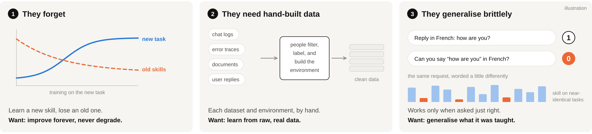</a>
</figure>

rn it has 3 problems :

1. Catastrophic Forgetting - you must have felt this, when you train on a new task, the model has tendency to get worse at old ones, which is catastrophic forgetting. post-training pulls the model toward the new data and nothing in that pull protects what the model already knew
2. it needs hand-built data (aka synthetic data) - fine-tuning needs the right answer spoonfed, RL needs a program that can score any answer, and raw data like chats, documents or error logs comes in neither form, so theres literally companies converting it by hand (@д@)
3. Brittle Generalization - if you phrase the prompt exactly right it works, but if you reword it a bit, it falls over (people call this jagged intelligence), because a model that learns by copying examples can succeed by matching their surface with no depth of understanding enough to generalize to think creatively

I want a model that keeps improving without getting worse, learns from real data as it shows up, and generalises. THats continual learing, and the prize is hugeeee btw, chat assistants get billions of messages a day and learn from none of them ( ͡° ʖ̯ ͡°) which would be an awesome unlock

## 1 score for a 1000s tokens

the standard recipe today is RL with GRPO. it basically lets model write some attempts for a problem, have a verifier score each one (a verifier is just a checking program, it compares the final number for maths and runs the tests for code), here 0, 1, 0, 0, and move the weights toward the attempts that scored well. simple

<figure class="diagram">
<a href="intro-problem.svg">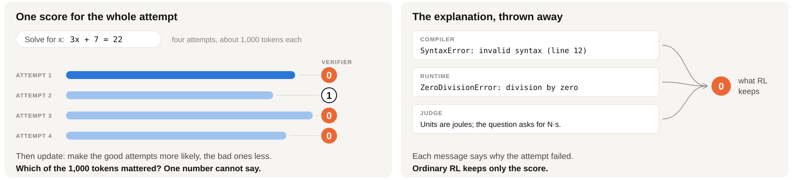</a>
</figure>

but this way of doing things has 2 problems, and the 2nd one turns out to be the answer to the 1st. The first is that 1 score covers the whole attempt, which is obviously not ideal. Which token caused the 0, the 3rd line or the 500th?? one number cant say, so the model works it out statistically over many attempts, tokens that show up in passing answers drift up and tokens in failing ones drift down. It works, slowly, because each attempt carries almost no information about any single token. this is the crazy credit assignment problem, deciding which steps deserve the credit or the blame.

The 2nd is that the explanation gets thrown away. a compiler says the syntax is broken, a runtime exception says you did dumb thing of division by zero, whatever, and each of those points right at where the attempt went wrong, which is of importance as it is exactly the credit assignment the model was struggling with.obviously, you want to keep the info as well!

## moving learnings from the prompt into the weights

The fix comes from something whihc is literally bread and butter of models capabilities these days - in-context learning. The context is everything the model is reading right now (your prompt, the conversation so far, pasted docs), and in-context learning means it changes behaviour because of what's in there, with zero training whatsoever. when you write - "shorter, please", the answers actually get shorter! just think about it, this works with messy shit you are saying to you model, and just a tiny bit is enough. THis is the key, a magical key to continual learning world

<figure class="diagram">
<a href="icl-weights.svg">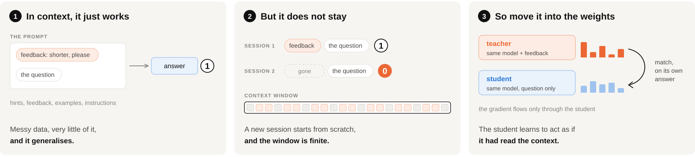</a>
</figure>

But the problem is that it doesnt stay. as soon as i start a new session, the model to zero, and the context window is finite anyways, so to keep a lesson the weights themselves have to change. the model actually needs to learn

Self-distillation moves the learnings into the weights. run the same model twice on the same question, once with the extra text in its prompt, which we call the teacher, and once without, the student. their next token probabilities differ because only the teacher read the feedback, so you train the student's probabilities toward the teacher's. The teacher's probabilities are what the model does when the lesson is in front of it, so once the student matches them without seeing the lesson, the lesson lives in the weights :) The teacher here is the same model, just shown more.

THis just feels natural to me cuz people dont learn by copying an example 1 to 1 either, we act on whats in front of us, feedback included, and improve from it. models are pretty good at reading feedback now, so it feels natural that the training algorithm should use that.

## reread your own answer in hindsight

Back to our equation - the right move is to subtract 7, so `3x = 15` and `x = 5`. Our model writes `3x = 22 + 7`, so `3x = 29` and `x = 29/3`, which is 1 bad token followed by correct algebra on a wrong line (－‸ლ)

There's 1 model with 1 set of weights, used with 2 prompts, and a training step goes like this:

1. write - The model reads only the question, exactly like at test time, and writes its attempt. This is the student, and its the only step that writes anything.
2. check - The environment says more than 0. plugging `x = 29/3` back in gives 36, not 22. That diagnoses the attempt without giving away the answer.
3. reread, 2wice - The same model reads the question, the feedback and the student's attempt pasted in unchanged, and I read off how likely it finds each token, the teacher's view. Then the same again without the feedback, the student's view.
4. update - The gap between the 2 views at each token is the grade. Move the student toward the teacher, then on to the next question.

<figure class="diagram">
<a href="intro-idea.svg">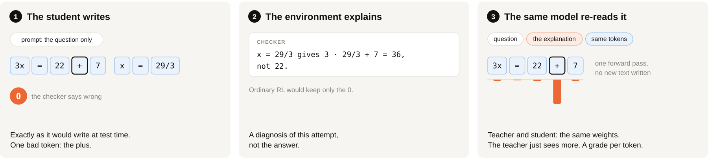</a>
</figure>

The obvious question is why should the teacher's view be any better when its literally the same model? while writing, the model has to pick each token without knowing where it leads. While rereading, it sees the whole answer and what went wrong with it, so it only has to recognize the bad step, and recognizing a mistake youre shown is wayyyy easier than not making it, for people like me and for models unlike me. That gap between judging and writing is where the whole signal comes from. The teacher never writes a better answer, it only says, token by token, "I'd have been more likely, or less likely, to write that".

<figure class="diagram">
<a href="water.png">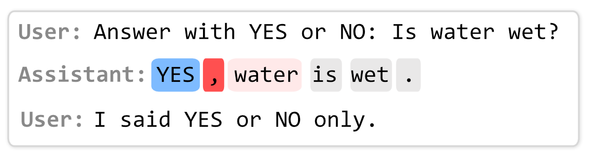</a>
</figure>

## just a loop and 5 possible kindof of signal

The loop never changes, only the extra text in the teacher's prompt does. All it needs is some text the student doesnt see that changes how the teacher reads the student's answer, and every source of such text is a new use.

<figure class="diagram">
<a href="five-uses.svg">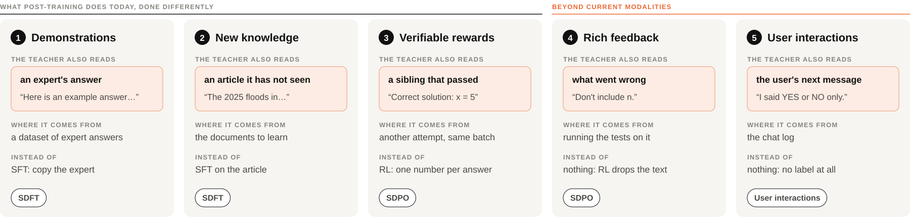</a>
</figure>

- Demonstrations - an expert's answer from a fine-tuning dataset, which informs the grader instead of being copied word for word.
- New knowledge, an article the model has never seen, say about events after its training data ends.
- Verifiable rewards - where the environment only says right or wrong. Sample a few attempts at the same question, which I'll call siblings, and a sibling that passed becomes the extra text for grading the ones that failed.
- Rich feedback - what went wrong in this very attempt, like "Don't include n".
- User interactions - the user's next message in a chat.

The first 2 come from [Self-Distillation Enables Continual Learning](https://arxiv.org/abs/2601.19897) (SDFT), the middle 2 from [Reinforcement Learning via Self-Distillation](https://arxiv.org/abs/2601.20802) (SDPO), and the last from [Aligning Language Models from User Interactions](https://arxiv.org/abs/2603.12273). The last 2 come with no right answer to copy and no score to optimise, only text, so neither fine-tuning nor RL could use them before.

Why a whole talk on it? There's no extra model and no labels, and it works ( ͡° ͜ °) On chemistry, SDPO matches GRPO's accuracy in a sixth of the wall clock time with answers up to 11x shorter, SDFT learns 3 skills in a row without losing the earlier ones, and its already in use, [OpenClaw-RL](https://github.com/Gen-Verse/OpenClaw-RL) trains agents from live conversations this way and [GLM-5](https://arxiv.org/abs/2602.15763) distils its own earlier stages back in on-policy.

## how a model writes, and the 2 ways to teach it

A model writes one token at a time, just your neighbourhood next token  you know. At every step it puts a probability on every candidate next token and draws one our. After `3x = 22` this one puts most of its mass on -, which is the right continuation, and a fat chunk on +. This time it drew the +. That map, from "what is written so far" to a distribution over the next token, is the policy. Training decides, for each token the model actually wrote, whether that token should become more likely or less.

<figure class="diagram">
<a href="basics-next-token.svg">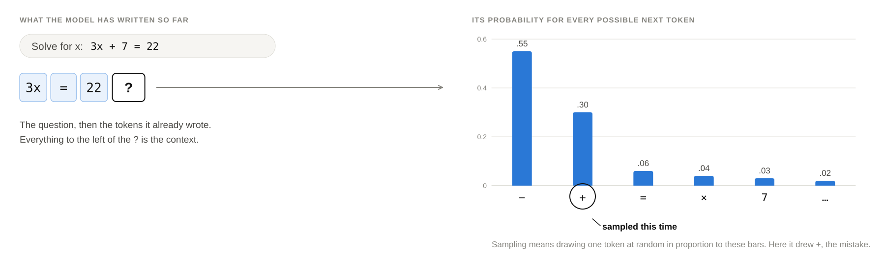</a>
</figure>

People write that rule as `π_θ(y_t | x, y_<t)`, the probability that the model writes token `y_t` next, given the question `x` and the tokens `y_<t` it already wrote. π is the policy (RL's word for the thing that picks the next action, which here is just the model) and θ is the weights, so in our example `π_θ(plus | question, "3x = 22") = 0.30`, and training changes θ to push numbers like that up or down.

There are 2 standard ways to decide which way to push.

SFT -  the foundation of the post-training pipeline, and the choice of technique here has significant implications for compute cost, model quality, and practical deployment. you just collect [high quality accurate (no halluciated crap), diverse (the model develops broad capability rather than overfitting to a narrow distribution, diff instruction types, diff domains and all) and complex (underrated, you want you model to do multi-step reasoning, nuanced analysis, and compositional tasks) worked solutions (datasets)](https://arxiv.org/pdf/2502.02737?) from people or a stronger model (given you have it) and train the model to predict every token of them. Its stable because every token has a target, and its weakness comes from the same fact, the text is someone else's, so the model only ever practises on paths it didnt choose and never on its own mistakes. DeepSeek's small R1 models are ordinary Qwen and Llama models fine-tuned on 800,000 answers written by the big [R1](https://arxiv.org/abs/2501.12948). You can do full fine tuning updating every parameter in the model using fp16, if you have memory and compute. This is the gold standard for quality, as it allows the model to adapt its entire weight space to the new data distribution. kinda default at frontier labs, for poor peeps like use you can do LoRA/QLoRA in which instead of updating all parameters, you freeze the base model/quantized-model and injects small trainable matrices into each transformer layer. THey get you 80-90% of results you want

RL - the try, score, update loop from before. Nobody has to write the ideal answer, you only need to be able to check one, which is why RL can go beyond its data. Its weakness is the 1 number per attempt. R1-Zero was trained this way alone.

Just to make things clear, on-policy means learning from text the model wrote itself, so RL is on-policy and SFT isnt. Dense means feedback on every token, so SFT is dense and RL isnt. Learning on your own text means you practise exactly the situations you'll face, mistakes included, and per-token feedback means each mistake gets located instead of guessed. RL has the first, SFT has the second, and this whole post is about getting both at once (☝ ՞ਊ ՞)

As we go I'll compare every new method with the ones before it using the same 5 questions, because otherwise all these acronyms blur into one soup (◎＿◎;)

1. Who writes the text the model learns from?
2. Who grades it?
3. What does the grader know that the student doesn't?
4. What does the feedback look like, 1 number or something at every token?
5. What do you need to have?

For SFT an expert writes, nobody grades because the model just imitates, the feedback is the expert's next word, and you need expert answers. For RL the model writes, a checker grades, the checker knows whether the answer is right and says so with 1 number per attempt, and you need a checker.

## RL gives 1 number for the whole attempt

The simple intuition is "do more of what worked and less of what didn't". we arent telling the model the right answer, the score alone steers it.

<figure class="diagram">

</figure>

The update is easiest to read inside out:

`∇_θ J ∝ Σ_t A · ∇_θ log π_θ(y_t | x, y_<t)`

`log π_θ(y_t | …)` is the log probability of a token the model actually wrote, `∇_θ` is the direction to nudge all the weights so that token gets more likely, and `A`, the advantage, says how good the attempt was. Positive `A` pushes every token of the attempt up, negative pushes every token down. This is the policy gradient, and you need it because you cant take a gradient through "run the tests". The log turns an answer's probability, a product over its tokens, into a sum with 1 term per token.

Why an advantage and not the raw score? If every reward were +ve, every attempt would get pushed up, the bad ones just a bit less, so what matters is whether the attempt beat what was expected for this question. That needs a baseline. PPO, the classic algorithm, gets it from a trained critic, and GRPO gets it from the other attempts, `A_i = (r_i − μ) / σ`, attempt i's reward minus the group's average, divided by the group's spread. 1 of 4 attempts succeeded so `μ = 0.25`, and ours scored 0, so it gets pushed down.

The catch is right there in the figure. That one advantage hangs under every token, so the plus gets pushed down and so do `3x`, the equals sign and `22`, which were all fine ( >︹<) RL learns on its own path, but from a sparse signal. The obvious alternative is a target at every token, and that exists, its called distillation.

## distillation - dense, but on someone else's path

the words "teacher" and "student" come from distillation, which is traditional idea where a student learns to behave like a teacher, usually a different and bigger model.

<figure class="diagram">

</figure>

The simplest version copies the teacher's words. The teacher writes `3x = 22 − 7, 3x = 15, x = 5` and the student is trained to predict each token, with loss minus the log of its probability for the teacher's token. Thats exactly SFT with a teacher model writing the solutions: dense, because every token has a target, and off-policy, because the tokens are the teacher's. And it breaks the moment the student slips. The data only ever says what comes after `3x = 22 − 7`, so once the student writes plus its on a line the data never covers, it never practised recovering from its own mistake, and the errors compound ◔̯◔

A richer version copies the teachers probabilities. say at some position the teacher puts 45% on "so", 43% on "thus", 8% on "hence" and almost nothing on "+". Copying only the word "so" tells the student "thus" was as wrong as "+", while copying the whole distribution keeps the ranking. That extra ranking is called the infamopus dark knowledge, it goes back to [Distilling the Knowledge in a Neural Network](https://arxiv.org/abs/1503.02531), and the methods below use it wherever they can afford to. Compared with SFT only the feedback changed, from 1 word to a whole distribution, and the text being learned from is still the teacher's.

obviously a teacher has to know something the student doesn't. [Towards Understanding Ensemble, Knowledge Distillation and Self-Distillation in Deep Learning](https://arxiv.org/abs/2012.09816) shows that 2 copies of the same network trained from different random starts learn different features (one spots cars by headlights, the other by wheels), so distilling one into the other teaches the missing feature even at the same size. If teacher and student are identical though, the update is exactly 0. Remember this one, because later the teacher IS the same model, and then the "something extra" can only come from its prompt ;)

## The missing corner

So far there are 3 ways to train, and they fit on a grid of whose tokens you learn from and how many grades you get.

<figure class="diagram">

</figure>

The empty corner, where the student writes its own attempt and a teacher grades every token, is on-policy distillation. The chess analogy from the [On-Policy Distillation](https://thinkingmachines.ai/blog/on-policy-distillation/) blog is i think really cool. RL only knows who won, just blind copying is watching a GM in positions you'll never reach, and on-policy distillation is a coach grading every move of your own games.

Why should "your own attempts" matter so much? The cleanest evidence I found is from [SFT Memorizes, RL Generalizes](https://arxiv.org/abs/2501.17161). 1 vision-language model gets post-trained 2 ways on the same tasks, by copying expert answers or by RL, and then the rules change at test time. In a card game J, Q and K count as 10 in training and as 11, 12 and 13 at test, and in navigation "go north" becomes "turn left", or the city is new.

| changed rule | before | after RL | after copying |
| --- | --- | --- | --- |
| card values | 11.5 | 15.0 | 3.4 |
| left/right directions | 80.8 | 91.8 | 1.3 |
| card colours | 23.6 | 41.2 | 13.7 |
| new cities | 16.7 | 77.8 | 11.1 |

Copying memorised the old answers and RL picked up the rule (◕‿◕) copying rewards reproducing the exact answers it was shown, so memorising them is enough, while RL rewards whatever the model's own attempts got right across tons of different deals and routes, and the cheapest way to be right on all of them is to learn the rule. some copying first was still needed, just so the model learned the output format. And the RL model saw the checker's message and could retry, and more retries transferred better, so reading feedback already helped here, which is exactly where SDPO is heading.

## grading every token

To fill the empty corner I need a grade for every token of the student's own attempt.

<figure class="diagram">
<a href="grade-token.svg">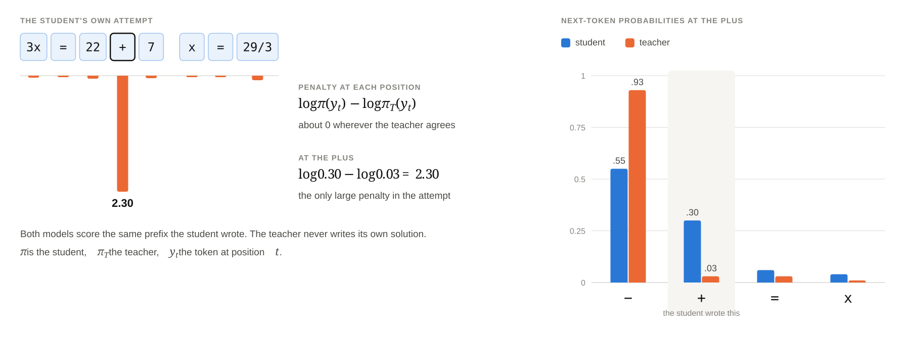</a>
</figure>

A teacher, a bigger model for now, reads the student's text and reports how likely it would have been to write each token, without writing anything itself. The penalty at token t is

`log π_student(y_t | x, y_<t) − log π_teacher(y_t | x, y_<t)`

the student's log probability for its own token (blue) minus the teacher's for that same token after the same prefix (orange), and blue is the student and orange the teacher for the rest of the post. A difference of logs is the log of a ratio, "how many times more likely did the student find this token than the teacher". Agreement gives 0, an overconfident student gets a penalty, and a token the teacher liked more gets a reward. At the + the student put 0.30 and the teacher 0.03, 10x more likely, and log 10 is about 2.3, the only big bar in the attempt (^^ ) The log is there so that going from 0.03 to 0.06, which is a big change, and going from 0.50 to 0.53, which is a tiny one, land on the same scale.

This only grades the token the student actually wrote though. Using dark knowledge needs a way to compare 2 whole distributions, which is the KL divergence.

## Forward KL vs reverse KL

KL is 1 number for how far the student's distribution is from the teacher's, zero only when they match. The annoying part is that it has 2 directions that push the student opposite ways, and the best explanation I've found is [Give me 19 min, I will make Reverse KL Divergence Click Forever](https://www.youtube.com/watch?v=mMQRr9TDJQ4), so I'm borrowing its example. Yeah it sounds AIish but who cares, its  good work.

Fill in "water boils at ___". The teacher knows 2 right answers, 100 (Celsius) and 212 (Fahrenheit), and nothing in between. The student is smaller and can only hold 1 peak, so it has to get something wrong, and the direction of KL decides what. Train it with forward KL and it lands at 150, the teacher's average, which is wrong in both units lol. Train it with reverse KL and it locks onto 100 and stays there.

Forward KL, `Σ_a p_T(a) log(p_T(a) / p_S(a))`, weights every token by the teacher, so its the teacher pointing at its own list going "you should learn this". It can never ignore a missing answer, because if the student gives almost nothing to a token the teacher uses, the penalty grows without limit, so the student spreads out to cover everything. Reverse KL, `Σ_a p_S(a) log(p_S(a) / p_T(a))`, weights every token by the student, so its the student asking about its own answers, "did I get this right?". It can never ignore an invented answer, because saying something the teacher wouldn't say costs without limit, while dropping one of the teacher's answers costs only a little, so the student commits to 1 answer. People call these mode-covering and mode-seeking.

<figure class="diagram">

</figure>

Same story on words in the figure: the forward student hedges across "so" and "thus" and leaks some mass onto "wait" and "um", while the reverse student piles 0.86 onto "so" (◎＿◎;)

2 more things from that video matter later. Forward KL's gradient is plain cross-entropy, which is what SFT and classic distillation do, while reverse KL's gradient is a policy gradient step with reward `log p_T − log p_S`, which is exactly the per-token penalty from the last section with the sign flipped, so reverse KL is basically RL with the teacher as the reward ([MiniLLM](https://arxiv.org/abs/2306.08543) made the case for it in 2023). And reverse KL gets stuck when the student starts far from every answer, because all the nearby gradients cancel, which is why people do forward first (SFT or mid-training) and reverse after. A blend of the 2, Jensen-Shannon, sits in between. Which one works best depends on the task, the methods below pick differently, and KL is measured in nats, which shows up again later.

## On-policy distillation: the student writes, the teacher grades

Now the pieces snap together. On-policy distillation is the empty corner: the student writes, and a separate bigger teacher grades every token with its full probabilities. Its the core idea's loop without the feedback step, because the teacher already knows more.

<figure class="diagram">
<a href="opd-loop.svg">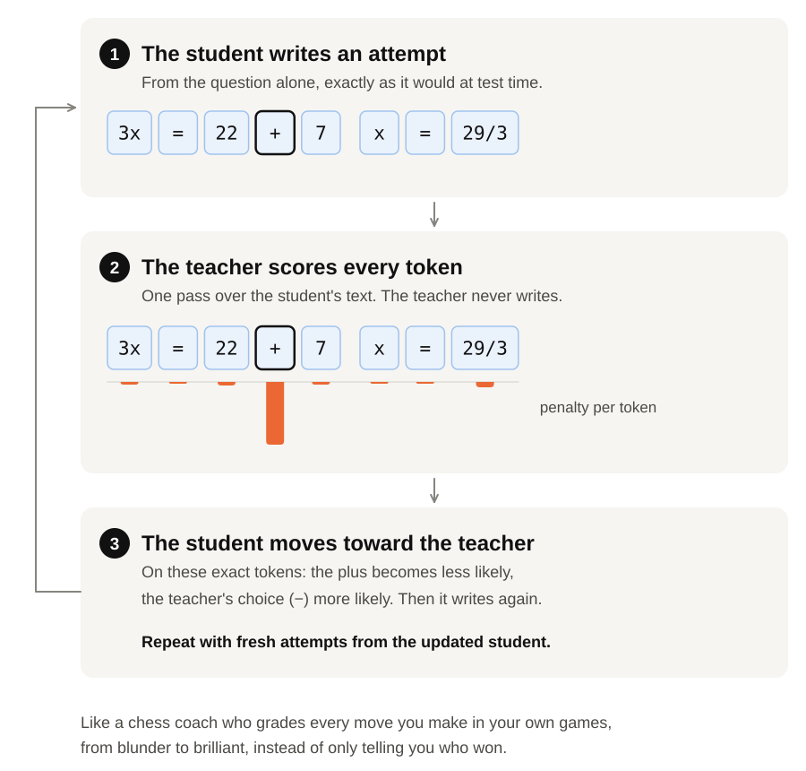</a>
</figure>

The loss is

`E_{y ∼ p_S} Σ_t D( p_T(· | x, y_<t), p_S(· | x, y_<t) )`

The expectation over `y ∼ p_S`, answers the student writes, is the on-policy part, `D` is forward KL, reverse KL or a blend, and both distributions are conditioned on the student's own prefix, so the teacher now says what to do right after the student's own mistake. That fixes the compounding errors from distillation. Robotics had this problem first, a driving policy copied from a human's recordings works until it drifts slightly off the road, and [DAgger](https://arxiv.org/abs/1011.0686) fixed it by letting the learner drive and having the expert say what to do wherever the learner actually ends up. [On-Policy Distillation of Language Models](https://arxiv.org/abs/2306.13649) did the same for language models in 2023.

Does it work? 2 results, 1 small and 1 at scale.

The 2023 one: students from 77 to 800 million parameters learn from a 3 billion parameter teacher on news summaries, English to German translation and grade school maths, each trained once with ordinary distillation and once on-policy. On-policy gave about twice the gain over where each student started, and on every task more of the student's own text was better, because training finally looks like test time.

The 2025 one is [Qwen3](https://arxiv.org/abs/2505.09388). A single 8B checkpoint finished its reasoning training 2 ways, RL on one copy and on-policy distillation from the bigger Qwen models on the other, tested on AIME 2024. RL reached 67.6 using 17,920 GPU hours, roughly a thousand GPUs for 18 hours. On-policy distillation reached 74.4 using 1,800. Better score, about a tenth of the compute, wowww.

Why higher? A long maths attempt gets a grade at every token, on the order of a thousand grades instead of 1. The teacher shows the better token at every step even inside a failed attempt, so nothing waits for the student to get lucky. And the teacher knows things the student doesnt, so the student can learn past its own best attempts, where RL can only reinforce what the 8B already manages sometimes. Why cheaper? The expensive part is the student writing long attempts token by token, distillation learns more from each attempt so it needs far fewer, and the teacher only reads text that already exists, in 1 parallel pass. The fine print is that the 1,800 hours dont include training the bigger teacher, so its only this cheap when a better model already exists, which is exactly the situation the big labs are in after RL, with domain specialists they already trained. More on that in a bit.

So compared with what came before, the student writes, like RL, which kills compounding errors, the grade comes at every token, like distillation, which fixes credit assignment, and the grader is a separate, better model that knows way more than whether the final answer is right. The loop and the update stay the same as RL, only the advantage changed. The new cost is needing a better model to query, and the rest of this post is basically about getting rid of it (ง'̀-'́)ง

## A company assistant, and your earlier self as the teacher

So far the teacher has been a bigger model. Here's a case where it isnt, and its one tons of companies are in rn: they want an internal assistant that knows their own documents and still behaves like a good assistant. This is the personalisation experiment from the same [On-Policy Distillation](https://thinkingmachines.ai/blog/on-policy-distillation/) post, and you can watch forgetting happen and then get repaired.

<figure class="diagram">
<a href="opd-repair.svg">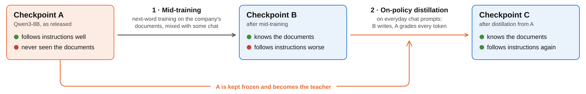</a>
</figure>

Checkpoint A is Qwen3-8B as released, good at following instructions and clueless about the internal docs. Teaching it the docs the standard way, mid-training, is the same next word training as pretraining run on the raw documents, basically SFT on text, and that gives checkpoint B. Then 2 things get measured: knowledge, a quiz about the docs, and behaviour, IF-eval, a public set of instructions a program can check like "answer in under 100 words" or "use no commas".

| model | internal docs QA (%) | IF-eval (%) |
| --- | --- | --- |
| A, Qwen3-8B | 18 | 85 |
| B, trained on 100% documents | 43 | 45 |
| B, trained on 70% documents + 30% chat | 36 | 79 |
| C, B + on-policy distillation from A | 41 | 83 |

Training on documents only takes knowledge to 43%, and instruction following crashes from 85 to 45. Thats the catastrophic forgetting from the start of the post, measured ༼ ༎ຶ ෴ ༎ຶ༽ Every update pulls the weights toward predicting the docs, nothing in that data says "and keep following instructions", and instruction following was taught by RL, which changes only a small part of the network, so a big run of new training overwrites it easily.

Mixing chat back in is the usual guard, and 70% docs plus 30% chat gives 36% and 79%, even though the chat data is the best kind you could have, answers that A itself wrote to everyday prompts. It costs knowledge, no mix they tried held 85, LoRA learned less and still forgot, and the most surprising one, even training on A's chat answers alone, with zero docs, didnt hold 85% (@д@) Those answers were written once, by A, before training started, and after many updates the model being trained isnt A anymore, so its "own" answers have become someone else's text and we're back to copying along a path the model no longer takes.

The repair is on-policy distillation with A as the teacher. B gets ordinary public chat prompts, nothing about the company, writes its own answers, and a frozen A grades every token. Where B drifted, say it ignores "under 100 words", A gives low probability to what B wrote and pulls it back, and where they agree nothing moves. Instruction following comes back to 83 and knowledge sits at 41. It works because B writes fresh answers every step, so the grades always land on the mistakes B makes now, and A is frozen, so the target never moves. The facts survive because the prompts never mention the company and the student only changes where it disagrees with A, the smallest change that fixes the behaviour (same reason on-policy training forgets less, more on that under continual learning). Knowledge even went up from 36 to 41 without a single document in this phase, which the post only calls positive transfer. My reading is that the quiz is still a set of questions and answering questions well is part of following instructions, so restoring the behaviour lets more of what B knows show.

So the teacher doesnt need to be bigger, it needs to be better at the skill being graded, and your own earlier self is better at what you just forgot. That smells like a recipe for a model that keeps learning: train on new data, distill your earlier self back in, repeat. The fine print: its a company blog with 1 model, internal docs nobody else can check, 1 run and no error bars, neither number fully recovers (83 isnt 85 and 41 isnt 43), the cost of the distillation phase isnt reported ("cheaply" is their word), and its 2 phases, damage first and repair after. SDFT, later, avoids the damage in the first place.

## PPO vs GRPO: a trained critic, or a group of siblings

On-policy distillation is the best corner of the grid, but it needs a teacher thats better at the skill, and when there isnt one the labs use RL. Every method from here on plugs into RL, so here's how its actually run today. The 2 big algorithms differ in 1 thing, where the baseline comes from. The diagram is my redraw of the one in [DeepSeekMath](https://arxiv.org/abs/2402.03300), yellow boxes are being trained and grey ones are frozen.

<figure class="diagram">
<a href="ppo-grpo.svg">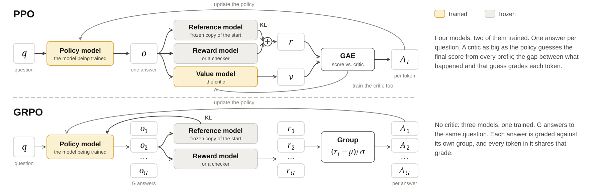</a>
</figure>

PPO, Proximal Policy Optimization, is from 2017, and for years it was THE way to do RL on language models, including the training that first made chat assistants follow instructions. Next to the policy and a reward model it has 2 extra pieces. A frozen reference model works like a rubber band, drifting far from where you started costs you. And the value model, the critic, is a second network, often as big as the policy, that reads a half-written answer and predicts the final score, like a chess commentator going "white's chances are now 60%" after every move. GAE turns the gap between what happened and what the critic expected into a grade per token. "Proximal" means nearby: generating is expensive, so PPO reuses each batch for several updates and reweights each token by `r_t = π_now(y_t) / π_old(y_t)`, clipped to roughly 0.8 to 1.2, so old data cant push the model too far. This ratio comes back to bite later, when SDPO meets real traffic ( ͡° ʖ̯ ͡°)

GRPO, Group Relative Policy Optimization, came out in 2024 with DeepSeekMath and trained DeepSeek-R1. Its the same flow minus the critic: write G answers to the same question, score each one, turn the scores into advantages against the group's average and spread, and give every token of answer i that answer's `A_i`. The rubber band and the clipped ratio stay. Its grading on a curve, you dont need a commentator to tell you how hard the question was because the siblings already show it :)

What GRPO gains is pretty clear. There's no critic to train, which is 1 less big network in memory and 1 less thing that can be wrong, and guessing the final score from the middle of a long chain of reasoning is really hard anyway. The baseline is honest, the real average score of other answers to the same question. And any scorer plugs in, tests, answer checks or a judge model, because GRPO only needs 1 number per answer.

What it costs, and these 4 drive the rest of the post:

1. 1 grade for the whole answer, so the plus gets pushed down exactly as hard as the right tokens around it.
2. Same-score groups teach nothing. All pass or all fail makes every advantage zero, and on hard questions early on everything fails.
3. Many full answers per question, each finished before it can be scored, which is slow for long agent tasks, and in production a user asks once, so there's no group.
4. Only the number survives. The error message, the judge's comment and the user's reply all get squashed into 1 score.

SDPO keeps GRPO's gains and goes after all 4: a grade per token, a signal even when every attempt fails, 1 attempt is enough, and the text is kept.

## GRPO is still king

So what do the labs actually run? If everyone builds on the same algorithm, improving what that algorithm learns from improves everything downstream, so I went through the recent tech reports:

| model | RL | what happens after RL |
| --- | --- | --- |
| [DeepSeek-V4](https://arxiv.org/abs/2606.19348) preview, Apr 2026 | each domain specialist trained with GRPO after fine-tuning | more than ten specialists merged into one by on-policy distillation, which "entirely replaced" the combined RL stage |
| [Kimi K3](https://arxiv.org/abs/2607.24653), Jul 2026 | several attempts per problem, advantage = reward minus the group's mean, with its own loss and per-token masking for stale data | 9 RL experts (3 domains × 3 effort levels) merged by on-policy distillation |
| [GLM-5](https://arxiv.org/abs/2602.15763), Feb 2026 | "builds upon GRPO", groups of 32, fully on-policy, masking tokens where training and inference disagree | reasoning, then agent, then general RL, with earlier stages distilled back in on-policy |
| [Qwen3](https://arxiv.org/abs/2505.09388), May 2025 | GRPO on 3,995 checkable problems, then general RL on 20+ tasks | small models finished by on-policy distillation from the 32B and 235B |

OpenAI and Anthropic dont publish the algorithm. The [gpt-oss card](https://arxiv.org/abs/2508.10925) says "similar CoT RL techniques as OpenAI o3", and Anthropic's system cards say RL from human feedback and RL from AI feedback, aligned with Claude's constitution. Thats all the public surface there is ( ͡° ʖ̯ ͡°)

Look at the last column. After RL, several of them merge their specialists into 1 model with on-policy distillation, so a grade on every token of the model's own text is already running at the frontier, and what it needs is a teacher. GRPO hasnt been replaced because of the gains above, and when one of its costs bites, people patch it locally, like masking some tokens, instead of giving those gains up. New methods also run inside it, on-policy distillation reuses the same loop with a different advantage and so does SDPO. So imo the practical question was never "what replaces GRPO", its "what should the advantage be made of" (☝ ՞ਊ ՞)

## No bigger teacher? Then who grades the tokens?

The reasoning goes like this:

1. On-policy distillation needs a teacher thats better than the student at the skill being graded. That can be a bigger model, or, like the company assistant, the student's own earlier self for a skill it lost.
2. But if you want the best model you have to get better than it has ever been, no version of it, bigger or earlier, knows more.
3. A teacher identical to the student teaches nothing, it has to know something extra.
4. So use the same model and put something extra in its prompt.

That something extra is a hint: any text in the teacher's prompt that the student doesnt get to see, or privileged information if you want the fancy name. With the same weights on both sides, the hint is the only difference between teacher and student. A good hint changes the teacher's opinion about the student's mistakes and only those. A bad one either changes nothing, so there's nothing to learn, or gives away something the student could never work out, so the student learns to imitate a teacher that knows more than it can, and that trade-off decides how well every method from here on works.

<figure class="diagram">
<a href="grade-three.svg">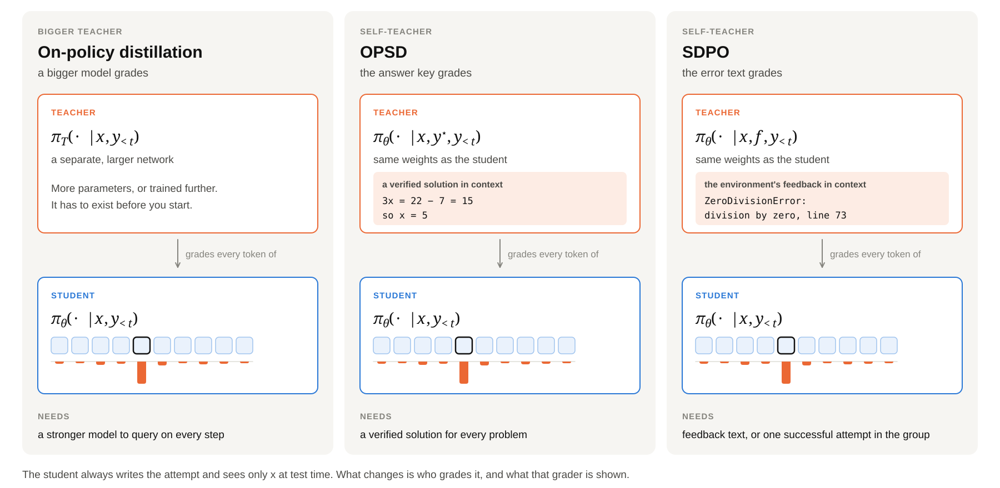</a>
</figure>

The student is identical in all 3 panels, and what changes is who grades and what that grader is shown: a separate bigger model, the same weights with a verified solution (OPSD), or the same weights with the environment's feedback (SDPO). The rest of the post climbs this ladder of hints :) From here on the student writes, the feedback comes at every token and the update stays the same, and what changes rung by rung is who grades, what the grader knows, and so what you need.

## OPSD - grading yourself with the answer key

The first rung of the ladderr is [OPSD](https://arxiv.org/abs/2601.18734), on-policy self-distillation, where the hint is the answer key. Compared with on-policy distillation only the grader changes, its the student's own weights, frozen at the start, with a worked solution in the prompt, so what you need goes from a better model to a solution for every problem. And compared with plain SFT on those same solutions, the student never sees the solution at all, it only informs how the student's own attempt gets graded.

Maths datasets come with a worked solution for every problem, and checking an attempt against a solution is easier than finding one, so the idea is to use the solution without copying it. On our equation:

1. The student reads only "Solve for x: 3x + 7 = 22" and writes 1 attempt, at most 1,024 tokens in the paper.
2. The teacher is the same model with a longer prompt: the problem, "Here is a reference solution:" and the worked solution, then "After understanding the reference solution, please try to solve this problem using your own approach below:", and then the student's attempt pasted in as if it were the teacher's own answer. The "your own approach" bit asks it to act like a solver who now gets the problem, so it judges whether the attempt is heading somewhere sensible instead of whether it matches the reference word for word.
3. At every position the teacher's full next token distribution is compared with the student's using forward KL, which worked best in their tests, and each position's contribution is capped because a few style tokens were dominating the signal. Hold on to that, its telling.
4. Only the student moves. The teacher stays frozen at the starting weights, a fixed target and an anchor, because if it updated too, every change to the student would also move the target and training could end up chasing its own tail.

On AIME 2024, AIME 2025 and HMMT 2025 averaged, Qwen3-1.7B goes from 37.1 to 37.7 with RL and to 43.4 with OPSD, and at 4B and 8B it roughly ties RL, 63.6 vs 62.7 and 64.8 vs 64.0. It got there with 1 attempt per problem of at most 1,024 tokens over 100 steps, where RL used 8 attempts of up to 16,000 tokens over 500 steps, because every token of every attempt gets a grade, while more than half of RL's batches had no reward spread within 100 steps and taught nothing. Fine-tuning directly on the same solutions made the 1.7B model worse, 35.8, since those solutions are written tersely, nothing like the model's own reasoning. Reading the solution helps and copying it hurts. Fine print: OPSD reports its best checkpoint within 100 steps and RL its best within 500, and the clear win is only at the smallest model.

### the teacher has read the answer

OPSD is a cute idea, and ngl I dont think it survives most real training setups. The reason sits in the setup itself, no hyperparameter will save it.

<figure class="diagram">
<a href="opsd-bias.svg">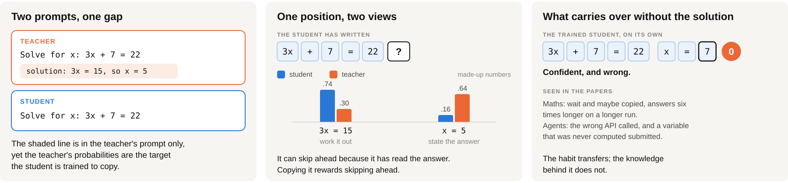</a>
</figure>

The figure has the whole thing on our equation, with made-up numbers: the teacher has read "x = 5", so it prefers jumping straight to the answer, the student has to work it out, and trained toward the teacher it learns to jump, all the way to a confident "x = 7" on a new problem. The habit transfers and the knowledge behind it doesnt (ー_ー；) The general version goes like this:

1. The teacher's probabilities depend on 2 things, the question, which the student also sees, and the solution, which it never sees.
2. The part that comes from the question can be learned. The part that comes from the solution cant, because nothing in the student's prompt tells it the answer.
3. Training still pushes the student toward that part, so the student copies what it can copy, how the teacher behaves once it knows the answer: confident, decisive, skipping steps.
4. The more the hint gives away, the bigger that unlearnable part, and the bigger the bias.

Its like practising for an exam where the marker has the answer sheet open and marks you on how much you sound like someone holding it, you'd learn to sound sure of yourself and not to solve anything lol.

You can see it creeping in:

1. The biggest teacher/student disagreements are on hesitation words like "wait" and "maybe", not on the maths. A teacher that read the answer never hesitates, so the student gets trained to stop hesitating whether or not it knows the answer.
2. Longer runs degrade. [OPASD](https://arxiv.org/abs/2609.33200) ran OPSD on Qwen3-4B to 200 steps, past the 100 the paper stopped at, and answers grew from about 1,100 to 6,100 tokens while accuracy ended below where it started.
3. In agents, [From Self-Distillation to Self-Practice](https://arxiv.org/abs/2609.29051) found OPSD-trained agents calling the wrong API and submitting a variable they never computed, acting like they knew without knowing.
4. The per-position cap from the walkthrough exists because a few style tokens were dominating training, so the method itself had to clip the bias to keep things sane ◔̯◔

2 papers test the mechanism head on. [Rethinking On-Policy Self-Distillation for Thinking Models](https://arxiv.org/abs/2607.05184) gives the teacher privileged context on 5 Qwen3 and OLMo thinking models and gets up to a 17% relative drop on AIME and HMMT, growing with how much is withheld from the student (the final answer alone does mild damage, the full solution more). [Why Does Self-Distillation (Sometimes) Degrade the Reasoning Capability of LLMs?](https://arxiv.org/abs/2603.24472) calls the same thing suppressed uncertainty and finds it in any method whose teacher reads a full solution, SDPO included.

Then there's a production team's post, [Scaling On-Policy Self-Distillation with Hint Auto-Optimization](https://www.appliedcompute.com/research/scaling-on-policy-self-distillation). They used OPSD to teach Qwen3-4B to recover from failed tool calls, starting from 47% success, writing a hint for every failure and changing only how hints were chosen:

1. A 1-token check, 50%: look at where teacher and student disagree most and keep the hint if the hinted teacher's next token there looks right. 1 token says nothing about whether the rest of the teacher's answer works.
2. Hand-tuned by a researcher, 72%.
3. Checked by rerunning, 80%: the hinted teacher actually reruns the task from that point, and only hints that lead it to success are kept. Rechecking the hardest cases during training pushed it to 83%.

The student can only be as good as what the teacher does with the hint, and each step up checks more directly that the hinted teacher is actually right. Picking the hints that changed the teacher as little as possible, to keep the bias down, did worse, because a hint first has to be right (◎＿◎;) And their hint-writer is told never to reveal the answer, so the people running OPSD in production treat leakage as one of the main risks. Its a company blog on internal data with 1 model, so I read it as a direction and not a result.

so overall, OPSD's hint is the answer, so part of its target can only be imitated, never learned, and making it work needs a correct, checked hint for every case, which is exactly the expensive pipeline that team had to build. SDPO's hint is mostly a diagnosis of the student's own attempt, a failing test or an error message, which points at what went wrong without stating the right answer, and its checked for free because its what actually happened when the code ran. Thats why I am not exactly a big fan of OPSO, lets go to SDPO. one caveat for later though, when SDPO's hint is a successful sibling, its an answer key again, and some of the same style shift shows up.

## SDPO - keep the feedback info

okay, the MC of the manga is hereee. SDPO, Self-Distillation Policy Optimization, from [Reinforcement Learning via Self-Distillation](https://arxiv.org/abs/2601.20802), is the core idea's loop with the environment's feedback as the hint. Its lovely that it can make model introspective. paste an error back into a chatbot and it usually finds its own mistake, we all do this 50 times a day xD

<figure class="diagram">
<a href="sdpo-flow.svg">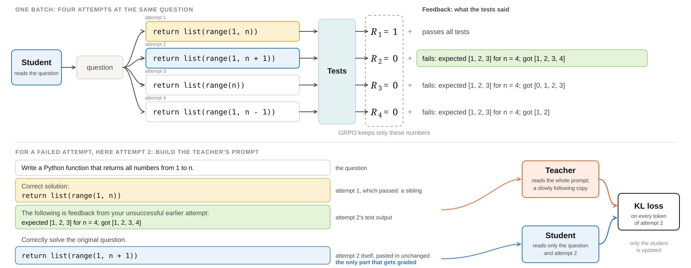</a>
</figure>

This is 1 training step on a coding question, "return all numbers from 1 to n", where the tests want n left out. The top half is any RL step - 4 attempts, the tests run each one, and each gets a reward and the feedback text, like "expected [1, 2, 3] for n = 4; got [1, 2, 3, 4]". GRPO stops there, keeps 1, 0, 0, 0, and pushes attempts 2, 3 and 4 down equally even though they failed in 3 different ways (－‸ლ)

The bottom half is what SDPO adds, for each failed attempt, say attempt 2, `range(1, n + 1)`. The teacher's prompt is the question, "Correct solution:" with the sibling that passed, "The following is feedback from your unsuccessful earlier attempt:" with attempt 2's test output, "Correctly solve the original question.", and then attempt 2 pasted in unchanged. The teacher (the same model, in its slowly following version) reads all that and writes nothing, the student reads only the question and attempt 2, and a KL compares their probabilities token by token on attempt 2 only. Where they agree nothing happens, but at the + the teacher strongly disagrees, so thats where the update actually happens. Only the student gets updated, then the slow copy takes a small step toward it. If nothing in the batch passed, the prompt just has no "Correct solution" part and the feedback alone still works.

This feels similar to OPSD. the student and the per-token grade stay same, and the grader is still the model itself. the hint changes from a worked solution written in advance by someone else to what the environment said about this particular attempt+ a passing sibling if there is one. What you need changes from a solution for every problem to an environment that returns text, which most coding and agent environments already do. And the teacher follows the student slowly instead of staying frozen, which matters in the coding results below.

## SDPO's feedback, token by token

`p_t` (blue) is the student's next token distribution at position t, from the question only, and `q_t` (orange) is the self-teacher's, same weights with `f`, the feedback plus the sibling if there is one, in the prompt. Then

`A_t(a) = log q_t(a) − log p_t(a)`

is the advantage of every candidate token `a` at that position, not only the one that got written. How much more or less likely does this token become once the model has read the feedback? On the token that keeps the wrong bound, the student puts 0.6 and the teacher 0.1, and `log 0.1 − log 0.6` is about −1.8, so that token goes down. On `def` or `range` the feedback changes nothing, so the advantage is about zero.

<figure class="diagram">
<a href="signal-bits.svg">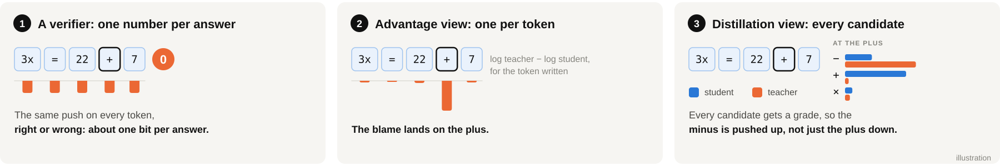</a>
</figure>

There are 2 ways to apply that number, and the figure shows both next to a plain verifier. As RL, take only the written token and use `A_t` as the multiplier in the RL update, so each token gets its own advantage instead of GRPO's shared one, which is a 1-line change to a GRPO trainer and still learns when every attempt in a group failed. As distillation, compare the student's and teacher's whole distributions at each position with a KL over the most likely candidates, the top 20 tokens on code and the top 100 on science, which also pushes up the token that should have been there. The teacher is held fixed in both, a stop-gradient in code, because with shared weights the gap could also close by moving the teacher toward the student, which means learning to ignore the feedback ( ͡° ͜ °) The 2 give the same update on average, the 1-token version is just noisier, and the full version won every comparison in the paper. DeepSeek-V4 also picked it for its own distillation because the 1-token version was unstable.

## The teacher finds the plus

Now on a real model, Qwen3-8B, to check the grade actually lands where it should. It writes `return list(range(1, n + 1))`, a totally fair reading of "from 1 to n", and the checker only says "Don't include n", no Python error and no corrected answer.

<figure class="diagram">
<a href="sdpo-fig-logratios.png">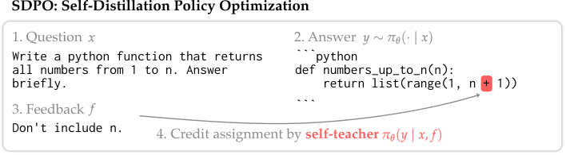</a>
</figure>

The red sits on the plus and almost nowhere else. `def`, `range` and `(1,` are all consistent with "n shouldn't be included", so reading the feedback doesnt change the model's view of them, and only the `+ 1`, which is what puts n in, conflicts with it. The model found its own mistake just by rereading, and nobody told it where (◕▽◕)

<figure class="diagram">

</figure>

In this one, the top row of each block is what got written and the cells underneath are other tokens the model could have written there. GRPO paints the whole row 1 colour, while SDPO grades every candidate, mostly near white. Below the red plus, the dark blue cell is `))\n`, closing the brackets right after n, which gives `range(1, n)`, exactly what the checker wanted, so the teacher is saying the line should have ended there. 1 step to the right, stuck with the plus already written, it moves weight to `0`, so `range(1, n + 0)`, which also leaves n out lmao. So the update also says what to write instead. GRPO pushes down `range`, `(` and `1` as well, the very tokens the correct answer needs, so the next attempt has to undo that damage, while SDPO pushes down only the plus and pushes up the fix. Thats dark knowledge, with the model as its own teacher.

## a teacher that gets better while teaching

i expained so much, but now a bit of result time. there is a cool [LiveCodeBench](https://livecodebench.github.io/) that keeps adding new CP contest problems, so you can test only on problems released after the model's training data, with the output of half of each problem's tests as the feedback during training.

<figure class="diagram">

</figure>

On Qwen3-8B, GRPO flattens at 41.2% while SDPO keeps going to 48.8% and hits GRPO's final score with 4x fewer attempts (ﾉ◕ヮ◕)ﾉ The dotted line is Claude Sonnet 4 on the same problems, a reference point and not a comparison, since the training recipes have nothing in common. SDPO also forgets less, on held-out benchmarks it averages 42.4 vs GRPO's 41.8, from a base model at 43.5.

<figure class="diagram">

</figure>

an obvious thought that comes to mind is that - is SDPO better because it grades every token?, or just because it reads the feedback at all? The left plot separates the 2 with 4 ways to turn the teacher's reread into a training signal, coarsest to finest:

1. Grey, plain GRPO, which doesnt read the feedback, so every token of the answer gets the same push.
2. Blue, sequence-level SDPO, which averages the teacher-minus-student grade over the answer into 1 number. Exactly as coarse as GRPO, but the number now comes from how the feedback changed the model's view of this answer, so this one isolates the value of reading the feedback.
3. Orange, token-level SDPO, a separate grade per written token, so the blame lands on the plus, but alternatives the student didnt write get nothing.
4. Green, logit-level SDPO, the full thing, comparing all the likely candidates at every position, so at the plus `+` goes down and `))\n` goes up together.

They finish in exactly that order. Reading the feedback helps on its own even with 1 number per answer, since a nearly right answer now gets a mild push and a badly wrong one a big push, without needing a sibling to pass. Putting the grade on the right token helps again, and grading the alternatives helps once more, since each position now carries a whole ranking of what to write instead, which is less noisy too.

The right plot is my favourite thing in the paper. Green is the student answering from the question alone, the way it would at test time, and orange is the teacher, the same model solving the problem with the feedback from a failed attempt in its prompt. At step 0 the teacher is way ahead, about 0.42 vs 0.30, and that gap is what the feedback is worth. Around step 20 to 25 the student passes the teacher's starting line, so from then on the student with NO feedback beats its teacher at the start WITH feedback, and by step 80 its at about 0.50, with the teacher climbing to about 0.50 too. The teacher is the student's weights plus the feedback, so every update that makes the student better at the task also makes the model better at reading feedback about the task. Better teacher, better grades, better student, better teacher again, thats the bootstrapping. In ordinary distillation the student can at best catch up with a fixed teacher, and here the teacher's ceiling rises with the student, which is also why "the model teaches itself" isnt circular, the feedback is new information every time.

But for the teacher to improve its weights have to change, while its target moves, and a target that moves too much is hard to hit! The paper tried 3 options, best score within 90 steps:

1. The current weights, the very ones being trained. If 1 update makes the student a bit worse, the teacher gets the exact same flaw instantly and nothing pulls it back, so errors feed on themselves and training collapses, 36.1 (╯°□°)╯︵ ┻━┻
2. A frozen copy of the starting weights, like OPSD. Perfectly steady at 48.8, but the teacher never improves
3. A copy that follows the student slowly, moving a small fraction toward the student after every step, like 99% old copy and 1% student. 1 bad step barely moves it, while improvements that last do reach it, like a thermostat reacting to the average temperature over the last hour and not every gust. 49.3 to 50.6, depending on how slowly it follows

The slow copy gets both, and its what SDPO and SDFT use. The cost is memory for a second set of weights, and the reread is still 1 pass.

## what the teacher should read

The student's prompt never changes, its the question and nothing else, so everything that makes the teacher a better grader is the hint. What should it contain? The paper tests 4 answers on code with Qwen3-8B. A sibling, again, is another attempt at the same question in the same batch, like a `range(1, n)` that passed next to our failed `range(1, n + 1)`.

| hint in the teacher's prompt | teacher's own answer fails the same way | student after SDPO | student variety (entropy) |
| --- | --- | --- | --- |
| error output | 13.7% | 39.9% | 0.40 |
| successful sibling | 12.1% | 42.6% | 0.41 |
| error + sibling | 10.1% | 48.3% | 0.38 |
| + the failed attempt itself | 30.0% | 44.5% | 0.23 |

before any training, the teacher actually answers the question with the hint in its prompt, and that answer goes through the same tests. if it fails in exactly the same way as the student, the teacher would make the exact same mistake, so it cant point at the bad tokens, and lower is better. The last column is the trained student's entropy, how spread out its next token probabilities are, and this kind of training finds new solutions by trying different things, so if variety collapses, learning stalls.

the error and the sibling are quite complementary, one says what's wrong with this attempt and the other shows what right looks like, so together they give the best student, 48.3. The error exists from the very first failure, so SDPO can learn on problems where nothing has worked yet (thats the test-time experiment later). the sibling is an answer key like OPSD's, except the model wrote it, but it only exists once something in the batch passed.

Adding the failed attempt to the hint makes the teacher fail the same way 3x as often, and the student drops to 44.5 with its variety falling from about 0.4 to 0.23. The teacher anchors on it, kinda like proofreading your own essay right after writing it, you see what you meant and not what you wrote (ー_ー；) So it stops disagreeing on the bad tokens, and since it now agrees with the student's current choices, training makes the student even surer of what it already writes. The failed attempt is what gets graded, so keep it out of the hint.

## learning from success and failure

now the setting most people (or benchmarks) actually have, an environment that only says right or wrong, like science multiple choice or tool calls. Sample a group, and for each failed attempt the hint is a sibling that succeeded, so the teacher can see where the 2 part ways, which is where its grades land. On the ladder thats OPSD's answer key again, except the model wrote it itself, which brings back some of OPSD's bias tooo, and you can see it in the answer lengths below.

<figure class="diagram">

</figure>

In Chemistry, Olmo3-7B-Instruct, 3 seeds - SDPO reaches GRPO's 5 hour accuracy in about 50 minutes, so 6x faster, and ends more than 10 points higher, partly because each failed attempt gets a grade on every token instead of 1 shared number, and partly because SDPO's answers get way shorter, so each step takes less time to generate. Across 5 tasks and 2 models it scores 70.2% vs a tuned GRPO's 66.6%. Not everywhere though, it lost on biology with Qwen3-8B, 56.8 vs 59.9, and on one tool task.

GRPO's answers grow past 2,000 tokens as it trains and SDPO's drop to a few 100s, 11x shorter here and more than 3x shorter on average, at higher accuracy. 1 question after 50 steps - GRPO writes 5,549 tokens with 25 "Wait"s, the same calculation 4 times and literally "Wait, I'm going in circles", then picks the wrong answer xD SDPO writes 764 tokens and gets it right.

Why shorter? becuase of 2 reasons i think. Hindsight: critique an answer next to a working solution and you can see the loops it didnt need, so the teacher penalises them token by token, while GRPO upweights everything in a winning answer, filler included. And style, which is OPSD's bias again, a teacher that has read a correct solution is confident and concise, so it pushes "Wait" down whether or not the waiting helped, and [On Repulsive and Attractive Teachers](https://arxiv.org/abs/2609.21561) measured "Wait" becoming about 80x less likely under such a teacher. So some of the shortening is better reasoning and some is style (￣▽￣) Other work fits both. Reasoning models keep re-solving problems they already cracked, the first solution was already right in over 92% of the maths problems they got right ([Do NOT Think That Much for 2+3=?](https://arxiv.org/abs/2412.21187)), and part of GRPO's length growth comes from dividing each answer's loss by its length, which penalises long wrong answers less ([Understanding R1-Zero-Like Training](https://arxiv.org/abs/2503.20783)).

So is SDPO just better than OPSD? its a bit messy. In most published head2heads both methods read the same kind of privileged text, a reference solution or a sibling, on maths, and configured like that they mostly tie. The 1 big gap I found is search agents in [CRPO](https://arxiv.org/abs/2607.28026), where OPSD collapses on multi-hop questions and SDPO tracks GRPO. The controlled evidence is about what the teacher reads. [The Role of Feedback Alignment in Self-Distillation](https://arxiv.org/abs/2606.11173) gives the self-teacher either the reference solution or a critique aligned step by step to the student's own attempt, and the critique wins by 5.27 points (1 small model, but a clean mechanism), while [Why Does Self-Distillation (Sometimes) Degrade the Reasoning Capability of LLMs?](https://arxiv.org/abs/2603.24472) measured about a 40% drop on AIME 2024 when SDPO's teacher reads a sibling's full solution on maths. No paper I found compares SDPO reading real feedback against OPSD reading a solution on the same task under 1 protocol, so the way I'd put it, its feedback versus answers more than SDPO versus OPSD (☝ ՞ਊ ՞)

## why your own outputs forget less

Now moving to continual learning - training 1 model on a sequence of tasks over time, adding skills without losing old ones, the way a person keeps learning through a career, instead of training, freezing and shipping. A continual learner needs to learn on its own attempts, not forget, and learn from any data, and this part is about not forgetting.

<figure class="diagram">
<a href="razor-teaser.png">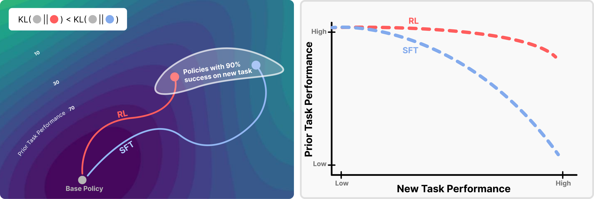</a>
</figure>

[RL's Razor](https://arxiv.org/abs/2509.04259) starts with a clean experiment. teach the same model a new task twice, once with GRPO and once with SFT, until both are equally good at it, then check its old skills. RL (red) stays high and SFT (blue) falls, it buys the new task with old skills.

what predicts the forgetting is the foundational questions? its not how far the weights moved, and not how sparse or low-rank the change was. its the KL divergence between the fine-tuned model and the base model, meaning how differently the model now answers. RL and SFT land on the same curve, and SFT on labels hand-picked to move the model as little as possible forgets even less than RL. so what protects old skills is staying close, and RL happens to stay close.

The picture is a map of every possible version of the model. The grey dot is the base model, distance is KL, the shading is old-task performance (contours at 70, 30 and 10, highest near the base), and the pale oval is every version that gets 90% on the new task. There are tons of ways to be good at a new task, and they arent all the same distance from where you started. RL's path ends at the near end of the oval, still in the dark region, and SFT's ends at the far end, same 90% but out where old skills are low.

Why does each one end where it does? RL can only reweight what the model already says. With a right or wrong score, it amounts to keeping the model's own answers, dropping the wrong ones and renormalising, and among all models that only give right answers, that one is provably the closest to where you started (the paper shows RL in a simplified setting converges to exactly that). nothing in the update asks the model to change its wording or format, so it doesnt. SFT has to reproduce someone else's text, with their wording, length, formatting and habits, so the model has to change all of that too, and those changes spill into everything it does. Teach a model to call a new tool, and RL keeps its own way of writing and only fixes the calls that fail, while SFT on a dataset written in another style also teaches it to write like that dataset, and the new habit shows up in maths and code where nobody asked for it (@д@)

And "your own" has to mean the model as it is now, which is why in the company assistant, answers written by the original model stopped protecting it once the model had moved. Thats RL's Razor - among all the solutions, on-policy learning picks the closest one. But "just do RL" throws away demonstrations, documents and feedback, and I want something on-policy that can learn from all of them, which is SDFT.

## SDFT is same trick, with demonstrations

SDFT, Self-Distillation Fine-Tuning, from [Self-Distillation Enables Continual Learning](https://arxiv.org/abs/2601.19897), is the core loop with an expert demonstration as the hint. Demonstrations normally mean SFT, which forgets, and RL forgets less but needs a reward, which demonstrations dont come with.

How it differs from what we've seen:

- From SFT, the data is the same, but SFT trains the model to write the demonstration word for word, while SDFT never shows it to the student. The student writes its own answer and the demonstration only sits in the grader's prompt.
- From OPSD, its almost the same machine, except the teacher follows the student slowly instead of being frozen, the demonstration can be any good example and not only a solution with a checkable answer, and the question being tested is whether the model can add a skill without losing old ones.
- From SDPO, the hint arrives before any attempt, as a demonstration, instead of coming back from the environment as feedback, so it needs no checker and no environment at all.

<figure class="diagram">
<a href="sdft-method.png">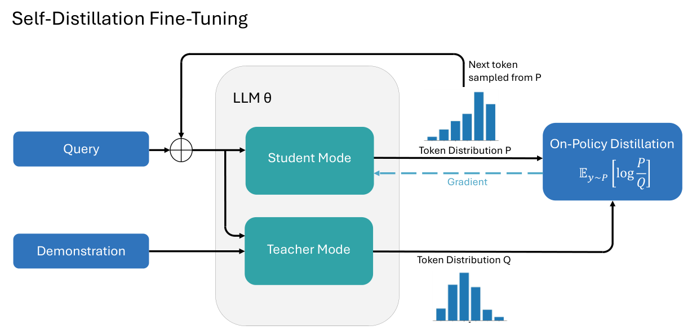</a>
</figure>

The teacher's prompt is roughly "This is an example of a response to the question… Now answer with a response of your own." So the teacher answers in its own way, having seen a good example. If it copied, the target would be the expert's exact text and we'd be back to SFT, and answering in its own way keeps the target close to what the model itself would say. The loss is a KL from the student `π_θ(· | x)` to the teacher `π(· | x, c)`, where c is the demonstration and the teacher is the slow copy, and forward KL worked best in practice. Read as RL, the reward is `log π(y | x, c) − log π(y | x)`, how much more likely an answer becomes once the model has seen the demonstration, which is SDPO's advantage with a demonstration in place of feedback.

<figure class="diagram">
<a href="sdft-kl.png">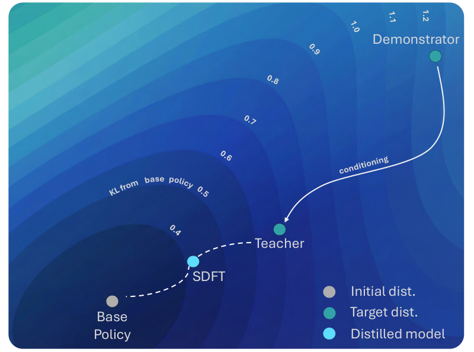</a>
</figure>

Why it doesnt forget is RL's Razor again. The demonstrator is far from the base model, because expert text is in a style the model would never produce, while the teacher, the base model reading the demonstration, sits much closer because it still answers in the model's own words, and the trained model ends up near the teacher. On a tool-use set where the base model solves 42%, the teacher solves 100% while being only 0.68 nats from the base model, vs 1.26 for the SFT model.

<figure class="diagram">
<a href="sdft-scatter.svg">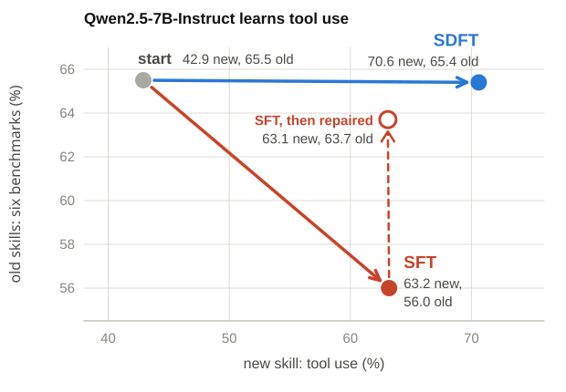</a>
</figure>

And here's what that buys on that tool-use set with Qwen2.5-7B-Instruct, where old skills is the average of HellaSwag, HumanEval, IFEval, MMLU, TruthfulQA and Winogrande. SFT learns the skill and loses nine and a half points of everything else ( >︹<) "SFT, then repaired" is the company assistant recipe (after SFT, distil the starting model back in on-policy, the paper calls it re-invoke), which gets most of the damage back in a second phase without improving the skill. SDFT goes almost straight right, the best tool use of the 3 with old skills basically where they started (◕‿◕) My reading of why it also learns more - it practises on its own attempts, same reason RL generalised better than copying in the card game.

My honest take though, this teacher reads a full solution, so OPSD's bias applies, and you can see it. The student picks up openings like "Based on the text…", which the teacher writes because it has read a text, so those openings have to be masked out (－‸ლ) But the alternative is SFT, which copies the demonstration outright, and next to that this is way less biased.

## 3 skills in a row, without forgotten

THis is a really cool plot tbh. 1 model learns tool use, then science, then medical, one after another, and the y axis is normalised performance on each skill, 0 for the base model and 1 for the best either method reached.

<figure class="diagram">
<a href="sdft-seq-sdft.svg">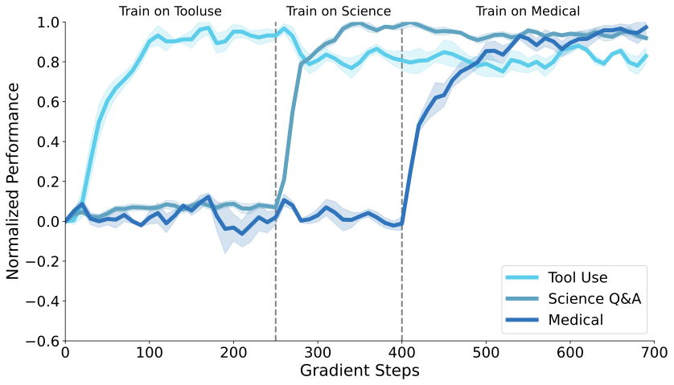</a>
</figure>

<figure class="diagram">
<a href="sdft-seq-sft.svg">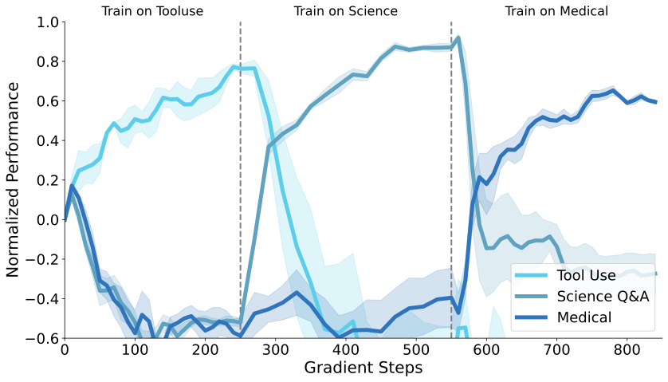</a>
</figure>

With SDFT each skill rises in its turn and the earlier ones stay up, and with SFT every new skill knocks the previous one off a cliff, often below where it started (╥﹏╥) SFT's examples pull the model toward each new skill's text and nothing protects the previous one, while SDFT's target is the model itself plus a demonstration, which still has all the old skills, so matching it doesnt push them away. Single skills say the same thing:

| skill | new skill, SFT | new skill, SDFT | old skills, SFT | old skills, SDFT |
| --- | --- | --- | --- | --- |
| science Q&A | 66.2 | 70.2 | 53.4 | 64.5 |
| tool use | 63.2 | 70.6 | 56.0 | 65.4 |
| medical | 35.5 | 40.2 | 60.2 | 65.4 |

Old skills started at 65.5 in all 3. One more I really like - a thinking model trained on medical answers with no reasoning, just the final answer. SFT copies those bare answers, accuracy drops from 31.2 to 23.5 and the model stops reasoning, while SDFT's teacher reads the bare answer but responds in the model's own thinking style and reaches 43.7. Copying the format of the data can erase a behaviour, on-policy learning keeps it.

The limits - it leans on in-context learning, so small models that cant make sense of the demonstration lose to SFT. It costs about 2.5x the compute and 4x the wall clock of SFT, because the student has to write its own answers first. It cant create a big new behaviour like chain of thought in a model that never had it, since the teacher can only produce what the model can already do with a hint. And most of this is 1 model, Qwen2.5-7B-Instruct, with 3 seeds and 3 skills in a row, and I'm generally suspicious of post-training results that are mostly Qwen2.5 (ಠ_ಠ)

## Facts no amount of RL can find

Next, new knowledge, meaning facts, like what happened in an earthquake last year, as opposed to skills. Ask a model whose training data ends in 2024 about 2025 and however much it explores it wont guess a fact it has never seen, so no attempt succeeds, theres never a reward, and GRPO learns nothing (ー_ー；) With self-distillation the article goes in the teacher's prompt, tokens consistent with it go up and wrong ones go down, and the student learns it without ever seeing the article. The test is 9 Wikipedia articles about disasters in 2025:

| what the model was given | strict | lenient | out of distribution |
| --- | --- | --- | --- |
| nothing, the base model | 0 | 0 | 0 |
| the right article always in context (oracle RAG) | 91 | 100 | 100 |
| continued pre-training on the articles | 9 | 37 | 7 |
| SFT "self-study": synthetic questions, trained on answers written with the article in context | 80 | 95 | 80 |
| SDFT on the same questions | 89 | 100 | 98 |

Oracle RAG, the right article in the prompt at answer time, is the ceiling, and reading a text once with continued pre-training barely puts the facts in. The column I care about is out of distribution, questions that need the facts without asking about them directly, like "what were the ten worst natural disasters of the last decade?", where SFT stays at 80 and SDFT gets 98, nearly as good as having the article right there (ﾉ◕ヮ◕)ﾉ SFT trains on fixed answers to fixed questions, so it learns those answers, while SDFT trains the student to respond the way the model does when the article is in front of it, which carries over more like actually having read it. Caveats: its a small test, questions written and graded by GPT-5 models, 1 model, and the teacher read the article plus a worked answer (with the article alone it scored 75 strict instead of 89).

## Bigger models make better self-teachers

The self-teacher is the model reading a hint, so its only as good as the model's ability to understand its prompt, and bigger models understand prompts better. This is a great feature to have as models willobviously become bigger and bigger!

<figure class="diagram">

</figure>

SDPO vs GRPO on competitive programming - at 0.6B the 2 lines almost touch, and at 8B they're far apart, about 0.49 vs 0.41. On an older, weaker model, Qwen2.5-1.5B, SDPO actually lost. Mixing the 2 advantages, 90% GRPO's and 10% SDPO's, is a dial between a signal thats unbiased but coarse and one thats dense but only as good as the model's reading, and at 90% GRPO the small model stopped losing, at a small cost on the bigger ones.

<figure class="diagram">
<a href="sdft-scaling.svg">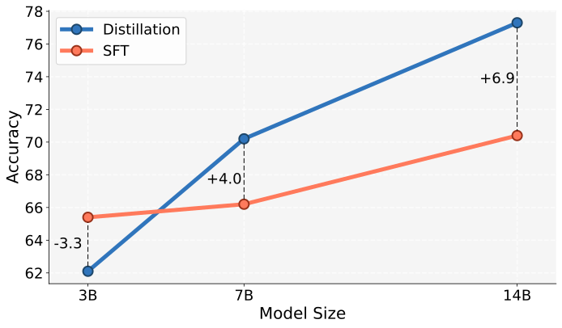</a>
</figure>

SDFT vs SFT on science - 3.3 points behind at 3B, 4.0 ahead at 7B and 6.9 ahead at 14B, so the lines cross (☞ﾟヮﾟ)☞ Judging your own attempt in hindsight is an ability that grows with scale, and in-context learning keeps getting better every year, so I expect these methods to ride that for free. The caveat is that both studies stop at 8B and 14B.

## Test-time training - put the feedback in the weights

Now learning after deployment, the part that excites me the most. Today a deployed model's weights are frozen and all you can do is prompt it, and test-time training means continuing to train it on the task in front of it.

SDPO's test-time experiment is my favourite in the paper. 1 very hard question at a time, attacked until something works. There are 19 problems Qwen3-8B rarely solves, and on the 9 hardest a batch of 64 attempts contains a success less than 3% of the time. GRPO cant even start, every attempt scores zero so every advantage is zero (ー_ー；) Best of k keeps sampling fresh attempts from the same unchanged model and hopes one works, so attempt 1,000 has the same small chance as attempt 1. Multi-turn keeps every attempt and its error in the prompt and asks again, which is in-context learning only, its history is mostly failures it can anchor on (remember the failed-attempt row in the hint table), and the context fills up after 800 to 1,000 attempts.

<figure class="diagram">
<a href="sdpo-fig-ttt.png">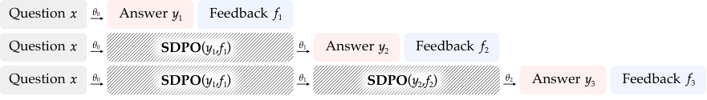</a>
</figure>

SDPO runs its loop on the same question over and over, answering, getting feedback and training, then asking the same question again with an empty history. The feedback goes into the weights and not the prompt, so later attempts really are better than earlier ones and nothing fills up.

<figure class="diagram">
<a href="TTT_pass_at_k_curves.svg">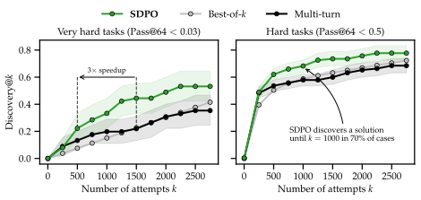</a>
</figure>

The metric is discovery at k, the fraction of runs that found at least 1 correct solution within k attempts. On the very hard tasks SDPO pulls away after a few hundred attempts, finding a solution within 2,750 attempts in 53% of runs vs 42% and 36%, and reaching 22% with about 3x fewer attempts. 1 question only SDPO ever solves, first at attempt 321 (ง'̀-'́)ง On the merely hard tasks everyone does fine and SDPO still leads.

the detail that matters is that on 78% of these questions the teacher, reading the feedback once, solves it 0% of the time. So no single reading of the hint gives the answer away, the progress comes from many small updates, each nudging the model the way the feedback points, which is what you'd expect if the model is actually getting better at the problem.

## Learning from conversations

Learning from users is SDPO with the user's next message as the hint. Remember those billions of messages a day, this is the richest feedback a deployed model gets, and people react to the answer they just got, so when its wrong, too long or off target, the next message usually says so, which is the same kind of diagnosis a failing test gives.

On the hint ladder, OPSD's hint is the answer key (the most informative and the most biased), SDPO's is what the environment said about the attempt, SDFT's is a demonstration, and here its the user's reply. The 1 new difference is who wrote the text being graded, which in logged chats is often an older model and not the one being trained, more on that in a sec.

<figure class="diagram">
<a href="uia-overview.png">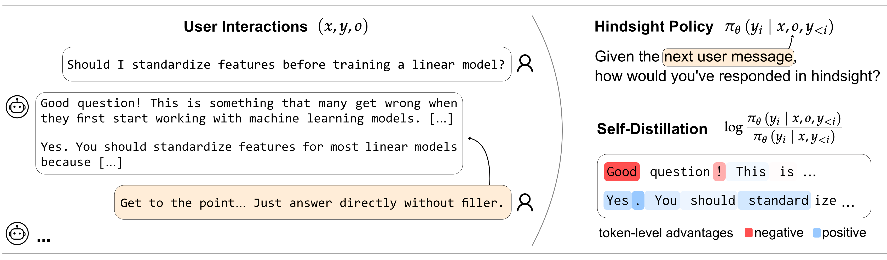</a>
</figure>

From [Aligning Language Models from User Interactions](https://arxiv.org/abs/2603.12273): cut each conversation into triples, `x` the history ending with the user's question, `y` the model's reply, and `o` the user's next message. The student read `x` and wrote `y` back when the conversation happened. The teacher reads `x`, then `o`, then `y`, and its prompt literally says "The following is a future user message. Use this to guide your answer to the user prompt." The advantage is SDPO's log ratio with `o` in place of the feedback, so in the figure the "Good question!" filler goes red and the direct answer goes blue. No reward model, no preference pairs, no human raters (◕▽◕) There's a cute bit of theory behind it too: if users reply according to how much they liked the answer and the model updates on its context like a perfect Bayesian reasoner, this advantage equals the user's hidden reward, up to a normalising term. Strong assumptions, but a good intuition.

The obvious worry is that most of what users say isnt feedback on the last answer. Each heatmap below is 24 replies over their first 128 tokens, red pushed down and blue up.

<figure class="diagram">
<a href="uia-heatmap-relevant.png">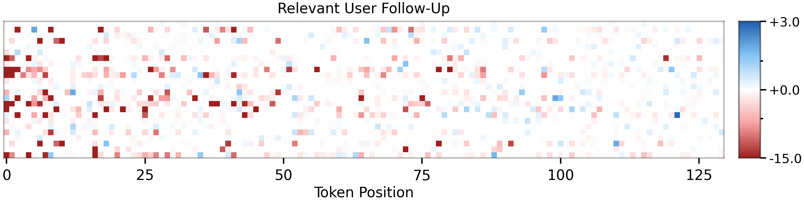</a>
</figure>

<figure class="diagram">
<a href="uia-heatmap-unrelated.png">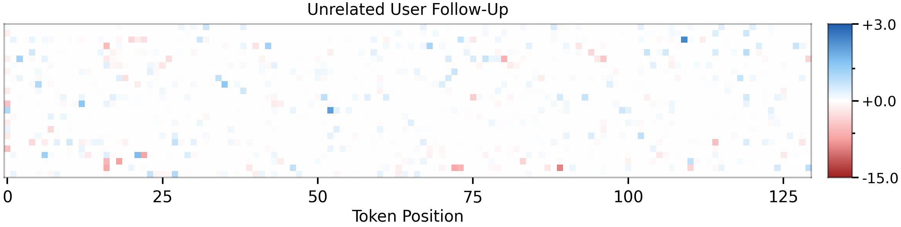</a>
</figure>

After "Rewrite in a formal, professional tone" under a friendly email, there's strong red on "Quick", "Hey" and "Just", and after an unrelated "What is 27 times 4?" its nearly white everywhere. If the next message is about something else, reading it doesnt change how the model judges the reply, so every grade is near zero, and nobody has to filter the chats, which is honestly pretty neat ( ͡° ͜ °)

## Real chat logs, and personalisation in 50 messages

2 experiments. First, real logs. WildChat is a big public set of real conversations with GPT-3.5 and GPT-4, and WildFeedback is the 3% of those where users push back, about 50,000 triples. Chat quality, hard prompts and creative are win rates judged by a model, instructions checks rules like "no commas", and knowledge is a hard multiple choice exam.

| model | chat quality | instructions | hard prompts | creative | knowledge |
| --- | --- | --- | --- | --- | --- |
| Qwen3-8B | 49.3 → 51.9 | 83.9 → 85.0 | 14.0 → 15.5 | 13.7 → 16.2 | 62.5 → 63.3 |
| Qwen3-8B, unfiltered chats | 50.7 | 84.5 | 13.4 | 14.0 | 62.4 |
| Qwen3-4B | 37.9 → 46.1 | 81.9 → 83.2 | 9.0 → 7.8 | 8.0 → 7.9 | 58.1 → 58.0 |
| Olmo 3 7B (DPO) | 50.4 → 51.8 | 80.2 → 80.4 | 1.7 → 2.0 | 8.2 → 10.0 | 28.4 → 28.7 |
| Qwen3-4B, SFT on the replies | 18.9 | 73.2 | 3.1 | 2.6 | 51.2 |

Qwen3-8B goes up in all 5, Qwen3-4B's chat quality jumps from 37.9 to 46.1 while hard prompts slip, Olmo goes up a little everywhere, and an unfiltered slice still helped, a bit less. The bottom row is the sanity check, plain fine-tuning on the same replies wrecks the model, because users complained about more than half of those replies and SFT copies them, complaints and all xD SDPO can push tokens down, SFT can only copy.

<figure class="diagram">
<a href="uia-flip.png">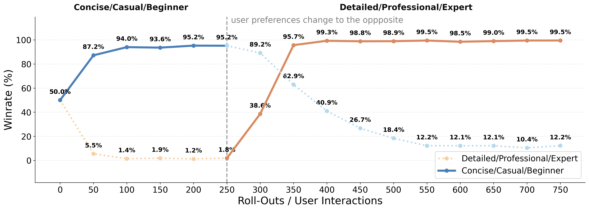</a>
</figure>

Second, personalisation. A personal assistant wont ever get a dataset of my preferences, I'll tell it 1 thing at a time. Another model plays a user who wants concise, casual, beginner-friendly answers, and the trained model beats its own starting point by that user's taste 87% of the time after 50 interactions and 95% after 200, better than putting the user's profile in the prompt, which gets about 80%. At 250 the user flips to wanting detailed, expert answers and the model follows within about a hundred interactions :) After the flip the replies criticise exactly what the model learned before, so the grades change sign and the same machinery pushes the other way. My guess at why it beats the profile in the prompt is that a short profile describes the taste in words, while 200 replies show it on real answers.

My reading, because this is early work. The WildChat replies came from GPT-3.5 and GPT-4, not the model being trained, so the headline result is off-policy, and the truly on-policy loop is only shown with simulated users. Its 1 run per model, no error bars, gains of a point or two outside chat quality, and SFT as the only baseline. And it cant tell an honest correction from a user steering the model somewhere unsafe, so if you deploy this, guardrails arent optional.

## OpenClaw-RL 

Is anyone doing this outside a paper? The most complete attempt i found so far is [OpenClaw-RL](https://arxiv.org/abs/2603.10165), which turns whatever happens after each of an agent's actions into training signal, while the agent is in use.

<figure class="diagram">
<a href="openclaw-framework.png">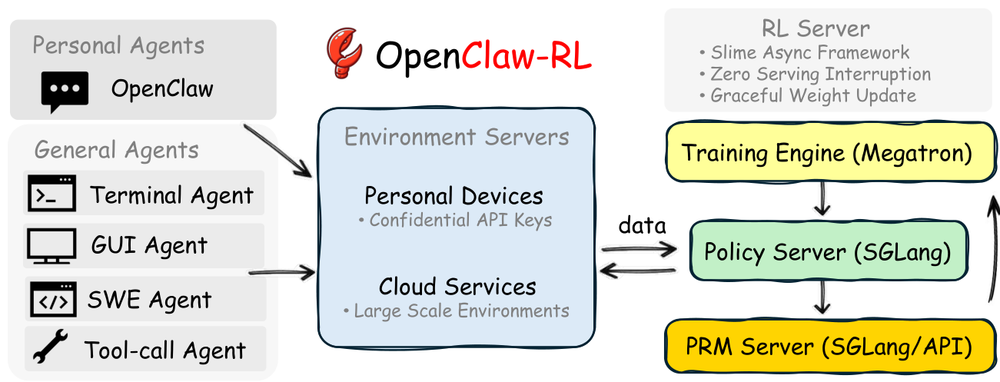</a>
</figure>

A training engine, a policy server and a judge server run side by side and all async, so learning never makes the user wait. After every action comes a next state, the user's reply, a tool's output or a screen change, and a judge model reads it and votes +1, −1 or 0 (a redo request counts as −1). If the next state contains a usable correction, the judge also writes a short hint. Votes come often and hints carry more information.

<figure class="diagram">
<a href="openclaw-method.png">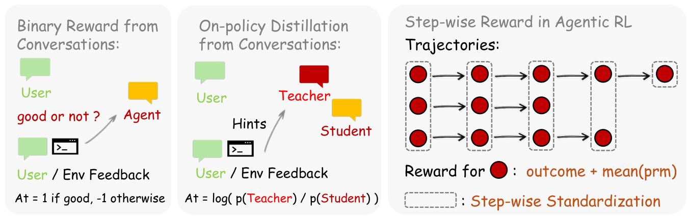</a>
</figure>

Of the 3 ways to use a conversation in the figure, the middle one, on-policy distillation with the hinted model as teacher, is our self-distillation advantage. The judge writes the hint and the teacher only reads it, and the hint problem shows up here too. The judge writes 3 hints and keeps the one whose teacher agrees most with the student's own top 4 tokens, because a vague hint shifts the teacher everywhere while a precise one moves only the tokens that matter, and a hint picked at random was no better than GRPO alone ◔̯◔ The final objective is GRPO on the votes plus distillation toward the hinted teacher, weighted equally, with each token's gap clipped, and without the clip answers doubled in length (@д@)

With simulated personal users and Qwen3-4B, it takes about 10 sessions until a preference sticks, vs 14 for GRPO alone, 30 for hints alone, and 14.5 for a memory system that stores notes without changing weights. Votes arrive after every turn but say very little, hints say a lot but only arrive when the user corrects something, and together the model learns on every turn and gets the detail when its there. Train 1 model per user though and it only ties the memory system. On tool-using maths it scores 22.6 vs 17.2 on AIME. the users are simulated, the preferences are cosmetic (formatting, length, tone), and the tables are means of 5 trials with no variance reported. Its a promising system and a real adoption signal, but not yet a result on real users

## Agents - 1 wrong move and the run is gone

Everything so far treats an attempt as text, where a bad line can be ignored by the next one and graded afterwards. An agent's turns are actions in an environment, open the fridge, call an API, edit a file, and each one changes what the agent sees next, so an agent cant un-take an action.

<figure class="diagram">

</figure>

Write our equation the way an agent would, 1 line per turn, and turn 1 is the sign flip while turns 2 and 3 are correct algebra on the wrong equation. [PivotOPD](https://arxiv.org/abs/2609.40285) calls that a pivotal mistake, an action that makes the shortest route to the goal longer, or impossible, so every later move can be sensible and the run is still dead. The household version comes from ALFWorld, a simulator where an agent does chores through text commands: told to put a cool egg in the microwave, the agent finds no egg in the fridge, takes a tomato, microwaves it, and then wanders around for turns 6 to 30 looking for an egg, score 0 (ー_ー；)

ALFWorld knows the shortest route from any state, so these mistakes can be counted exactly. 59% of the failed runs of 3 Qwen3 models contain one, usually by turn 8 to 12 of 30, followed by about 20 wasted turns.

<figure class="diagram">
<a href="pivot-replay.svg">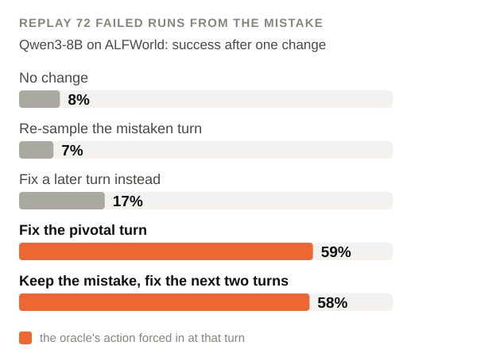</a>
</figure>

This replay of 72 failed Qwen3-8B runs is the plot that convinced me. Fixing the pivotal turn gets 59%, and keeping the mistake but playing the next 2 moves right gets 58%, so 2 right moves after the mistake are as good as never making it. The mistakes are recoverable, and the recovery move is just one the model basically never makes.

Why doesnt practising on its own attempts teach recovery? An update built from your own attempts can only reweight what you sampled, and RL's Razor cuts the other way here, staying close to what you already do is exactly the problem when what you already do never includes the fix. The paper's OPSD-style baseline (their own variant, which grades only the written token and uses retrieved tips as context, so weaker than the original) shows it nicely. After 120 steps it pushed the mistake's probability from 0.999 to under 1 in a hundred thousand, and the right move still stayed under 1% at every pivotal turn, so with 8 attempts per task nothing ever reinforces it, and failures after a pivotal turn barely moved, 51% to 49%. Thats what a model going bad looks like from the inside, it learns to stop making the mistake and still has no clue how to get out of one ( >︹<)

## PivotOPD - train the fix and the recovery

PivotOPD finds the turn that decided a failed run and trains 2 things there, avoiding the mistake and recovering from it.

<figure class="diagram">
<a href="pivot-method.svg">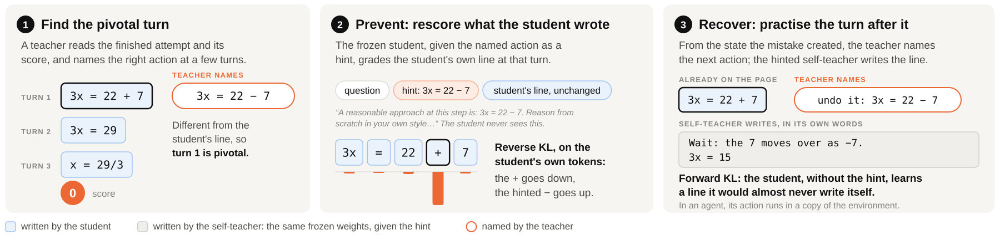</a>
</figure>

1. Find the pivotal turn. A teacher, a bigger model or the student itself, reads the finished attempt and its score and names the right action at a few turns, here `3x = 22 − 7` at turn 1, and where the student did something else, that turn is pivotal. It lands within 1 turn of the true pivotal turn in 71% to 84% of failed runs depending on the teacher, against about 30% for random turns.
2. Prevent. OPSD's trick with a tiny hint: the frozen student gets "A reasonable approach at this step is 3x = 22 − 7. Reason from scratch in your own style" and rescores the student's own line, so the plus goes down and the hinted minus goes up, with the token grades coming from the student's own weights.
3. Recover. The new part, where the self-teacher writes a line instead of only scoring one. From the state the mistake created (`3x = 22 + 7` already on the page, or the tomato already in hand), the teacher names the next action, undo it, the hinted self-teacher writes that line in its own words, "Wait: the 7 moves over as −7. 3x = 15", and the student, without the hint, learns a line it would almost never write itself. In an agent this runs in a copy of the environment.

The loss is GRPO plus those 2 terms:

`L = L_GRPO + w_prev Σ_pivotal KL( π_θ(· | c) ‖ π̄(· | c, h(a*)) ) + w_rec Σ_recovery KL( π̄(· | c̃, h(a*)) ‖ π_θ(· | c̃) )`

`L_GRPO` keeps the checker deciding what counts as success, `π̄` is the student frozen at the start of the step, `h(a*)` is the hint naming the right action, `c` is the context at the pivotal turn and `c̃` the state after the mistake, and the 2 weights set how much the new terms count next to the real reward (too large and a wrong hint does real damage). The 2 KL directions are the forward vs reverse KL section doing actual work. The prevent term has the student first, reverse KL, which is fine at the pivotal turn because the student did write the wrong line. After the mistake though, the useful move is one the student never writes, and reverse KL, like GRPO, can only reweight what was written, so the recover term has the teacher first, forward KL, and the recovery line gets trained even though the student never sampled it. Honestly the cleanest use of "the direction matters" I've seen (◕‿◕)

Its the best of 13 baselines on household chores, search questions and a web shop, with Qwen3 1.7B and 8B and 3 seeds, and replaying the same 72 mistakes it recovers 73% of the time, against 8% untrained and 20% for their OPSD variant. The self-teacher's pass adds 5% per step and 1 recovery turn 12%, but a second recovery turn means replaying the episode in a copy of the environment, +94%, so the real requirement is an environment you can reset and replay exactly, and a live website isnt one ;) And a wrong named action becomes a wrong target, the self-teacher will happily teach whatever the hint says.

## Where self-distillation wont help

When plain GRPO is the better tool:

1. Weak models - the teacher is the model reading the hint, and if the model cant make sense of the hint its grades are noise. Thats what we saw with the small models, and its true of today's robot policies (－‸ლ)
2. Pure sharpening - if the model already solves a problem half the time and you want it every time, the hint barely changes the teacher's view, so the grades are near zero, while GRPO's group comparison still works because some attempts pass and some fail.
3. Bias vs variance - GRPO's signal is unbiased but super noisy, 1 number smeared over a thousand tokens, and the self-teacher's is much less noisy but biased, because each grade is only as right as the model's reading of the hint. With unlimited compute and well balanced groups I'd probably run the unbiased one.

Messy feedback is a mixed bag. Subjective feedback works (the personalisation runs), and so does incomplete feedback, a runtime error points the right way without leaking the answer, which is the test-time experiment. Feedback that needs interpreting is still open, and 1 untried idea is to let the teacher think about the feedback in a short chain of thought before the part you distil over (free project idea if anyone wants it ;)). And wrong feedback gets distilled faithfully, the method cant check the hint, it only reads it, so where the feedback comes from matters a lot.

What I want to see next is scale, since every study here stops at 14B or below and the self-teacher gets better with size. Then sample efficiency, because in-context learning changes behaviour from 1 sentence while gradient descent only nudges, and the dream is that a user says "never use the letter F" and 1 update is enough (☆▽☆) And models that go and seek the feedback they need, the way people choose whom to ask.

If you wanna try any of this, Hugging Face's [TRL](https://huggingface.co/docs/trl/example_overview) has experimental SDPO and SDFT trainers. What excites me most are the settings where no method could learn from the data at all before, user conversations and agents that learn as you use them, because the lesson of 2 decades of deep learning is scale, and this is a way to put way more data into a model.

## Scaling SDPO in production

The question I care about most is whether SDPO can run on production shaped traffic, where every request gets answered once. The best answer I've seen is [Scaling SDPO](https://www.trajectory.ai/field-notes/scaling-sdpo), from Trajectory, who build continual learning infra for companies. All the experiments and plots in this part are from their post. 

<figure class="diagram">
<a href="setting.svg">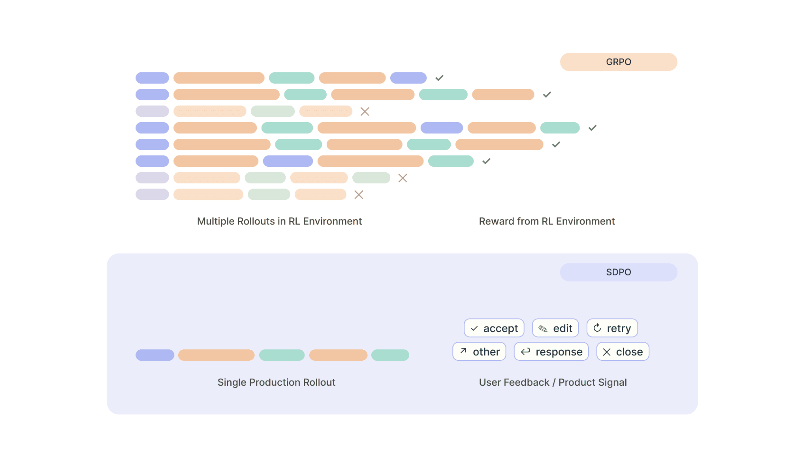</a>
</figure>

A real user asks once, so you get 1 attempt and whatever the user did next (accepted it, edited it, retried, replied, or closed the window), and making a group would mean rerunning the request in a simulator, training on an environment you dont deploy. SDPO doesnt need a group, the teacher's grade exists as soon as there's 1 attempt and some text about how it went. They tested this on τ-bench retail, an agent serving simulated customers of an online shop through tools, with Qwen3-4B and 3 SDPO runs that differ only in G, the number of attempts per question.

<figure class="diagram">

</figure>

G = 1 with failures kept learns the most per attempt, and G = 4 throwing away groups where all 4 failed, like a lot of GRPO pipelines do, is the slowest, still climbing past 8 hours. The failures were where the learning signal was, because SDPO learns from a failed attempt plus its feedback, so throwing those away throws away its best data ( >︹<)

## Long tasks make data stale, and the textbook fix blows up

<figure class="diagram">

</figure>

Stale data was the first real problem they hit at scale. Agent tasks take anywhere from seconds to an hour, so in the figure user 3's attempt was written by the model at `θ₀` but finishes when the trainer is at step 4, 3 updates old. Call that K = 3, the number of trainer steps between the model that wrote the tokens and the model learning from them. Waiting for everyone doesnt make K zero, it just idles the trainer while the slowest task finishes, and the SDPO paper always trained fresh, at K = 0, so this was new territory. (Kimi pauses unfinished attempts across rounds for the same reason.)

The textbook correction is PPO's ratio with the old model now K updates behind, which on average exactly corrects for learning from an older model's data. But on average isnt always. If the old model gave a token 0.001 and sampled it anyway, and the current model gives it 0.1, the ratio is 100, 1 token multiplied by a hundred (@д@)

<figure class="diagram">
<a href="is-collapse.svg">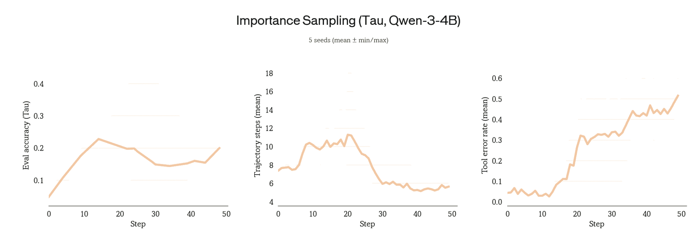</a>
</figure>

With no cap at 3 updates stale, accuracy rises for about 15 steps and then falls, the agent starts giving up early, and broken tool calls climb to half, so training collapses ༼ ༎ຶ ෴ ༎ຶ༽ It hurts SDPO more than GRPO because in GRPO every token shares 1 advantage, so 1 wild token gets diluted among its neighbours, while in SDPO each token has its own advantage and the wild ratio is the whole update at that position.

## Cap the ratio, and cap each token's advantage too

Each token's push is the product of 2 numbers, the ratio, which corrects for an older writer, and the advantage, which says how much the token should move, so a fix has to handle both. Each row below is 1 fix, with the same 3 plots as before, and the shaded bands are the range across runs, where wide means the result depends on luck.

<figure class="diagram">
<a href="ppo-clip.svg">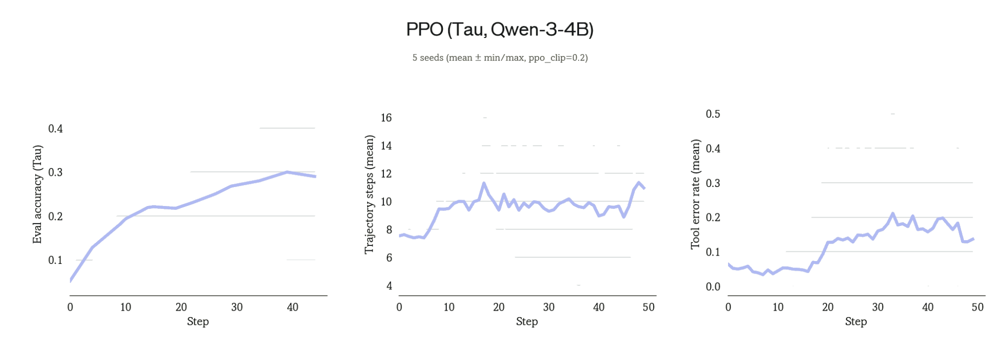</a>
</figure>

Fix 1 caps the ratio PPO-style between 0.8 and 1.2. That stops the crash, but at step 40 accuracy ranges from about 0.10 to 0.45 depending on the run, same setup and wildly different results (◎＿◎;) With the ratio bounded, the suspect is the other number. In GRPO the advantage is standardised within the group, so it cant get much bigger than a few units, but in SDPO its log teacher minus log student on a single token with no normalisation like that. If the student gave a token 1 in a thousand and the teacher gives it 0.9, the grade is `log(0.9 / 0.001)`, about 6.8, way bigger than a typical token's, and a handful like that can dominate a whole batch. My reading is that stale data makes these extremes more likely, since text written by an older model contains more tokens the current model finds surprising.

<figure class="diagram">
<a href="kl-penalty.svg">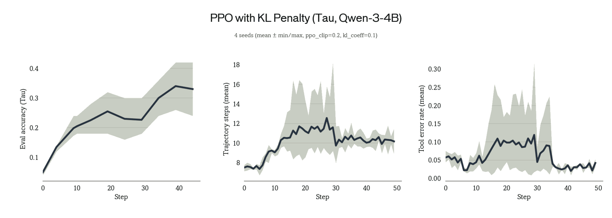</a>
</figure>

Fix 2 tests that suspicion with PPO's rubber band again, a KL penalty toward a frozen copy of the starting model at weight 0.1. The bands tighten, which fits the diagnosis that the trouble was single updates going too far, but it treats the symptom, costs an extra model pass every step, and ties the model to where it started, the opposite of what continual learning wants.

<figure class="diagram">

</figure>

Fix 3 caps the advantage itself, at 3x a running average of how big advantages typically are. A relative cap adapts as the typical size changes during training and from task to task, so normal tokens are untouched and only the outliers get trimmed. Accuracy climbs about as well as with the reference model, without the extra pass and without the tie to the start. Its not perfect, the bands are still wide and broken calls creep up late, and the 3 came out of an ablation, nobody derived it (￣▽￣) The ratio cap limits how much a stale token gets reweighted and the advantage cap limits how hard any single token can push, and both caps together is what Trajectory calls SDPO++. Kimi and GLM-5 have their own per-token guards for the same reason, and the SDPO paper caps advantages in its test-time runs.

## With both caps, a bit of staleness is fine, even at 120B

<figure class="diagram">

</figure>

With both caps, data up to 3 updates stale ends about as well as fresh data, 5 gets there later, and 10 stalls. They pick 3, the stalest setting that loses nothing, because then the trainer doesnt wait for the slowest task and training runs about twice as fast (ﾉ◕ヮ◕)ﾉ My reading of why 10 stalls: the writer is further from the current model, more tokens look surprising and get clipped, so less of each batch carries signal.

<figure class="diagram">
<a href="apex.svg">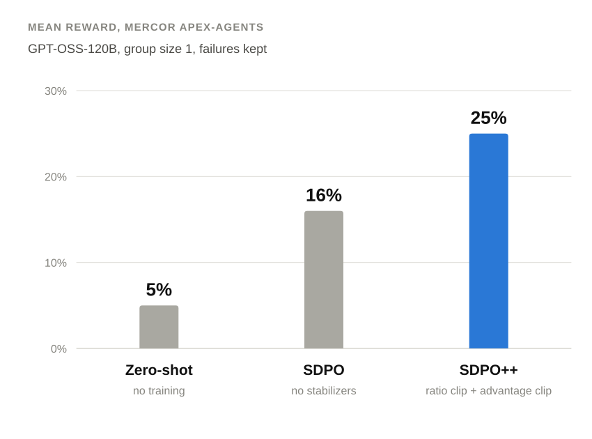</a>
</figure>

Then they took the same caps, no retuning, to [APEX-Agents](https://www.mercor.com/blog/introducing-apex-agents/), long professional tasks in investment banking, consulting and law that take an expert about 2 hours, graded against expert checklists. The model is GPT-OSS-120B, which almost never passes at the start, so a group-based method would discard nearly everything, while SDPO learns from each failure's feedback. With 1 attempt per task, mean reward goes from 5% to 16% with plain SDPO and 25% with both caps. The advantage cap is relative, so it adapts to the new task's scale, and the ratio cap is the standard PPO range, which is why stabilisers found on a 4B model carried over to a 120B one (◕▽◕)

## 1 model, 2 prompts

Here's every method in this post in 1 table.

| method | who writes the text learned from | who grades it | what the grader knows that the student doesn't | feedback | what you need |
| --- | --- | --- | --- | --- | --- |
| copying (SFT) | an expert or a bigger model | nobody, you imitate it | nothing | the expert's next word | expert answers |
| GRPO | the student | a checker | the right answer, as 1 number | 1 number per attempt | a checker, groups with mixed results |
| on-policy distillation | the student | a separate, better model | its own knowledge | probabilities, every token | a better model to query |
| OPSD | the student | the same model, frozen | a worked solution in its prompt | probabilities, every token | a solution per problem |
| SDFT | the student | the same model, moving slowly | an expert demonstration, or an article, in its prompt | probabilities, every token | demonstrations, a model that learns from examples in context |
| SDPO | the student | the same model, moving slowly | the error message, or a sibling's success | top candidate tokens, every position | useful feedback text, a model that can use hints |
| SDPO from user interactions | the student (or, in logged chats, another model) | the same model | the user's next message | a grade per written token | conversations where people react, guardrails |
| PivotOPD | the student, and after its mistake the self-teacher | the same model, frozen for the step, inside GRPO | the action a teacher named for that turn | probabilities at the pivotal and recovery turns | a model that can name the right action, an environment you can replay |

Read top to bottom, its the story of this post, and each row keeps what worked in the row above and changes 1 thing :) From OPSD down the grader is the student's own weights, it always knows something the student wont have at test time, and the last column decides which method you can actually use.

3 things I actually believe after drawing all of this.

The teacher is a prompt. Everything the teacher knows beyond the student comes from its prompt, so the hint decides what gets learned. A wrong hint teaches wrong things, like the production team found, and a hint that gives away the answer teaches style, like OPSD showed, so first check the hint is right, then keep it small.

Full probabilities beat 1 number. A ranking over the candidates at every position carries way more information than 1 number per answer and its less noisy, and the credit assignment ablation, dark knowledge and DeepSeek-V4's choice all point the same way.

GRPO stays the chassis. Every method here keeps the RL update and only changes what the advantage is made of, so you can adopt it inside the trainer you already have. In agents, copying a hinted teacher token by token taught confidence without the content and fell below plain GRPO, while PivotOPD, which keeps the reward in charge, didnt. And your own text forgets less, which is RL's Razor.

## So which one do I use?

Depends on what your environment gives you:

| if you have… | …use |
| --- | --- |
| groups of attempts with mixed pass/fail | GRPO is fine |
| a stronger model you can query | on-policy distillation |
| several RL-trained specialists | merge them with on-policy distillation |
| a worked solution per problem | OPSD, in short runs, and watch answer length |
| expert demonstrations of a new skill, and old skills you must keep | SDFT instead of SFT |
| new documents the model must absorb as knowledge | SDFT, with the article and a worked answer in the teacher's prompt |
| text that explains what went wrong | SDPO, 1 attempt per request is fine |
| users who react to the answers | SDPO on their next message, and watch what they teach it |
| an agent, a model that can name the right action, and an environment you can replay | PivotOPD |

I find 1 coding agent easier to think about than a table, so here's one that uses most of the rows.

A user asks it to fix a failing test, and CI says `AssertionError: expected 4, got 5`. Thats feedback text about this patch, exactly what SDPO turns into per-token grades, so I'd run SDPO with the CI log in the teacher's prompt and let the grade land on the line that caused the failure. 1 attempt per request is enough, and the user's later edit to the patch is feedback too. If traces take more than a few seconds you'll be training async, so cap the ratio and cap the per-token advantage.

Some tickets have the patch a senior engineer merged. Thats a verified solution, the hint that gives away the most, so OPSD's bias applies, and I'd use it only in short runs with the tests still deciding the reward, and watch the length, a per-token teacher will happily teach "wait" (ー_ー；)

A bigger internal model, or specialists for say Python and Rust, means on-policy distillation, the cheapest, densest signal there is when a better teacher already exists, which is also how DeepSeek and Kimi merge their domain experts after the GRPO stage. A session that goes wrong early, editing the wrong file at turn 3 and then spending 40 turns patching around it, is the PivotOPD shape, so if you can replay the sandbox, have a stronger model name that turn and the right action. Tickets you can retry with mixed results still get GRPO, because when groups have mixed results its baseline is honest and its signal unbiased. And the 2 SDFT rows are for a new skill from demonstrations, or new docs. Through all of it the test suite stays the final judge, it just stops being the only thing the model learns from.

The through-line I keep coming back to is tiny. The model already writes 1 token at a time, so the grade should be allowed to be 1 token at a time too. GRPO is what you do when the only thing you trust is a checker and a group, and the moment the environment or the user writes a sentence about the attempt, that sentence can go into a second prompt on the same weights, and the advantage can finally sit on the plus. A sentence that gives away the answer is a different thing, and it teaches a different thing.

Okay thats it, if you made it till here you deserve a medal, or atleast a nap (￣▽￣) The talk this follows is mostly built on [this video](https://youtu.be/7ng3RLFB144) and [this one](https://youtu.be/OgEGV7apEzI), the KL part leans on [this one](https://www.youtube.com/watch?v=mMQRr9TDJQ4), the production runs are from Trajectory's [Scaling SDPO](https://www.trajectory.ai/field-notes/scaling-sdpo) field note, and the papers are linked inline wherever they show up. If you try SDPO or SDFT on something real, ping me, I really wanna know how it goes.
