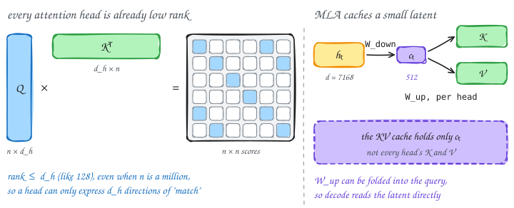
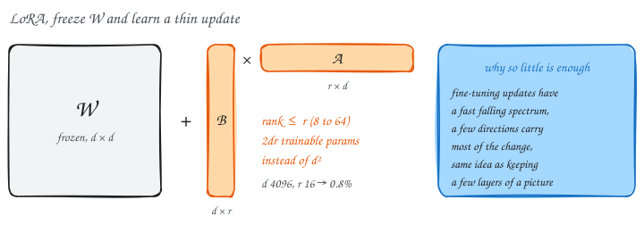

+++
aliases = ["/writes/the-bit-where-svd-starts-making-people-actual-money/"]
title = "The bit where SVD starts making people actual money"
date = 2026-10-29
draft=true
path = "writes/2026-10-29-the-bit-where-svd-starts-making-people-actual-money"
description = "A hands-on, animated look at SVD, from stretching a circle to compressing pictures, eigenfaces, movie recommendations, PageRank and inverses that blow up."
[taxonomies]
tags = ["math", "ml", "svd", "interactive"]
+++

You know SVD is kinda the gigachad of Linear ALgebra. Quite literally absorbs so many imp concepts into one theorem, and on other end, extremely applicable to ML. Its literally a fuking decomposition that rules them all (Jordan, Spectral, QR, LU, Cholessky, Interpolative, Schur, Polar, Mostow, etcc). 

In undergrad, it mostly means [grinding through matrix arithmetic](https://www.youtube.com/watch?v=rYz83XPxiZo) untill three matrices multiplied back into the one I started with, which is boringg obviously (ー_ー；)

SVD is the same idea sits behind image compression, face recognition and recommendation systems, and even Google's PageRank, and that felt like a far more interesting invitation than another worked example of AX = B. How does a pile of numbers know which parts of a picture to keep, or which movie you are probably going to like? And a bunch of those are literally how companies make money, hence the title ;)

Classic PageRank is not really an SVD problem though, it is an eigenvector problem from the same family of spectral linear algebra, and SVD shows up more directly in search through latent semantic indexing and the maths behind HITS. 

<link rel="stylesheet" href="lab.css">
<noscript><p><strong>The interactive parts need JavaScript.</strong> The maths and the Python still read fine without it.</p></noscript>

## What SVD is

### What a matrix does

In simple terms, SVD says that any matrix, regardless of symmetry, rank, shape, can unconditionally can be decomposed into 3 beloved matrices

I mean, you probably remember this from class, but a real m × n matrix A is just a linear map from ℝ<sup>n</sup> to ℝ<sup>m</sup>, x ↦ Ax, and linearity, A(αx + βy) = αAx + βAy, means the whole map is pinned down by what it does to the standard basis, because Ae<sub>j</sub> is just the j-th column of A and every other input is a combination of the e<sub>j</sub>. Geometrically that forces a lot of structure, lines through the origin go to lines through the origin, parallelograms go to parallelograms, and the unit sphere in ℝ<sup>n</sup> goes to an ellipsoid in ℝ<sup>m</sup>, a flat one of dimension r whenever A has rank r.

And the SVD says this map always factors the exact same way, turn, stretch, turn- an orthogonal map, then a scaling along the coordinate axes, then another orthogonal map.

<div class="svd-equation" role="math" aria-label="A equals U Sigma V transpose. x maps to V transpose x, then to Sigma V transpose x, then to U Sigma V transpose x which equals A x">A = U Σ V<sup>T</sup><br>x ↦ V<sup>T</sup>x ↦ ΣV<sup>T</sup>x ↦ UΣV<sup>T</sup>x = Ax</div>

Here V ∈ ℝ<sup>n×n</sup> and U ∈ ℝ<sup>m×m</sup> are orthogonal, so V<sup>T</sup>V = I and U<sup>T</sup>U = I, and Σ ∈ ℝ<sup>m×n</sup> is zero everywhere except for σ₁ ≥ σ₂ ≥ … ≥ 0 down its diagonal. Read right to left, V<sup>T</sup> rotates (or reflects) ℝ<sup>n</sup> so the right singular vectors v<sub>i</sub> go to e<sub>i</sub>, Σ multiplies the i-th coordinate by σ<sub>i</sub> (and pads with zeros or drops coordinates when m ≠ n), and U rotates (or reflects) ℝ<sup>m</sup> so e<sub>i</sub> goes to the left singular vector u<sub>i</sub>. Orthogonal maps keep every length and angle, so all the stretching lives in Σ, and the visual below plays the three maps one at a time on the unit circle of a 2 × 2 matrix, with the actual numbers of each factor on top.

<section class="svd-lab" data-lab="geometry" id="geometry-lab" aria-labelledby="geometry-title">
<h4 class="lab-title" id="geometry-title">The unit circle under UΣV<sup>T</sup></h4>
<p class="lab-intro">Press play or click a step to apply V<sup>T</sup>, then Σ, then U, and drag the tip of x or use the θ slider to pick another input.</p>
</section>

Two things are worth trying in there, starting with the rank 1 matrix, where if you stop at ΣV<sup>T</sup>x you can see σ₂ = 0 wipe out the second coordinate, so the circle collapses onto a segment and U has no way of getting the lost direction back, since v₂ spans the null space. Then try the one with a negative determinant, its singular values still come out positive, because the sign lives in U, which is the wierd little moment where the plane turns over during the last step (◎＿◎;)

For a tall or wide matrix you usually store the reduced SVD instead. With p = min(m, n) it keeps U as m × p, Σ as p × p and V<sup>T</sup> as p × n, dropping the columns of U or V that only ever meet the zero rows or columns of Σ, and nothing about Ax changes.

If I had to keep just 1 equation from all of this, its this one.

<div class="svd-equation" role="math" aria-label="A v i equals sigma i u i">Av<sub>i</sub> = σ<sub>i</sub>u<sub>i</sub></div>

Feed in the special input direction v<sub>i</sub> and you get the special output direction u<sub>i</sub>, scaled by σ<sub>i</sub>. So its pairs of directions, and the 2 can even live in different spaces, while an eigenvector asks for something much stricter, the output has to point along the <em>same</em> direction as the input, which only makes sense for a square matrix in the first place.

### Why those directions

Take any unit vector x, and ask how long its output is.

<div class="svd-equation" role="math" aria-label="Squared norm of A x equals x transpose A transpose A x">‖Ax‖² = x<sup>T</sup>A<sup>T</sup>Ax</div>

The matrix A<sup>T</sup>A is symmetric and positive semidefinite, so its perpendicular eigenvectors tell you exactly which inputs come out longest. The biggest eigenvalue is the biggest <em>squared</em> stretch, so its square root is σ₁, and you repeat the same argument in the leftover perpendicular directions to get the rest of the singular values.

For σ<sub>i</sub> > 0, set u<sub>i</sub> = Av<sub>i</sub> / σ<sub>i</sub>. These output directions are perpendicular too, because their inner products reduce to v<sub>i</sub><sup>T</sup>A<sup>T</sup>Av<sub>j</sub> / (σ<sub>i</sub>σ<sub>j</sub>), which is zero whenever i ≠ j, and for any zero singular values you just complete the remaining orthonormal directions. Thats the whole reason the turn, stretch, turn picture works.

You can definately check a small case like this one by hand :)

<div class="svd-equation" role="math" aria-label="A is the matrix with rows 3 1 and 1 3. Its singular values are 4 and 2.">A = [[3, 1], [1, 3]]<br>v₁ = (1, 1)/√2 &nbsp; → &nbsp; Av₁ = 4v₁<br>v₂ = (−1, 1)/√2 → &nbsp; Av₂ = 2v₂</div>

This A happens to be symmetric and positive definite, so its input and output directions line up with its eigenvectors, and the shear in the visual above is a good reminder that in general they don't.

Its a cute derivation, but please dont compute a big SVD this way. Forming A<sup>T</sup>A squares the condition number (for a full column rank A), which makes the small directions much harder to pin down in floating point, so just use a library. [NumPy's implementation](https://numpy.org/doc/stable/reference/generated/numpy.linalg.svd.html) gives back U, the singular values as a vector, and Vh, which is V<sup>T</sup> for real input, and it calls LAPACK instead of forming the Gram matrix.

```python
import numpy as np

A = np.array([[3., 1.], [1., 3.]])
U, s, Vt = np.linalg.svd(A, full_matrices=False)
print(s)                          # [4. 2.]
print(np.allclose((U * s) @ Vt, A))  # True
```

## Where it makes money

### Pictures as layers

The same multiplication also reads in a completely different way, and ngl this is my favourite one.

<div class="svd-equation" role="math" aria-label="A equals the sum of sigma i u i v i transpose">A = σ₁u₁v₁<sup>T</sup> + σ₂u₂v₂<sup>T</sup> + …<br>A<sub>k</sub> = ∑<sub>i=1…k</sub> σ<sub>i</sub>u<sub>i</sub>v<sub>i</sub><sup>T</sup></div>

Each outer product u<sub>i</sub>v<sub>i</sub><sup>T</sup> is a rank one matrix where every column is a scaled copy of the same vector, so if the matrix holds grayscale pixels, each term is a simple layer of stripes, and adding the layers back up rebuilds the picture.

The order of the layers matters a lot, because keeping the first k gives the smallest possible error of any matrix with rank at most k, measured as the sum of squared pixel differences (this is the Eckart, Young and Mirsky result), and "smallest" means exactly that sum of squares, which isn't always what a person notices first. The [UBC lecture notes](https://www.cs.ubc.ca/~nando/540-2007/lectures/l1.pdf) connect this expansion to low rank image approximation and to information retrieval.

<section class="svd-lab" data-lab="compression" id="compression-lab" aria-labelledby="compression-title">
<h4 class="lab-title" id="compression-title">Rebuild a picture, one layer at a time</h4>
<p class="lab-intro">The landscape coming back one layer at a time, biggest σ first, with a count of how many numbers it costs.</p>
</section>

The error is sitting right there in the singular values.

<div class="svd-equation" role="math" aria-label="Squared Frobenius error is the sum of discarded squared singular values">‖A − A<sub>k</sub>‖<sub>F</sub>² = ∑<sub>i&gt;k</sub> σ<sub>i</sub>²<br>energy retained = (∑<sub>i≤k</sub> σ<sub>i</sub>²) / (∑<sub>i</sub> σ<sub>i</sub>²)</div>

That works because the rank one layers are perpendicular to each other (as matrices) and layer i has size σ<sub>i</sub>, so dropping layers is like dropping perpendicular sides of a right triangle, and Pythagoras just adds up their squares. The RMSE is then √(discarded energy / number of pixels).

The whole compression step fits in a few lines, with A as a 2D array of grayscale values.

```python
def approximate(A, k):
    U, s, Vt = np.linalg.svd(A, full_matrices=False)
    Ak = (U[:, :k] * s[:k]) @ Vt[:k, :]
    rmse = np.sqrt(np.mean((A - Ak) ** 2))
    return Ak, rmse
```

The original has m × n numbers and the factors have k(m + n + 1), so for this 80 × 80 picture, keeping 8 layers stores around 1,300 numbers instead of 6,400, and somewhere around 40 layers the factors already need more numbers than the picture itself. That is a count of numbers and not a file size either (if the pixels are one byte each and the factors are four byte floats, those 1,300ish values take about 5 KB), and real codecs like JPEG and WebP use transforms, quantisation and clever coding, so nothing here shows SVD beating them. Please dont go pitch SVD to VCs as the new JPEG lol.

Keeping "99% of the energy" also doesn't mean the picture is 99% recognisable. A bright background can hold most of the squared energy while the small details that actually matter disappear, and singular components are global patterns, so they don't line up with objects or neat bands of frequency.

Noisy pictures are the fun case ( ͡° ͜ °), add noise to the landscape and the error against the noisy version keeps falling as you add layers, but the error against the clean picture bottoms out and then creeps back up as the later layers start faithfully rebuilding the noise. In real life you never get to see the clean picture (we can only do it here because we added the noise ourselves), and small singular values are not automatically noise, but it shows why keeping everything can be the wrong goal.

### A space of faces

The image matrix gets used in two quite different ways in this post. For compression the rows and columns were positions inside one picture, but for eigenfaces each row is a whole flattened face and each column is one pixel position across the entire dataset.

Say there are N aligned grayscale faces with d pixels each, stacked into X ∈ ℝ<sup>N×d</sup>. Subtract the mean face μ from every row, then decompose what is left.

<div class="svd-equation" role="math" aria-label="Centered X equals U Sigma V transpose, and the covariance equals V Sigma squared V transpose divided by N minus one">X<sub>c</sub> = X − 1μ<sup>T</sup> = UΣV<sup>T</sup><br>C = X<sub>c</sub><sup>T</sup>X<sub>c</sub> / (N − 1)<br>&nbsp; = VΣ²V<sup>T</sup> / (N − 1)</div>

And this is exactly where SVD turns into principal component analysis, or PCA. The right singular vectors are directions in pixel space, and reshaping one back into an image gives you an <em>eigenface</em>, whose covariance eigenvalue is σ<sub>i</sub>² / (N − 1).

For a new face f you work out its coordinates z = V<sub>k</sub><sup>T</sup>(f − μ), and then you can rebuild it as μ + V<sub>k</sub>z, or compare its coordinates with the stored training ones. [Turk and Pentland's 1991 paper](https://direct.mit.edu/jocn/article/3/1/71/3025/Eigenfaces-for-Recognition) built face recognition on exactly this idea, and an eigenface doesn't have to look like any familiar feature, its just a direction along which the training faces differ alot (they usually look kinda ghostly tbh).

<section class="svd-lab" data-lab="faces" id="faces-lab" aria-labelledby="faces-title">
<h4 class="lab-title" id="faces-title">A face as a handful of numbers</h4>
<p class="lab-intro">One new photo rebuilt as the average face plus more and more eigenfaces.</p>
</section>

At k = 0 everyone is just the average face, which is lowkey creepy, and even with all 11 eigenfaces the new photo never comes back quite right. Keeping most of the <em>training</em> variance doesn't promise a good rebuild of a new face, and even all 11 components only span the centred training faces, which is a tiny corner of all the possible 1,600 pixel pictures.

```python
# Each row is one flattened training face.
mean = X.mean(axis=0)
U, s, Vt = np.linalg.svd(X - mean, full_matrices=False)
basis = Vt[:k]
training_coordinates = (X - mean) @ basis.T
query_coordinates = (face - mean) @ basis.T
reconstruction = mean + query_coordinates @ basis
nearest = np.linalg.norm(
    training_coordinates - query_coordinates, axis=1
).argmin()
```

The sneaky problem is the objective. PCA keeps variation, and light, pose or background can easily vary more than identity does, so the nearest training face is only the closest point available and doesn't prove the new face belongs to a known person. A real system needs alignment, testing on unseen people and conditions, and some way of saying "I don't know this person", so this toy only shows the projection mechanism and nothing about reliable identification.

Centring matters too, because without subtracting μ the first component mostly ends up describing the shared brightness of every face. For compression we deliberately kept the raw intensities, but here we care about how faces vary <em>around</em> the shared face.

### Shared taste

And this is the bit the title is about ;) Imagine a table where the rows are people, the columns are movies and the entries are ratings. Two viewers who keep enjoying the same movies leave similar patterns in their rows, two movies liked by the same viewers leave similar patterns in their columns, and the model doesn't need to know anyone's age or any movie's genre to pick up on that.

Start with a deliberately complete, made up table R, subtract a baseline of 3 stars, and decompose the deviations B = R − 3 with a truncated SVD.

<div class="svd-equation" role="math" aria-label="B k equals P Q transpose, with P equals U k square root Sigma k and Q equals V k square root Sigma k">B<sub>k</sub> = U<sub>k</sub>Σ<sub>k</sub>V<sub>k</sub><sup>T</sup> = PQ<sup>T</sup><br>P = U<sub>k</sub>Σ<sub>k</sub><sup>½</sup>, &nbsp; Q = V<sub>k</sub>Σ<sub>k</sub><sup>½</sup><br>predicted rating(u, m) = 3 + p<sub>u</sub> · q<sub>m</sub></div>

Each viewer gets a short vector p and each movie a short vector q, and their dot product measures how well those learned coordinates line up. Splitting the singular values evenly between P and Q is only a convention (putting all of Σ on one side gives the same product), and the patterns it finds are associations, which aren't necessarily correlations or genres you could put a name to.

<section class="svd-lab" data-lab="recommend" id="recommend-lab" aria-labelledby="recommend-title">
<h4 class="lab-title" id="recommend-title">Taste as a direction</h4>
<p class="lab-intro">Rate Orbit and Starlit yourself and watch your dot move on the taste map, the four movies you havent rated get a guess next to their name.</p>
</section>

For the new viewer we solve a small regularised least squares problem, where Q<sub>O</sub> holds only the two movie vectors whose ratings we already know and y holds those two ratings minus 3.

<div class="svd-equation" role="math" aria-label="p minimizes squared norm Q observed p minus y plus lambda squared norm p">p = argmin<sub>p</sub> ‖Q<sub>O</sub>p − y‖² + λ‖p‖²<br>(Q<sub>O</sub><sup>T</sup>Q<sub>O</sub> + λI)p = Q<sub>O</sub><sup>T</sup>y<br>unseen movie score = 3 + p · q<sub>movie</sub></div>

```python
# Complete toy training table; 3 is our chosen baseline.
U, s, Vt = np.linalg.svd(R - 3, full_matrices=False)
Q = Vt[:k].T * np.sqrt(s[:k])
observed = [0, 2]                 # Only Orbit and Starlit
y = np.array([5., 1.]) - 3
Qo = Q[observed]
p = np.linalg.solve(Qo.T @ Qo + 0.3 * np.eye(k), Qo.T @ y)
scores = 3 + Q @ p
# Rank only the movies outside `observed`.
```

The big catch is that real rating tables are mostly empty, and a movie you haven't seen is not a zero star review (I havent seen most movies, doesnt mean I hate them lol). Plain SVD has no idea what "unknown" means, so filling every blank with zero quietly changes the problem, and real factor models instead learn user and item vectors by fitting only the ratings people actually gave, with regularisation and usually a bias per user and per item. [Google's recommendation course](https://developers.google.com/machine-learning/recommendation/collaborative/matrix) explains the dot product model and why the loss has to treat observed and unobserved interactions differently, and [Paterek's Netflix Prize work](https://www.cs.uic.edu/~liub/KDD-cup-2007/proceedings/Regular-Paterek.pdf) covers regularised SVD style models for sparse ratings.

The training RMSE isn't a recommendation quality score either, since every one of those ratings went into the factorisation. Judging a recommender needs genuinely held out interactions and a measure that fits the task, like how well it ranks the relevant items, and the four predictions for the new viewer have no ground truth at all, so there is nothing to check them against. The scores can also wander outside 1 to 5, becuase nothing in the model knows that ratings are bounded.

And the limits just keep coming ( >︹<), a new movie has no vector until someone rates it or some other model supplies one, people's taste drifts over time, what gets shown to people shapes what gets rated, and an axis that looks like "sci-fi versus romance" in this tiny example won't necessarily mean the same thing in another dataset. [Google's collaborative filtering summary](https://developers.google.com/machine-learning/recommendation/collaborative/summary) covers the cold start problem and how extra features help.

### Where PageRank fits

PageRank asks a different question altogether, if a surfer keeps clicking random links and occassionally jumps to a completely random page, where do they end up spending their time? The classic model is in [Brin and Page's search engine paper](https://research.google/pubs/the-anatomy-of-a-large-scale-hypertextual-web-search-engine/), and I'm only playing with that model here, nowhere near rebuilding a search engine (that one made somebody a LOT of money, sadly not me).

Use a column probability vector p, and let T<sub>ij</sub> be the probability of moving <em>from j to i</em>, so every column sums to one (a page with no outgoing links spreads its probability evenly in this example). With a link following probability α and a uniform jump vector v, the update and its fixed point look like this.

<div class="svd-equation" role="math" aria-label="Next p equals alpha T p plus one minus alpha v">p<sub>t+1</sub> = αTp<sub>t</sub> + (1 − α)v<br>G = αT + (1 − α)v1<sup>T</sup><br>Gp = p</div>

The answer is an eigenvector of G with eigenvalue 1, scaled so it sums to one. For 0 ≤ α < 1 and a strictly positive v, the random jumps guarantee there is exactly one stationary distribution and that you reach it from any starting point, while α = 1 throws that guarantee away.

<section class="svd-lab" data-lab="pagerank" id="pagerank-lab" aria-labelledby="pagerank-title">
<h4 class="lab-title" id="pagerank-title">Where does the random surfer end up?</h4>
<p class="lab-intro">Everyone starts on A and the probability flows round a tiny web until it settles, flip α to see how much the random jumps matter.</p>
</section>

At α = 1 nobody ever jumps, so D, which no page links to, ends up with nothing at all, and on a web that is just one loop the probability would chase itself round forever like a dog chasing its tail, so even though a uniform stationary distribution exists, starting from A you'd never get there. At α = 0 a single step forgets the links completely.

SVD can describe how G stretches things, but its top singular vector is generally not the vector with Gp = p, because "which direction gets stretched the most in one step" and "which probability distribution stays put" are different questions with different answers. On the little web above at α = 0.85 PageRank puts about 39% on C and 37% on A, while the top singular vector of the same G leans on B and D (~36% each) and gives C only ~6%. People have asked about this exact mix up [on Stack Overflow](https://stackoverflow.com/questions/1867934/pagerank-vs-svd), and if you want the PageRank maths in more detail, [this bachelor's project from Groningen](https://fse.studenttheses.ub.rug.nl/12910/1/Googlepagerank.pdf) walks through the Google matrix and the power method, and [this Georgia Tech report](https://bonetto.math.gatech.edu/teaching/3235-spring20/Projects_template/MATH3235%20Report.pdf) explains the Markov chain and Perron-Frobenius reasoning behind it.

Search uses SVD much more directly in a couple of other places.

- Latent semantic indexing applies a truncated SVD to a weighted term by document matrix, so words and documents can be compared in a few dimensions. The patterns it keeps reflect which words tend to show up together, which helps, but it doesn't magically sort out ambiguity or meaning.
- HITS works with a link matrix L whose rows are sources and columns are destinations, where the authority scores involve L<sup>T</sup>L and the hub scores involve LL<sup>T</sup>, so their leading eigenvectors are exactly the right and left singular directions of L, as [Kleinberg's original paper](https://www.cs.cornell.edu/home/kleinber/auth.pdf) works out.

So all of these ask some matrix for 1 useful direction, its just a different matrix each time, and a different reason for wanting it.

### When inverses explode

Back to good old Ax = b from undergrad. In singular vector coordinates solving the system is just dividing by the singular values, and the minimum norm least squares solution uses the pseudoinverse.

<div class="svd-equation" role="math" aria-label="x equals the sum over nonzero singular values of u i transpose b divided by sigma i, times v i">x = A<sup>+</sup>b = ∑<sub>σᵢ&gt;0</sub> (u<sub>i</sub><sup>T</sup>b / σ<sub>i</sub>) v<sub>i</sub></div>

An exactly zero singular value simply gets skipped, but a very small nonzero one is much sneakier, because any measurement error in its output direction gets divided by a tiny number, so the arithmatic can be perfectly correct while the answer is wildly wrong (@д@)

<section class="svd-lab" data-lab="inverse" id="inverse-lab" aria-labelledby="inverse-title">
<h4 class="lab-title" id="inverse-title">A tiny error, a huge answer</h4>
<p class="lab-intro">A = diag(1, ε) with a fixed measurement error of 0.01 along v₂, shrink ε and watch what that error turns into once we undo the matrix.</p>
</section>

With δ = 0.01 and ε shrinking from 1 to 0.0001, the second coordinate is 1 + δ/ε, so it climbs from about 1 to about 100 even though the measurement error never changed at all. The usual fix is truncation, drop every σ<sub>i</sub> under some cutoff, say 0.01, so once ε goes below it the second coordinate is just set to 0, the error can't blow up anymore but you also throw away the real x₂ = 1, and with no error at all the exact inverse would have been perfect.

Thats the price of regularising, you get less sensitivity and pay for it with some bias, no free lunch here. That 0.01 is just an example and not a universal threshold, in practice it depends on the scale of the matrix, the noise, and how much error you can live with. Ridge regularisation is the smooth version, it replaces the weight 1/σ<sub>i</sub> with σ<sub>i</sub> / (σ<sub>i</sub>² + λ) for some λ > 0.

For an invertible matrix the condition number is κ₂(A) = σ<sub>max</sub> / σ<sub>min</sub>, which measures the worst case, so not every input gets amplified that much, the direction of the error matters a lot, and the singular vectors tell you exactly which directions are the dangerous ones.

## Decompositions inside transformers

ok so here is the part that made me actualy care about all of this again. Modern LLMs are full of the same moves as everything above, keep a few directions, rotate without stretching, or pick a basis where the maths falls apart into independent pieces, its just that the matrices are weights, caches, optimizer states and activations instead of pixels. here's where each one sits, roughly.

<figure class="diagram"><a href="decomp-map.svg"></a></figure>

### Low rank

low rank just means the matrix only really uses a few independent directions, so you can write it as a thin column block times a thin row block, the same layers-of-a-picture idea as the compression animation.

#### Every head is low rank

this one is hiding inside every attention head, and i didnt notice it for the longest time. A head scores n queries against n keys, but Q is n × d<sub>h</sub> and K is n × d<sub>h</sub>, so the n × n score matrix QK<sup>T</sup> has rank at most d<sub>h</sub>, usually 128, no matter if n is a thousand or a million. Multi-head attention is basically many small low rank maps running side by side, each head only gets d<sub>h</sub> directions of "what counts as a match", which is a big part of why more heads helps.

<figure class="diagram"><a href="attention-lowrank.svg"></a></figure>

#### The LM head bottleneck

the same argument shows up again at the very top of the model, which was kinda a lightbulb moment for me. The last layer turns a hidden state h of size d into logits over the whole vocabulary with one matrix, logits = W<sub>out</sub> h, so if you stack the logits for every possible context into one big matrix, it has rank at most d. With d around 4096 and a vocabulary of 100k+ tokens, the model literally cant express every possible pattern of next token probabilities, which [this paper](https://arxiv.org/abs/1711.03953) called the softmax bottleneck. In practice it mostly works becuase language doesnt need all of those patterns, but its why people keep poking at bigger or mixed output layers ( ͡° ͜ʖ ͡°)

#### MLA

[MLA](https://arxiv.org/abs/2405.04434), the attention DeepSeek-V3 and Kimi K2 use. Plain multi-head attention caches a K and a V for every head at every token, for DeepSeek-V3's 128 heads of size 128 thats ~32k numbers per token per layer. MLA pushes each hidden state through a learned down projection into a 512 wide latent, caches only that (plus a tiny 64 wide slice for RoPE), and rebuilds the per head K and V with up projections when it needs them. The up projection can even be folded into the query matrix, so decoding reads the latent directly and never builds the full K at all. Its a learned low rank factorisation, not an SVD you compute, but the bet is the same one, the K and V of all those heads live in a much smaller subspace than their size suggests. I go deeper on it in the [attention post](/writes/2026-07-18-all-sorts-of-famous-attention-layers/).

#### LoRA

[LoRA](https://arxiv.org/abs/2106.09685) is how most of us fine-tune big models, and its a decomposition hiding in plain sight. it starts from a pretty simple question, when you fine-tune a model for a new task, how complicated is the change to each weight matrix really? and the paper bets its not very complicated at all.

> We hypothesize that the change in weights during model adaptation also has a low "intrinsic rank"

rank is just the number of independent directions a matrix can push along, nothing fancier. A d × d matrix could in principle use all d of them, but a rank r matrix is always a sum of r rank-one layers, a column times a row each, exactly like the picture layers above. Stack those r columns side by side and you get B, which is d × r, stack the r rows and you get A, which is r × d, so any rank r update can be written as ΔW = BA. thats literally the whole decomposition, and "low rank" just means r is tiny compared to d, like 16 vs 4096.

<figure class="diagram"><a href="lora-rank.svg"></a></figure>

so instead of learning a full d × d change, LoRA freezes W and learns only B and A, d·r + r·d numbers instead of d², and starts B at zero so the model begins exactly where the pretrained one was. after training you just add BA back into W, so inference costs nothing extra, which is kinda the best part tbh.

<figure class="diagram"><a href="lora.svg"></a></figure>

ok but why would a tiny r be enough? because the update you get from full fine-tuning tends to have a fast falling spectrum, a handful of directions carry most of it, which [this paper on intrinsic dimension](https://arxiv.org/abs/2012.13255) had already measured for fine-tuning in general. Its the compression animation again, the first few layers already look like the photo ;) The paper found ranks as small as 4 or 8 doing about as well as full fine-tuning on GPT-3, with 10,000× fewer trainable parameters. fwiw LoRA doesnt run an SVD though, it learns B and A by gradient descent, the decomposition is in the shape you force the update into, not in some algorithm you call.

```python
class LoRALinear(nn.Module):
    def __init__(self, base: nn.Linear, r=16, alpha=32):
        super().__init__()
        self.base = base.requires_grad_(False)          # W stays frozen
        d_out, d_in = base.weight.shape
        self.A = nn.Parameter(torch.randn(r, d_in) * 0.01)  # r × d_in
        self.B = nn.Parameter(torch.zeros(d_out, r))     # d_out × r, starts at 0 so BA = 0
        self.scale = alpha / r

    def forward(self, x):
        return self.base(x) + (x @ self.A.T @ self.B.T) * self.scale
```

### Rotations

orthogonal maps keep every length and angle, thats the U and V part of the SVD, and transformers lean on that in 2 big places.

#### RoPE

[RoPE](https://arxiv.org/abs/2104.09864) is how almost every LLM rn tells attention where tokens are. It splits q and k into pairs of dimensions and rotates each pair by an angle that grows with the position, fast for the first pairs and slow for the last. The whole thing is a block diagonal orthogonal matrix R(m), so it never changes the length of q or k, and because R(m)<sup>T</sup>R(n) = R(n − m), the score q<sub>m</sub>·k<sub>n</sub> only depends on how far apart the 2 tokens are, not where they sit, which is honestly so neat (◕‿◕)

<figure class="diagram"><a href="rope.svg"></a></figure>

#### Muon and the polar decomposition

the optimizer is my favourite one ngl. [Muon](https://kellerjordan.github.io/posts/muon/) is what [Kimi K2](https://arxiv.org/abs/2507.20534) was trained with (as MuonClip, Muon plus a clip on the attention logits), and it is literally the SVD with Σ thrown away. For every 2D weight matrix it takes the momentum G = UΣV<sup>T</sup> and steps along UV<sup>T</sup> instead, the same directions with every singular value set to 1. That UV<sup>T</sup> has a name, its the orthogonal factor of the polar decomposition G = (UV<sup>T</sup>)(VΣV<sup>T</sup>), a rotation times a pure stretch, and its the closest semi-orthogonal matrix to G.

why bother tho? momentum for a weight matrix usually has a few huge singular values and a long tail of tiny ones, so a plain step mostly pushes along the directions that were already moving, and the rare but useful directions barely learn. Flattening Σ gives every direction the same step size. Computing a real SVD every step would be way too slow, so Muon gets UV<sup>T</sup> with 5 Newton–Schulz iterations, a little polynomial applied to the matrix that only needs matrix multiplies, which GPUs love. Each iteration maps every singular value through σ ↦ aσ + bσ³ + cσ⁵ and leaves the singular vectors alone, so you can watch it in the same circle picture as the first visual.

<section class="svd-lab" data-lab="muon" id="muon-lab" aria-labelledby="muon-title">
<h4 class="lab-title" id="muon-title">Muon flattens the spectrum of an update</h4>
<p class="lab-intro">Each Newton–Schulz step pushes both singular values toward the same size while the directions stay put, so the squashed ellipse turns back into a circle.</p>
</section>

```python
def newton_schulz(G, steps=5):
    a, b, c = 3.4445, -4.7750, 2.0315        # tuned for speed, not exactness
    X = G / (G.norm() + 1e-7)                # biggest σ is now at most 1
    for _ in range(steps):
        S = X @ X.T
        X = a * X + (b * S + c * S @ S) @ X  # σ ↦ aσ + bσ³ + cσ⁵, same U and V
    return X                                  # ≈ U Vᵀ
```

The coefficients are picked so the small singular values shoot up as fast as possible, so the result doesnt land exactly on 1, it ends up somewhere around 0.7 to 1.2, and that turns out to be totally fine for training (◕‿◕) Muon only handles the 2D weight matrices, embeddings, the output head and norm parameters still go through AdamW.

#### Shampoo and SOAP

Muon has an older, heavier cousin, and the maths connecting them is lowkey beautiful. [Shampoo](https://arxiv.org/abs/1802.09568) keeps 2 small curvature matrices per weight, L = Σ GG<sup>T</sup> for the rows and R = Σ G<sup>T</sup>G for the columns, a Kronecker factorisation of the full curvature that would otherwise be impossibly big, and steps along L<sup>−1/4</sup> G R<sup>−1/4</sup>, which needs the eigendecomposition of L and R. the fun bit, if you drop the history and use only the current G, then L = UΣ²U<sup>T</sup> and R = VΣ²V<sup>T</sup>, and the update collapses to UΣ<sup>−1/2</sup>ΣΣ<sup>−1/2</sup>V<sup>T</sup> = UV<sup>T</sup>, which is exactly Muon (ﾉ◕ヮ◕)ﾉ [SOAP](https://arxiv.org/abs/2409.11321) runs Adam inside Shampoo's eigenbasis, and both show up in large training runs that want a stronger optimizer than AdamW.

### Diagonal

the third trick is picking a basis where a matrix becomes diagonal, which is the eigendecomposition A = PΛP<sup>−1</sup>, the square matrix cousin of the SVD. In that basis a matrix just scales each coordinate on its own, and that is what makes recurrent layers cheap.

#### SSMs and linear attention

State space layers and linear attention keep a state and update it every token, roughly h<sub>t</sub> = A h<sub>t−1</sub> + B x<sub>t</sub>. with a full A thats a matrix multiply per token, which is slow af, but if A is diagonal the state splits into independent channels, each just decays by its own number, so the whole sequence can be computed with a parallel scan or in chunks. [S4](https://arxiv.org/abs/2111.00396) started from a structured A written as diagonal plus low rank, because the matrix it wanted wasnt nicely diagonalisable, and [Mamba](https://arxiv.org/abs/2312.00752) went fully diagonal and made the decay depend on the input. The gates in GLA and Gated DeltaNet are the same idea, a diagonal decay on the state. I wrote about how this lines up with attention in the [state space duality part of the attention post](/writes/2026-07-18-all-sorts-of-famous-attention-layers/#state-space-duality).

### Directions inside the model

last one, and the most fun imo. If you look at a model's activations, a lot of behaviour turns out to sit along a few directions in the residual stream. The cleanest example is [refusal](https://arxiv.org/abs/2406.11717), take the difference between the average activation on harmful prompts and on harmless ones, and you get one direction r. Project it out of every activation, x ← x − r̂r̂<sup>T</sup>x, and the model mostly stops refusing, add it and it starts refusing harmless stuff xD [Steering vectors](https://arxiv.org/abs/2308.10248) do the same for style, sentiment or topic. Its the same "keep or drop a direction" decision as the whole post, applied to what the model is thinking instead of to a picture.

```python
r = (acts_harmful.mean(0) - acts_harmless.mean(0))   # difference of means, one direction
r = r / r.norm()
def ablate(x):                                        # x: (..., d) residual stream
    return x - (x @ r)[..., None] * r                 # orthogonal projection, removes r
```

what i like about all of these is that almost none of them call `svd()` in the hot path, the decomposition is the way of thinking, keep the directions that matter, rotate without stretching, pick the basis where things decouple, and the code just finds a cheap way to do exactly that.

## Using it well

### More places

The question I find more useful than "does this use SVD?" is "what is the matrix, and what does keeping or dropping a direction actually do?" Here's a wider map, including a few places where SVD is only one piece of the method.

<div class="svd-application-table" role="region" tabindex="0" aria-label="SVD applications, scroll sideways on small screens">

| Application | What goes into the matrix | What the directions do | What can go wrong |
| --- | --- | --- | --- |
| Image compression | Rows and columns of pixels | Rebuild the image from fewer rank one layers | Fine details can matter even when their squared energy is small |
| Denoising | Noisy images or repeated measurements | Keep the coherent structure and drop some weaker directions | Structured noise can dominate, and small real signals can vanish |
| PCA and data exploration | Centred samples × features | Project onto the directions with the most variance | Units and outliers can take over the picture |
| Eigenfaces | Centred faces × pixel positions | Describe a face with a few coordinates | Lighting and pose don't have to track identity |
| Collaborative filtering | Users × items, with a mask for what was observed in realistic models | Share information through user and item factors | Missing data, cold starts and popularity bias change the problem |
| Latent semantic indexing | Weighted terms × documents | Compare documents through words that show up together | A low rank linear model won't resolve every meaning or context |
| Least squares and inverse problems | Measurements × unknown parameters | Expose the unconstrained directions and control noise amplification | Inverting small singular values blows up the error |
| Video background models | Pixels × frames | Approximate a mostly still scene with a low rank part | Camera motion and objects that stay put break the assumption |
| Neural network compression | A layer's weight matrix, or a reshaping of its filters | Replace one big operation with smaller factorised ones | A small weight error can still change predictions, and hardware overhead matters |
| Scientific model reduction | State variables × simulation snapshots | Build a small basis for states that keep recurring | New dynamics can fall outside the learned subspace |

</div>

For the last few rows, [Candès and colleagues' robust PCA paper](https://arxiv.org/abs/0912.3599) separates a low rank part from a sparse part and shows video examples, which is a richer model than just dropping small singular values, [Denton and colleagues](https://arxiv.org/abs/1404.0736) try low rank approximations inside convolutional networks, and [Halko, Martinsson and Tropp](https://arxiv.org/abs/0909.4061) cover approximate decompositions for big problems, including compact representations of scientific data.

Every row is a small set of useful directions, and whether that compact description is any good depends on how you prepared the data, what you are minimising and how you check the result. PageRank sits next to this list as a related spectral method, with its own goal of a stationary vector.

### Before you trust it

The scale of the columns comes first, since a feature measured in thousands will drown one measured in tenths, and centring and scaling are modelling choices that PCA can't make for you because it has no idea which units matter.

Then look at the whole spectrum instead of hunting for a magic rank. A sharp drop in the singular values hints that a lower dimensional approximation will work well, a flat tail means you lose more by cutting, and picking k still needs an error budget or some check further downstream.

Keep the objective in mind as well, since a low reconstruction error is not the same thing as keeping someone's identity, a small printed number or a useful search result. SVD optimises one precise mathematical criterion, and its on us to decide whether that criterion actually serves the application.

Don't panic when two libraries disagree about the vectors either ಠ_ಠ, because flipping the signs of both u<sub>i</sub> and v<sub>i</sub> changes neither their outer product nor the reconstruction, and repeated singular values let you pick different orthonormal bases inside the same subspace, so they can return different looking vectors and still agree completely about A.

And mind the cost, since a full dense decomposition of a huge matrix is expensive and dense factors can wipe out whatever sparsity you had, so when you only need a few components, iterative or randomised methods usually make more sense. The whole point was what you could throw away, and computing everything just to throw most of it out is a bit silly.

What I was missing in class was this link between directions and decisions. A small singular value might be a layer of a picture nobody would ever miss, and in an inverse problem the exact same small number can be the source of enormous uncertainty, and which one you get depends entirely on what you ask the matrix to do. I really wish someone had shown me these visuals back in undergrad, would've made all that matrix grinding feel a lot less pointless (◕▽◕)

<script type="module" src="lab.mjs"></script>
