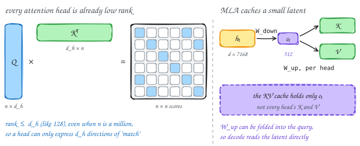
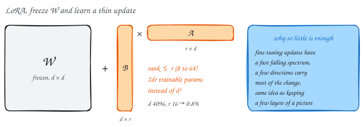

+++
aliases = ["/writes/the-bit-where-svd-starts-making-people-actual-money/", "/writes/2026-11-22-the-bit-where-svd-starts-making-people-actual-money/"]
title = "Decompositions inside transformers"
date = 2026-11-22
path = "writes/2026-11-22-decompositions-inside-transformers"
description = "Where SVD and its cousins hide inside modern LLMs, low rank heads, MLA, LoRA, RoPE, Muon, Shampoo, SSMs and steering directions, with hands-on visuals."
[taxonomies]
tags = ["math", "ml", "svd", "transformers", "interactive"]
+++

You know SVD is kinda the gigachad of Linear ALgebra. Quite literally absorbs so many imp concepts into one theorem, and on other end, extremely applicable to ML. Its literally a fuking decomposition that rules them all (Jordan, Spectral, QR, LU, Cholessky, Interpolative, Schur, Polar, Mostow, etcc). 

In undergrad, it mostly means [grinding through matrix arithmetic](https://www.youtube.com/watch?v=rYz83XPxiZo) untill three matrices multiplied back into the one I started with, which is boringg obviously (ー_ー；)

What actually made me care again is that modern LLMs are full of the same idea. Attention heads, the KV cache in DeepSeek, LoRA, RoPE, the optimizer Kimi K2 was trained with, Mamba style layers, even the way people switch off refusals, they are all some version of keep a few directions, rotate without stretching, or pick a basis where the maths falls apart into independent pieces. So this post is a tour of where each one sits.

<link rel="stylesheet" href="lab.css">
<noscript><p><strong>The interactive parts need JavaScript.</strong> The maths and the Python still read fine without it.</p></noscript>

## What SVD is

### What a matrix does

In simple terms, SVD says that any matrix, regardless of symmetry, rank, shape, can unconditionally can be decomposed into 3 beloved matrices

I mean, you probably remember this from class, but a real m × n matrix A is just a linear map from ℝ<sup>n</sup> to ℝ<sup>m</sup>, x ↦ Ax, and linearity, A(αx + βy) = αAx + βAy, means the whole map is pinned down by what it does to the standard basis, because Ae<sub>j</sub> is just the j-th column of A and every other input is a combination of the e<sub>j</sub>. Geometrically that forces a lot of structure, lines through the origin go to lines through the origin, parallelograms go to parallelograms, and the unit sphere in ℝ<sup>n</sup> goes to an ellipsoid in ℝ<sup>m</sup>, a flat one of dimension r whenever A has rank r.

And the SVD says this map always factors the exact same way, turn, stretch, turn- an orthogonal map, then a scaling along the coordinate axes, then another orthogonal map.

<div class="svd-equation" role="math" aria-label="A equals U Sigma V transpose. x maps to V transpose x, then to Sigma V transpose x, then to U Sigma V transpose x which equals A x">A = U Σ V<sup>T</sup><br>x ↦ V<sup>T</sup>x ↦ ΣV<sup>T</sup>x ↦ UΣV<sup>T</sup>x = Ax</div>

Here V ∈ ℝ<sup>n×n</sup> and U ∈ ℝ<sup>m×m</sup> are orthogonal, so V<sup>T</sup>V = I and U<sup>T</sup>U = I, and Σ ∈ ℝ<sup>m×n</sup> is zero everywhere except for σ₁ ≥ σ₂ ≥ … ≥ 0 down its diagonal. Read right to left, V<sup>T</sup> rotates (or reflects) ℝ<sup>n</sup> so the right singular vectors v<sub>i</sub> go to e<sub>i</sub>, Σ multiplies the i-th coordinate by σ<sub>i</sub>, and U rotates (or reflects) ℝ<sup>m</sup> so e<sub>i</sub> goes to the left singular vector u<sub>i</sub>. Orthogonal maps keep every length and angle, so all the stretching lives in Σ, and the visual below plays the three maps one at a time on the unit circle of a 2 × 2 matrix, with the actual numbers of each factor on top.

<section class="svd-lab" data-lab="geometry" id="geometry-lab" aria-labelledby="geometry-title">
<h4 class="lab-title" id="geometry-title">The unit circle under UΣV<sup>T</sup></h4>
<p class="lab-intro">Press play or click a step to apply V<sup>T</sup>, then Σ, then U, and drag the tip of x or use the θ slider to pick another input.</p>
</section>

Two things are worth trying in there, starting with the rank 1 matrix, where if you stop at ΣV<sup>T</sup>x you can see σ₂ = 0 wipe out the second coordinate, so the circle collapses onto a segment and U has no way of getting the lost direction back. Then try the one with a negative determinant, its singular values still come out positive, because the sign lives in U, which is the wierd little moment where the plane turns over during the last step (◎＿◎;)

If I had to keep just 1 equation from all of this, its this one.

<div class="svd-equation" role="math" aria-label="A v i equals sigma i u i">Av<sub>i</sub> = σ<sub>i</sub>u<sub>i</sub></div>

Feed in the special input direction v<sub>i</sub> and you get the special output direction u<sub>i</sub>, scaled by σ<sub>i</sub>. So its pairs of directions, and the 2 can even live in different spaces, while an eigenvector asks for something much stricter, the output has to point along the <em>same</em> direction as the input, which only makes sense for a square matrix in the first place.

### Why those directions

Take any unit vector x, and ask how long its output is.

<div class="svd-equation" role="math" aria-label="Squared norm of A x equals x transpose A transpose A x">‖Ax‖² = x<sup>T</sup>A<sup>T</sup>Ax</div>

The matrix A<sup>T</sup>A is symmetric and positive semidefinite, so its perpendicular eigenvectors tell you exactly which inputs come out longest. The biggest eigenvalue is the biggest <em>squared</em> stretch, so its square root is σ₁, and you repeat the same argument in the leftover perpendicular directions to get the rest of the singular values.

For σ<sub>i</sub> > 0, set u<sub>i</sub> = Av<sub>i</sub> / σ<sub>i</sub>. These output directions are perpendicular too, because their inner products reduce to v<sub>i</sub><sup>T</sup>A<sup>T</sup>Av<sub>j</sub> / (σ<sub>i</sub>σ<sub>j</sub>), which is zero whenever i ≠ j. Thats the whole reason the turn, stretch, turn picture works.

You can definately check a small case like this one by hand :)

<div class="svd-equation" role="math" aria-label="A is the matrix with rows 3 1 and 1 3. Its singular values are 4 and 2.">A = [[3, 1], [1, 3]]<br>v₁ = (1, 1)/√2 &nbsp; → &nbsp; Av₁ = 4v₁<br>v₂ = (−1, 1)/√2 → &nbsp; Av₂ = 2v₂</div>

For anything bigger just use a library, [NumPy's](https://numpy.org/doc/stable/reference/generated/numpy.linalg.svd.html) gives back U, the singular values as a vector, and V<sup>T</sup>.

```python
import numpy as np

A = np.array([[3., 1.], [1., 3.]])
U, s, Vt = np.linalg.svd(A, full_matrices=False)
print(s)                          # [4. 2.]
print(np.allclose((U * s) @ Vt, A))  # True
```

### A sum of layers

The same multiplication also reads in a completely different way, and ngl this is my favourite one, because almost everything below leans on it.

<div class="svd-equation" role="math" aria-label="A equals the sum of sigma i u i v i transpose">A = σ₁u₁v₁<sup>T</sup> + σ₂u₂v₂<sup>T</sup> + …<br>A<sub>k</sub> = ∑<sub>i=1…k</sub> σ<sub>i</sub>u<sub>i</sub>v<sub>i</sub><sup>T</sup></div>

Each outer product u<sub>i</sub>v<sub>i</sub><sup>T</sup> is a rank one matrix where every column is a scaled copy of the same vector, so if the matrix holds grayscale pixels, each term is a simple layer of stripes, and adding the layers back up rebuilds the picture. Keeping the first k layers gives the best possible approximation of rank k (the Eckart, Young and Mirsky result), and the error is just the squared σ's you threw away.

<section class="svd-lab" data-lab="compression" id="compression-lab" aria-labelledby="compression-title">
<h4 class="lab-title" id="compression-title">Rebuild a picture, one layer at a time</h4>
<p class="lab-intro">The landscape coming back one layer at a time, biggest σ first, with a count of how many numbers it costs.</p>
</section>

A handful of layers already looks like the photo, and thats the bet every low rank trick in a transformer makes, that the matrix only really uses a few directions.

## Where they sit

Modern LLMs are full of these moves, its just that the matrices are weights, caches, optimizer states and activations instead of pixels. here's where each one sits.

<figure class="diagram"><a href="decomp-map.svg"></a></figure>

## Low rank

low rank just means the matrix only really uses a few independent directions, so you can write it as a thin column block times a thin row block, the same layers-of-a-picture idea as the animation above.

### Every head is low rank

this one is hiding inside every attention head, and i didnt notice it for the longest time. A head scores n queries against n keys, but Q is n × d<sub>h</sub> and K is n × d<sub>h</sub>, so the n × n score matrix QK<sup>T</sup> has rank at most d<sub>h</sub>, usually 128, no matter if n is a thousand or a million. Multi-head attention is basically many small low rank maps running side by side, each head only gets d<sub>h</sub> directions of "what counts as a match", which is a big part of why more heads helps.

<figure class="diagram"><a href="attention-lowrank.svg"></a></figure>

### The LM head bottleneck

the same argument shows up again at the very top of the model, which was kinda a lightbulb moment for me. The last layer turns a hidden state h of size d into logits over the whole vocabulary with one matrix, logits = W<sub>out</sub> h, so if you stack the logits for every possible context into one big matrix, it has rank at most d. With d around 4096 and a vocabulary of 100k+ tokens, the model literally cant express every possible pattern of next token probabilities, which [this paper](https://arxiv.org/abs/1711.03953) called the softmax bottleneck, and its why people keep poking at bigger or mixed output layers ( ͡° ͜ʖ ͡°)

### MLA

[MLA](https://arxiv.org/abs/2405.04434), the attention DeepSeek-V3 and Kimi K2 use. Plain multi-head attention caches a K and a V for every head at every token, for DeepSeek-V3's 128 heads of size 128 thats ~32k numbers per token per layer. MLA pushes each hidden state through a learned down projection into a 512 wide latent, caches only that (plus a tiny 64 wide slice for RoPE), and rebuilds the per head K and V with up projections when it needs them. The up projection can even be folded into the query matrix, so decoding reads the latent directly and never builds the full K at all. Its a learned low rank factorisation, and the bet is that the K and V of all those heads live in a much smaller subspace than their size suggests. I go deeper on it in the [attention post](/writes/2026-07-18-all-sorts-of-famous-attention-layers/).

### LoRA

[LoRA](https://arxiv.org/abs/2106.09685) is how most of us fine-tune big models, and its a decomposition hiding in plain sight. it starts from a pretty simple question, when you fine-tune a model for a new task, how complicated is the change to each weight matrix really? and the paper bets its not very complicated at all.

> We hypothesize that the change in weights during model adaptation also has a low "intrinsic rank"

rank is just the number of independent directions a matrix can push along, nothing fancier. A d × d matrix could in principle use all d of them, but a rank r matrix is always a sum of r rank-one layers, a column times a row each, exactly like the picture layers above. Stack those r columns side by side and you get B, which is d × r, stack the r rows and you get A, which is r × d, so any rank r update can be written as ΔW = BA. thats literally the whole decomposition, and "low rank" just means r is tiny compared to d, like 16 vs 4096.

<figure class="diagram"><a href="lora-rank.svg"></a></figure>

so instead of learning a full d × d change, LoRA freezes W and learns only B and A, d·r + r·d numbers instead of d², and starts B at zero so the model begins exactly where the pretrained one was. after training you just add BA back into W, so inference costs nothing extra, which is kinda the best part tbh.

<figure class="diagram"><a href="lora.svg"></a></figure>

ok but why would a tiny r be enough? because the update you get from full fine-tuning tends to have a fast falling spectrum, a handful of directions carry most of it, which [this paper on intrinsic dimension](https://arxiv.org/abs/2012.13255) had already measured for fine-tuning in general. Its the compression animation again, the first few layers already look like the photo ;) The paper found ranks as small as 4 or 8 doing about as well as full fine-tuning on GPT-3, with 10,000× fewer trainable parameters.

```python
class LoRALinear(nn.Module):
    def __init__(self, base: nn.Linear, r=16, alpha=32):
        super().__init__()
        self.base = base.requires_grad_(False)          # W stays frozen
        d_out, d_in = base.weight.shape
        self.A = nn.Parameter(torch.randn(r, d_in) * 0.01)  # r × d_in
        self.B = nn.Parameter(torch.zeros(d_out, r))     # d_out × r, starts at 0 so BA = 0
        self.scale = alpha / r

    def forward(self, x):
        return self.base(x) + (x @ self.A.T @ self.B.T) * self.scale
```

## Rotations

orthogonal maps keep every length and angle, thats the U and V part of the SVD, and transformers lean on that in 2 big places.

### RoPE

[RoPE](https://arxiv.org/abs/2104.09864) is how almost every LLM rn tells attention where tokens are. It splits q and k into pairs of dimensions and rotates each pair by an angle that grows with the position, fast for the first pairs and slow for the last. The whole thing is a block diagonal orthogonal matrix R(m), so it never changes the length of q or k, and because R(m)<sup>T</sup>R(n) = R(n − m), the score q<sub>m</sub>·k<sub>n</sub> only depends on how far apart the 2 tokens are, not where they sit, which is honestly so neat (◕‿◕)

<figure class="diagram"><a href="rope.svg"></a></figure>

### Muon and the polar decomposition

the optimizer is my favourite one ngl. [Muon](https://kellerjordan.github.io/posts/muon/) is what [Kimi K2](https://arxiv.org/abs/2507.20534) was trained with, and it is literally the SVD with Σ thrown away. For every 2D weight matrix it takes the momentum G = UΣV<sup>T</sup> and steps along UV<sup>T</sup> instead, the same directions with every singular value set to 1. That UV<sup>T</sup> has a name, its the orthogonal factor of the polar decomposition G = (UV<sup>T</sup>)(VΣV<sup>T</sup>), a rotation times a pure stretch, and its the closest semi-orthogonal matrix to G.

why bother tho? momentum for a weight matrix usually has a few huge singular values and a long tail of tiny ones, so a plain step mostly pushes along the directions that were already moving, and the rare but useful directions barely learn. Flattening Σ gives every direction the same step size. Computing a real SVD every step would be way too slow, so Muon gets UV<sup>T</sup> with 5 Newton–Schulz iterations, a little polynomial applied to the matrix that only needs matrix multiplies, which GPUs love. Each iteration maps every singular value through σ ↦ aσ + bσ³ + cσ⁵ and leaves the singular vectors alone, so you can watch it in the same circle picture as the first visual.

<section class="svd-lab" data-lab="muon" id="muon-lab" aria-labelledby="muon-title">
<h4 class="lab-title" id="muon-title">Muon flattens the spectrum of an update</h4>
<p class="lab-intro">Each Newton–Schulz step pushes both singular values toward the same size while the directions stay put, so the squashed ellipse turns back into a circle.</p>
</section>

```python
def newton_schulz(G, steps=5):
    a, b, c = 3.4445, -4.7750, 2.0315        # tuned for speed, not exactness
    X = G / (G.norm() + 1e-7)                # biggest σ is now at most 1
    for _ in range(steps):
        S = X @ X.T
        X = a * X + (b * S + c * S @ S) @ X  # σ ↦ aσ + bσ³ + cσ⁵, same U and V
    return X                                  # ≈ U Vᵀ
```

The coefficients are tuned for speed, so σ ends up somewhere around 0.7 to 1.2 instead of exactly 1, which is totally fine for training (◕‿◕)

### Shampoo and SOAP

Muon has an older, heavier cousin, and the maths connecting them is lowkey beautiful. [Shampoo](https://arxiv.org/abs/1802.09568) keeps 2 small curvature matrices per weight, L = Σ GG<sup>T</sup> for the rows and R = Σ G<sup>T</sup>G for the columns, a Kronecker factorisation of the full curvature that would otherwise be impossibly big, and steps along L<sup>−1/4</sup> G R<sup>−1/4</sup>, which needs the eigendecomposition of L and R. the fun bit, if you drop the history and use only the current G, then L = UΣ²U<sup>T</sup> and R = VΣ²V<sup>T</sup>, and the update collapses to UΣ<sup>−1/2</sup>ΣΣ<sup>−1/2</sup>V<sup>T</sup> = UV<sup>T</sup>, which is exactly Muon (ﾉ◕ヮ◕)ﾉ [SOAP](https://arxiv.org/abs/2409.11321) runs Adam inside Shampoo's eigenbasis, and both show up in large training runs that want a stronger optimizer than AdamW.

## Diagonal

the third trick is picking a basis where a matrix becomes diagonal, which is the eigendecomposition A = PΛP<sup>−1</sup>, the square matrix cousin of the SVD. In that basis a matrix just scales each coordinate on its own, and that is what makes recurrent layers cheap.

### SSMs and linear attention

State space layers and linear attention keep a state and update it every token, roughly h<sub>t</sub> = A h<sub>t−1</sub> + B x<sub>t</sub>. with a full A thats a matrix multiply per token, which is slow af, but if A is diagonal the state splits into independent channels, each just decays by its own number, so the whole sequence can be computed with a parallel scan or in chunks. [S4](https://arxiv.org/abs/2111.00396) started from a structured A written as diagonal plus low rank, and [Mamba](https://arxiv.org/abs/2312.00752) went fully diagonal and made the decay depend on the input. The gates in GLA and Gated DeltaNet are the same idea, a diagonal decay on the state. I wrote about how this lines up with attention in the [state space duality part of the attention post](/writes/2026-07-18-all-sorts-of-famous-attention-layers/#state-space-duality).

## Directions inside the model

last one, and the most fun imo. If you look at a model's activations, a lot of behaviour turns out to sit along a few directions in the residual stream. The cleanest example is [refusal](https://arxiv.org/abs/2406.11717), take the difference between the average activation on harmful prompts and on harmless ones, and you get one direction r. Project it out of every activation, x ← x − r̂r̂<sup>T</sup>x, and the model mostly stops refusing, add it and it starts refusing harmless stuff xD [Steering vectors](https://arxiv.org/abs/2308.10248) do the same for style, sentiment or topic. Its the same "keep or drop a direction" decision as the whole post, applied to what the model is thinking instead of to a picture.

```python
r = (acts_harmful.mean(0) - acts_harmless.mean(0))   # difference of means, one direction
r = r / r.norm()
def ablate(x):                                        # x: (..., d) residual stream
    return x - (x @ r)[..., None] * r                 # orthogonal projection, removes r
```

what i like about all of these is that almost none of them call `svd()` in the hot path, the decomposition is the way of thinking, keep the directions that matter, rotate without stretching, pick the basis where things decouple, and the code just finds a cheap way to do exactly that. I really wish someone had shown me this side of it back in undergrad, would've made all that matrix grinding feel a lot less pointless (◕▽◕)

<script type="module" src="lab.mjs"></script>
