+++
aliases = ["/writes/inference-on-a-macbook/"]
path = "writes/2026-10-10-inference-on-a-macbook"
title = "squeezing a macbook for inference, kernel by kernel"
date = 2026-10-10
updated = 2026-10-12
draft = true
description = "Building Core and Dot inference incrementally: profiling and tuning an M5 Pro, isolating a portable MLX backend, fixing cache ownership and rounding, then measuring fresh and changed-question latency. The accepted changes, rejected experiments and unchanged accuracy checks."

[taxonomies]
tags = ["inference", "apple-silicon", "mlx", "metal", "performance", "gpus"]
+++

I had a dense model, a MacBook, and one question: how fast can this laptop *read* a prompt?

It's a decision model, not a chatbot. You give it a context and a few questions about it (is this a refund request, which team should handle it, how urgent is it), and the answer to each question is the probability of a handful of label tokens at the end. It never writes a single token. The GPU job is a forward pass over the prompt, the part of inference usually called prefill. The time a user waits also includes constructing and tokenizing the request, managing its cache, and collecting the answers. That distinction becomes important later.

The larger model is **Core**; its 0.9B sibling is **Dot**. This post builds their inference engine from the basics: what a MacBook's GPU is, how to see what it's doing, and each optimization in the order that taught me something. The first stage tunes the M5. The next isolates that hardware-specific work so the shared engine can use portable MLX operations, then follows cache ownership, CPU rendering and GPU normalization through controlled comparisons.

The checkpoints, architecture, tokenizer and bf16 weight and activation dtypes stay fixed. The implementation already uses fp32 for sensitive intermediate calculations. Every accepted change must pass the original probability-error limits and top-label checks; alternative floating-point reductions need not be bit-identical. Hypothetical architecture and precision changes in section 9 are comparisons, not changes made to these models.

*Updated 12 October 2026: sections 10–13 continue the experiment through portability, cache regressions, larger requests and the latest GPU work. Each table belongs to its own measured checkpoint; the original M5 numbers are not a before/after baseline for the later portable runs.*

## 1. What a MacBook GPU is

<figure class="diagram"><a href="m5-pro.svg">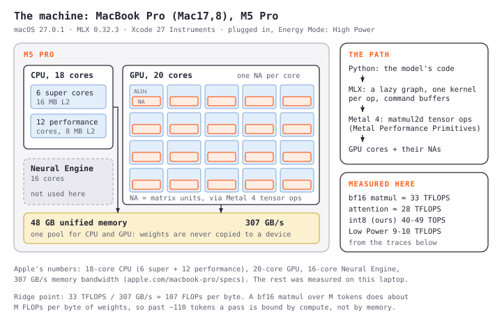</a></figure>

The laptop is a MacBook Pro with an [M5 Pro](https://www.apple.com/newsroom/2026/03/apple-introduces-macbook-pro-with-all-new-m5-pro-and-m5-max/): an 18-core CPU, a 20-core GPU and 48 GB of memory. Three things about it matter for everything that follows.

**The memory is shared.** There is no separate graphics memory: the CPU and GPU read the same 48 GB, at 307 GB/s. No copies between them, which is lovely, but also no fence: anything else running on the Mac competes for the same memory. The GPU can only keep part of it resident (MLX's `mx.device_info()` reports a recommended working set of 40.2 GB here, about 78%), and the model's weights, its cache of keys and values, and its activations all have to fit inside that.

**A GPU core runs threads 32 at a time.** Each group of 32 threads, a *SIMD group*, executes the same instruction in lockstep, and a kernel is launched as many *threadgroups* of a few SIMD groups each, spread over the 20 cores. Each core has ordinary arithmetic units, and on the M5, something new: a **Neural Accelerator**, a matrix-multiply unit inside every GPU core, reached through Metal 4's tensor operations (`matmul2d` in the [Metal Performance Primitives guide](https://developer.apple.com/download/files/Metal-Performance-Primitives-Programming-Guide.pdf)). M1 to M4 have no such unit; they multiply matrices on the ordinary arithmetic units. Apple's pitch for the M5 is prefill "up to four times faster" than the M4, precisely because prefill is matrix multiplication ([Apple's tech talk on the M5 GPU](https://developer.apple.com/videos/play/tech-talks/111432/)).

**[MLX](https://github.com/ml-explore/mlx) turns Python into GPU kernels.** Arrays are lazy: `y = x @ w.T` records an operation, and evaluating the result runs the whole graph, one Metal kernel per operation, encoded into command buffers that the GPU works through in order. Since macOS 26.2 MLX's matmul and attention kernels use the Neural Accelerators ([Apple Machine Learning Research](https://machinelearning.apple.com/research/exploring-llms-mlx-m5)). Measured on this laptop, its bf16 matmuls reach about **33 TFLOPS** at large sizes. That and the bandwidth are the two numbers that bound everything.

### The roofline

Every kernel either waits on memory or waits on arithmetic, and the [roofline model](https://dl.acm.org/doi/10.1145/1498765.1498785) says which. Divide the compute peak by the bandwidth: 33 TFLOPS over 307 GB/s is about **107 FLOPs per byte**. A kernel that does fewer FLOPs than that for each byte it reads is limited by memory; more, by compute.

<figure class="diagram"><a href="roofline.svg">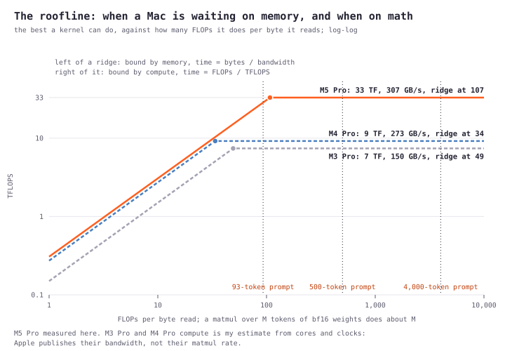</a></figure>

For a matmul the arithmetic is simple. Multiplying M tokens by a weight matrix of K × N does 2·M·K·N FLOPs and reads 2·K·N bytes of bf16 weights, so about **M FLOPs per byte**: the number of tokens. A prompt of more than about 110 tokens is compute-bound on this chip, and its time is its FLOPs divided by the TFLOPS achieved. A shorter one is bound by reading the weights. That gives every request a *floor*, the larger of the compute-time and memory-time lower bounds, and the honest score of an engine is how close it gets to that floor. That's the scoreboard for the rest of this post.

## 2. The model, as the GPU sees it

<figure class="diagram"><a href="architecture.svg"></a></figure>

Core is a plain dense decoder of 3.8B parameters outside its embeddings, and the figure is all of it that inference cares about. Two numbers come straight out of it.

**Matmul work per token.** Each layer runs four matmuls: qkv, o_proj, gate_up and down. Counting 2 FLOPs per weight per token, that's **7.55 GFLOPs a token** over 36 layers, and three quarters of it is the MLP (gate_up and down).

**Attention work per pair.** Every query attends to every earlier key, at 4 × head size × heads × layers = **589,824 FLOPs per query-key pair**. A causal prompt of n tokens has n(n + 1)/2 pairs, so attention grows with the square of the prompt: nothing at 500 tokens, most of the work at 32k.

And one thing about the prompt itself: the layout this model was trained on contains the context *twice*, plus the questions and their labels, about 2 × context + 85 tokens. A 500-token context is a 1,089-token prompt. Keep that in mind whenever a number is quoted "by context".

### How it differs from Liquid's d1

The other decision model on the market is [Liquid's d1](https://www.liquid.ai/blog/d1-open). Its 3B model is built very differently ([config](https://huggingface.co/LiquidAI/d1-3B/blob/main/config.json)): of its 30 layers only **8 are attention**, the other 22 short convolutions, with narrower heads of 64, and its prompt holds the input once. That's 4.87 GFLOPs a token and 65,536 FLOPs per pair, against this model's 7.55 G and 589,824. So for the same decision this model does **3.6 times d1's arithmetic** at a short input, 3.9 times at 3.4k tokens, 6.3 at 16k and 8.9 at 32k, and the gap grows with length because all of its layers are attention.

Liquid measured d1-3B on this exact chip, an M5 Pro, from PyTorch on the GPU in bf16 ([model card](https://huggingface.co/LiquidAI/d1-3B)): 30 ms for one question about a short input, 41 ms for three questions, 640 ms for a 3.4k-token input. Against the floor of its own arithmetic that's about **1.2 times**. No engine changes how much arithmetic a model needs; what it can change is how close to the floor that arithmetic runs. 1.2x is the bar to beat.

## 3. Seeing what the GPU does

Before optimizing anything, you need to see it. Xcode ships Instruments and its command-line twin, `xctrace`, and the **Metal System Trace** template records every command buffer the GPU ran, on the GPU's own clock, along with the GPU's performance state and what the driver was doing ([Apple's Metal tools](https://developer.apple.com/metal/tools/)):

```sh
xcrun xctrace record --template 'Metal System Trace' --output gpu.trace \
    --launch -- python bench/speed.py <model> --shapes single500
xcrun xctrace export --input gpu.trace --toc
```

Two tricks turn that into a per-kernel profile. First, the Metal Application instrument has an "Enable Shader Timeline" checkbox that records which shader is running, by name; there's no command-line flag for it, so you tick it in Instruments and save a template of your own. Second, MLX commits a command buffer once it holds more operations than `MLX_MAX_OPS_PER_BUFFER`; set that to 0 and every operation is its own buffer, so every interval in the trace is exactly one kernel. Because a transformer runs the same operations in the same order in every layer, each buffer can then be named by its place after the layer's attention kernel.

<figure class="diagram"><a href="instrumentation.svg">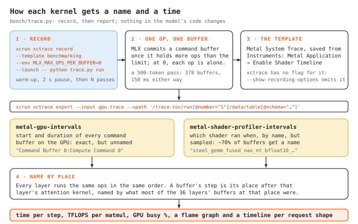</a></figure>

<figure><a href="instruments-trace.png">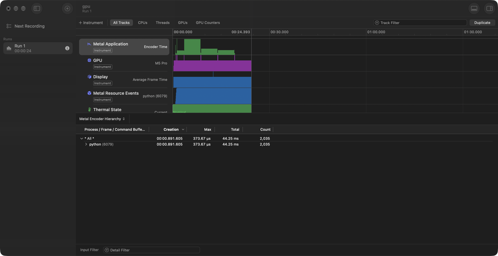</a></figure>

For this 500-token scoring pass, **the GPU was busy 149.2 ms of the pass's 150.5**. MLX encoded command buffers about 20 ms ahead of the GPU: there was almost no idle time for fewer Python calls or launches to recover in this workload. The trace directed me toward reducing GPU work or making the kernels faster. It didn't measure the request-rendering work before scoring, and it didn't rule out different overheads in cached or multi-question requests.

So which kernels? A [flame graph](https://www.brendangregg.com/flamegraphs.html) answers that at a glance. Read it bottom up: the request, then all 36 layers merged into one frame, split into the attention and MLP blocks, then each step, then the MLX kernel it ran. Every frame is as wide as its share of the GPU's time ([this version](flamegraph-single500-layers.svg) keeps the layers apart; click a frame to zoom).

<figure class="diagram"><a href="flamegraph-single500.svg">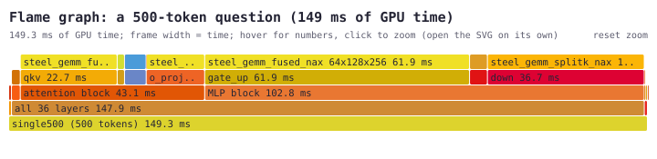</a></figure>

For a short request, it's the matmuls: 136 of 149 ms, with gate_up alone 62. Attention, the part everyone talks about, is 5 ms. That changes as prompts grow, and it's why later sections treat short and long requests differently.

### Measuring honestly on a laptop

A laptop is a terrible benchmark machine, and most of my wrong turns were the laptop, not the code. What fooled me:

- **Energy Mode.** Low Power Mode holds this GPU at 9 to 10 TFLOPS instead of 33: everything three times slower. It's set separately for battery and charger, and "Automatic" isn't "High Power" (`pmset -g` says which you're in).
- **The charger.** A 65 W adapter doesn't cover a sustained full GPU; the battery drained "while charging", and on a weaker charger at low battery the longest requests ran 2.5 to 4 times slower. `system_profiler SPPowerDataType` shows what the laptop negotiated.
- **Other people's memory.** Because memory is shared, a paused job elsewhere holding 25 GB pushed 10 GB into swap mid-run and made end-to-end numbers 30 to 60% worse. A paused process keeps its memory.
- **Background services.** iCloud, syncing a Desktop full of build output into a full iCloud account, sat at 85 to 100% CPU for hours, and moving the files set Spotlight re-indexing everything.
- **Heat.** An hour of heavy runs left the next ones up to 20% slower in their first rounds than in their last.

For this first M5 tuning stage, the useful discipline was an **A/B in fresh processes, alternating** A B B A, so drift lands on both arms; logging swap, Energy Mode and background CPU next to the results; and comparing a result to its floor, which makes a 10% outlier stand out. Accuracy checks compared the reference implementation's answers and a full fp32 run of the same 119 decisions. Later experiments keep their own workload definitions and sample counts beside their tables.

## 4. Do less work

The cheapest FLOP is the one you don't compute. Four ideas here, all exact: the answers don't change.

**One pass for all the questions.** A request's questions share its context. Run them one pass each and the context is processed once per question. Instead, put the context and every question's own tokens in one pass under a *tree mask*: the context attends causally, each question to the context and to itself. This is the prefix-sharing idea behind [SGLang's RadixAttention](https://arxiv.org/abs/2312.07104) and [Hydragen](https://arxiv.org/abs/2402.05099), squeezed into one call. A 2,000-token context with five questions went from 945 ms to 725.

**How an attention kernel works.** For each block of, say, 64 queries, the kernel walks the keys 32 at a time: multiply the queries by those keys to get scores, keep a running softmax (each row's maximum and sum so far, rescaling what's been accumulated whenever the maximum grows), and multiply the resulting weights by the values into an output tile. That's the trick of [FlashAttention](https://arxiv.org/abs/2205.14135): the full table of scores, n × n, never exists in memory. And with a causal mask, a block of queries never needs the keys after it, so a good kernel skips those blocks entirely, which halves the work.

**Don't let a mask switch off the shortcut.** The trace then showed something odd: that five-question request ran attention at 11 TFLOPS of *useful* work, a third of normal. MLX's attention kernel skips the blocks above the diagonal only in its built-in `"causal"` mode; given any other mask, it computes every block and throws the masked ones away ([scaled_dot_product_attention.cpp](https://github.com/ml-explore/mlx/blob/v0.32.3/mlx/backend/metal/scaled_dot_product_attention.cpp)). The fix is to split the call: the context rows go through causal mode, and only the questions' few hundred rows use the mask.

<figure class="diagram"><a href="tree-attention.svg">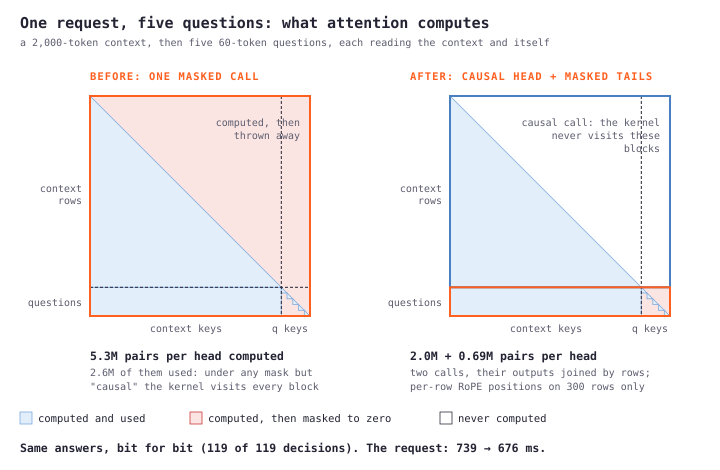</a></figure>

741 ms became 679, 8.5% faster, and the answers came out **bit-identical**, because the skipped blocks only ever contributed zeros.

**Compute only what's read.** Nothing reads the last layer's output except at the answer positions, so the last layer runs on a handful of rows instead of all of them. And the answer is a probability over a few labels, which needs only those labels' rows of the output matrix, not a softmax over the whole 250k-token vocabulary: 1.3 GB of weights never read.

**Keep what you've read.** Every layer turns each token into a key and a value that later tokens attend to, and those depend only on the tokens before it. So a request that starts like an earlier one has the same keys and values for that start, and can reuse them instead of recomputing them: that's the KV cache, kept between requests. The same 8.9k-token request again took 54 ms instead of 3.4 s, and another question about a context already sent costs 0.55 to 0.75 of the first, at every length. (Not less, because this model's layout puts each question before the context's second copy.)

Long prompts also run in 4,096-token chunks, which halves the peak memory at 32k (31 to 16 GB) and is slightly faster. One lesson from trying bigger chunks: at 8,192-token chunks, every kernel I measured got faster in the trace, and the requests didn't (1.003 at 32k in the A/B). A kernel getting faster is a hypothesis; only the request's clock decides.

And this is what "attention grows with the square" looks like. A 32k prompt in eight chunks: each chunk attends to everything before it, so each is wider than the last, and by the end the blue attention frames are most of every chunk.

<figure class="diagram"><a href="flamegraph-long32768.svg">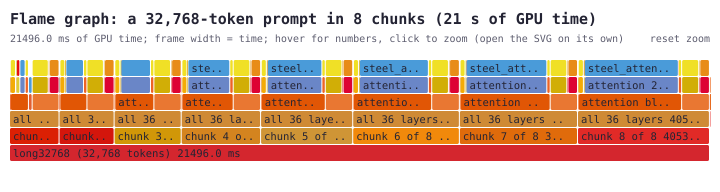</a></figure>

## 5. Keep the GPU ready

Real requests don't arrive back to back, so I measured a 500-token request after idle gaps from 20 ms to 30 s. Two things happen when a Mac's GPU sits idle.

After half a second, its clock drops, and the next request's first 12 ms run at the minimum clock. After about five seconds, something much worse: macOS lets the GPU's hold on its memory go. The next request then waits while the driver wires the whole model back in. The trace shows 362 "Wire Memory" events, 10.2 GB, and 66 ms before the GPU even starts.

<figure class="diagram"><a href="cold-start.svg">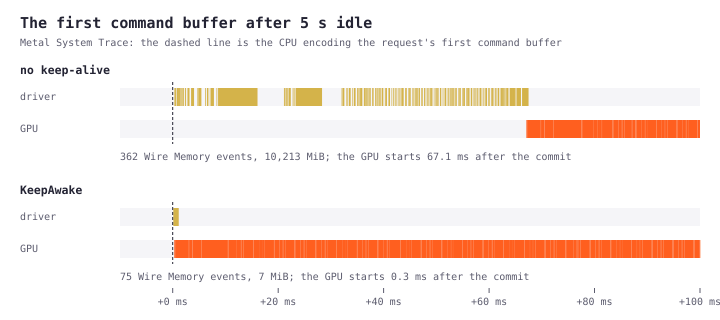</a></figure>

The fix is almost silly: a background thread that runs a 16-element add on the GPU once a second. That's enough to keep the memory wired, and a request after 5 to 30 seconds of idle went from **226 to 153 ms, 32% faster**. What it can't do is hold the clock up: a busier keep-alive slowed every other request and the 12 ms stayed. The clock only stays up under real load.

## 6. Faster matmuls

That leaves the kernels themselves, and for short requests that means the matmuls. To make one faster, you first need to know what it does.

<figure class="diagram"><a href="matmul-anatomy.svg">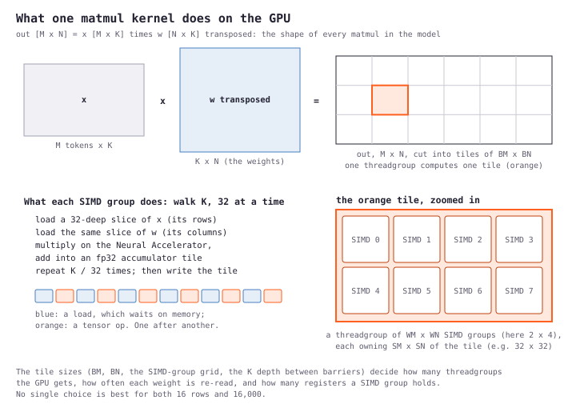</a></figure>

The output is cut into tiles; each threadgroup computes one; inside it, each SIMD group owns a piece and walks the shared dimension 32 elements at a time, loading a slice of the inputs and feeding it to the Neural Accelerator. The tile's shape is the knob. Big tiles re-read the weights less often but give the GPU fewer threadgroups; small tiles give it plenty of parallel work but re-read more. The right answer depends on how many rows (tokens) there are.

### One tile size doesn't fit all

MLX picks one tile for every matmul on this GPU: 64 × 128, each SIMD group computing 32 × 32 ([matmul.cpp](https://github.com/ml-explore/mlx/blob/v0.32.3/mlx/backend/metal/matmul.cpp)). At a few thousand rows that runs at 30+ TFLOPS. At a few hundred, the trace said 18 to 26: too few threadgroups for 20 cores, each doing too little.

MLX ships its kernel library as headers inside the Python wheel, including the tile machinery its matmul is built from, and `mx.fast.metal_kernel` lets you compile your own kernel from source with any template parameters ([custom Metal kernels](https://ml-explore.github.io/mlx/build/html/dev/custom_metal_kernels.html)). So the plan was MLX's own matmul with the tile shape as a parameter, and a tuner that tries every reasonable shape for each of the model's four weight shapes at each band of token counts. One lesson came in the first hour: **84 of 252 tile configurations compile and compute the wrong thing**, and my first tuner, which didn't check results, reported one at 84.6 TFLOPS, past the chip's peak. Every candidate is now checked against MLX's own matmul before it's timed.

### Two measurement lessons that mattered more than the tiles

**The threadgroup's shape.** My kernels were 7 to 35% slower than MLX's own at the *same* tile, with bit-identical output. I assumed it was the runtime compiler against MLX's precompiled kernels, and was about to build a C++ extension to fix it. Testing the cheap hypotheses first, nothing in the source mattered: not compile-time sizes, not barriers, not swizzling. What mattered was how the threadgroup was laid out. MLX launches its matmul's threadgroups as 32 × WN × WM threads; I'd passed the obvious flat 256 × 1 × 1. The SIMD groups are the same either way, and so is every output bit, but the GPU schedules them differently:

<figure class="diagram"><a href="threadgroup-layout.svg">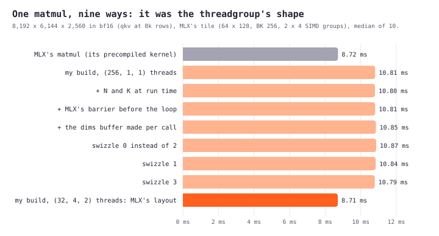</a></figure>

**Measure kernels the way the program runs them.** The tuner timed eight matmuls at once on separate weight copies, so that small sizes weren't served from cache. Those eight are independent, and MLX's encoder runs independent kernels *concurrently*, inserting a barrier only when one kernel reads what another wrote ([device.cpp](https://github.com/ml-explore/mlx/blob/v0.32.3/mlx/backend/metal/device.cpp)). So the GPU overlapped them, and a tile with a slow last wave looked fine. In the model every matmul waits for the one before, and pays that tail in full. The rankings didn't just shrink, they flipped:

<div role="region" aria-label="Matmul timing: independent kernels and dependent chains" tabindex="0" style="overflow-x: auto;">
<div style="min-width: 620px;">

| Matmul | rows | 8 independent: MLX → tile | 8 in a chain: MLX → tile |
|---|---|---|---|
| o_proj | 93 | 0.168 → **0.137 ms** | 0.170 → 0.186 ms |
| o_proj | 1,069 | 0.858 → 1.144 ms | 0.863 → **0.814 ms** |
| down_proj | 93 | 0.380 → **0.318 ms** | 0.406 → 0.407 ms |

</div>
</div>

An end-to-end A/B caught it, when tiles that were faster in the tuner made the model slower. The tuner now times a dependent chain, then re-times its three best candidates against MLX in alternating rounds before choosing. This is the result, tile by tile:

<figure class="diagram"><a href="matmul-retuned.svg">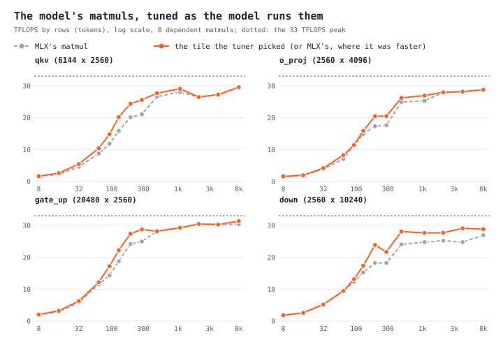</a></figure>

The tuned tiles win most at a few hundred rows, and where MLX's tile is already right (most large sizes), the table simply uses MLX's matmul. A 285-token request went from 101.7 to 88.3 ms, and the second tuning added 5 to 10% on short prompts and 2 to 6% on long ones.

### A few rows: waiting on memory

The shortest requests were still far from their floor. A trace of a 93-token request on the smaller sibling model (more on it below) showed why: nearly 90% of the time in matmuls that each took 70 to 100 µs regardless of size. o_proj moves 6 MB of weights, which memory delivers in 20 µs, and took 90.

That's the signature of a *latency-bound* loop. With a few dozen rows, a matmul is only a hundred or two SIMD groups. Each walks K one slice at a time: load, wait for memory, multiply, load the next. With thousands of rows, many SIMD groups per core take turns and hide each other's waits. With a few dozen, there's no one to take turns with.

<figure class="diagram"><a href="prefetch-timeline.svg">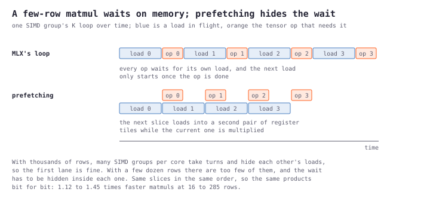</a></figure>

The classic fix is **prefetching**: load the next slice into a second set of registers while the current one is being multiplied, so the wait overlaps the work. Because it walks the same slices in the same order, its results are bit-for-bit identical to MLX's loop, checked across 76 shapes and row counts. It became one more option the tuner can pick per tile, and it won most of the bands from 16 to 285 rows, 1.12 to 1.45 times MLX's matmul. (I also tried split-K, cutting K into pieces run in parallel and adding the partial sums: it won at 16 rows and lost from 192 up, where writing the partials costs more than the parallelism buys.)

<div role="region" aria-label="Model latency before and after kernel tuning" tabindex="0" style="overflow-x: auto;">
<div style="min-width: 620px;">

| Prompt tokens | small model: before | after | big model: before | after |
|---|---|---|---|---|
| 16 | 12.6 ms | **11.6 ms** | 42.9 ms | **38.3 ms** |
| 32 | 12.1 ms | **10.6 ms** | 42.2 ms | **36.9 ms** |
| 93 | 13.4 ms | **11.8 ms** | 46.5 ms | **43.7 ms** |
| 285 and up | the same | | the same | |

</div>
</div>

Those few-row matmuls are everywhere in practice: follow-up questions on a context already sent, each question's own tokens, and every request's last layer.

### Fusing what's left

The residual add and the RMSNorm after it were already one kernel of my own, with the reference's rounding: 4.4 times faster than the compiled MLX version at 32k rows, which left its fp32 intermediates in memory. One more small win of the same kind: gate_up writes a 20,480-wide output only for the next kernel to read it back, compute SwiGLU, and write half of it. With my own matmul kernel, I can do SwiGLU in its *epilogue*. Interleave the gate and up weights 16 rows at a time, and each thread ends up holding a gate and its matching up in its accumulators, so it can compute silu(gate) × up directly and write half as much. It's 2 to 3% faster, and it rounds once instead of three times, so its error against fp32 is 2.3 times smaller.

What didn't help, measured: a port of MLX's attention kernel with bigger blocks, more rows per threadgroup and FlashAttention-4's lazy rescaling matched MLX but never beat it by more than 1%. Grouping each KV head's query heads into one threadgroup was slower (22 against 26 TFLOPS). The CPU beside the GPU manages 0.2 to 0.5 TFLOPS against 33. And 8- or 4-bit weights are *slower* for a compute-bound prompt (173 against 145 ms at 500 tokens): they save memory, not time.

## 7. The same engine on a smaller model

Dot is the 0.9B sibling, the same layer 28 times at 1,536 wide, which does 4.3 times less matmul work per token. Everything structural carried straight over: one pass per request, the causal split, the read-out rows, KeepAwake, the fused kernels, the threadgroup layout. What doesn't carry over is the tile table, because it's keyed by weight shape and all four shapes are new. Tuning its own table made it 3 to 15% faster on short prompts, and it's where the prefetching loop was found.

One check worth doing on any port: is it as accurate? Against its own fp32 run, the small model in bf16 lands a bit further away than the big one (a p95 difference of 0.019 to 0.028, against 0.0105). Putting the reference implementation's own bf16 run next to it settles whether that's the port: the reference is just as far from fp32, 0.0006 to 0.0124 on the parity requests against our 0.0005 to 0.0079. It's bf16 on a narrower model, not the engine.

## 8. The first M5 checkpoint

**Measurement correction, 12 October:** A later full sweep found that the synthetic benchmark sampled token IDs through 199,999, outside Dot’s 64,256-entry vocabulary. The earlier Dot synthetic prompt-speed and throughput figures are invalid and must not be used as a baseline. Core’s IDs were in range; real decision requests used tokenizer-produced IDs and were unaffected. The generator now uses the loaded embedding size and rejects non-finite logits. [The corrected full sweep](https://github.com/harsh-sqwish/local-models-benchmarking/blob/6eca5ef/results/final-latency-20261012/summary.json) records fresh measurements with unchanged models and inference code.

These are the original tuned-M5 measurements, before the portable-backend and shared-path experiments below: plugged in, High Power, bf16. They show where the first stage landed, rather than serving as a controlled baseline for a later stage with a different workload or backend. First, pure model speed: how long each model takes to read a prompt of a given length and answer one question.

<div role="region" aria-label="Original M5 model speed" tabindex="0" style="overflow-x: auto;">
<div style="min-width: 620px;">

| Prompt tokens | Core: time | Core: tokens/s | Dot: time | Dot: tokens/s |
|---|---|---|---|---|
| 500 | 129 ms | 3,870 | **34 ms** | 14,840 |
| 1,000 | 261 ms | 3,830 | **66 ms** | 15,060 |
| 2,000 | 537 ms | 3,720 | **135 ms** | 14,860 |
| 4,000 | 1.14 s | 3,520 | **290 ms** | 13,780 |
| 8,000 | 2.64 s | 3,030 | **688 ms** | 11,620 |
| 16,000 | 6.90 s | 2,320 | **1.83 s** | 8,720 |
| 32,000 | 20.6 s | 1,550 | **5.51 s** | 5,800 |

</div>
</div>

That's **86 to 93% of the chip's limit** for the big model from 500 to 16k tokens, and 82 to 96% for the small one.

Then real decisions, end to end through the decision API: a context and questions go in as JSON, the prompt is built (with the context twice), scored, and the answers come out. "Follow-up" is another question on a context already sent.

<figure class="diagram"><a href="two-models-latency.svg">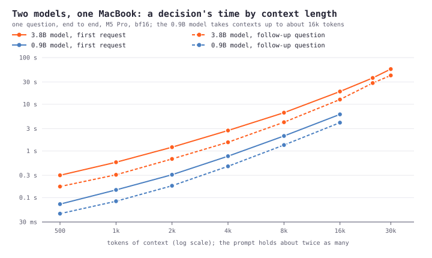</a></figure>

<div role="region" aria-label="Original M5 real-decision latency" tabindex="0" style="overflow-x: auto;">
<div style="min-width: 620px;">

| Context | Questions | Core: first decision | Core: follow-up | Dot: first decision | Dot: follow-up |
|---|---|---|---|---|---|
| 500 tokens | 1 | 301 ms | 173 ms | **72 ms** | **45 ms** |
| 500 | 4 | 394 ms | 270 ms | **108 ms** | **80 ms** |
| 2,000 | 1 | 1.20 s | 0.67 s | **309 ms** | **179 ms** |
| 8,000 | 1 | 6.61 s | 4.12 s | **2.10 s** | **1.34 s** |
| 16,000 | 1 | 18.8 s | 12.6 s | **6.07 s** | **4.04 s** |
| 30,000 | 1 | 56.8 s | 41.6 s | | |

</div>
</div>

(The 32k model-speed row and the 30k context row ran while macOS was indexing in the background, and are probably 5 to 10% slow. The small model takes contexts up to about 16k.)

Four questions cost 3 to 50% more than one, not four times. And here is the big model's journey against its floor, version by version, from MLX's kernels to where it is now:

<figure class="diagram"><a href="progress-by-version.svg">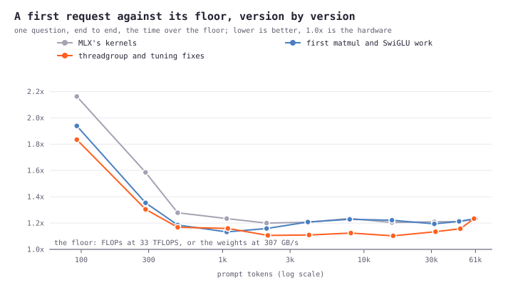</a></figure>

From 1.2 to 1.3 times the floor down to 1.09 to 1.17 across the middle, and the shortest requests from 2.2 times to 1.8. That's past the 1.2x bar d1 sets on the same chip.

<!-- D1-SAME-WORKLOADS -->

## 9. The questions underneath

### How does a model's architecture decide its speed on a Mac?

Four numbers, all computable from a model's config before running it:

<div role="region" aria-label="Model architecture and arithmetic costs" tabindex="0" style="overflow-x: auto;">
<div style="min-width: 620px;">

| Quantity | Formula | This model | Its 0.9B sibling | d1-3B |
|---|---|---|---|---|
| matmul FLOPs per token | 2 × parameters outside the embeddings | 7.55 G | 1.76 G | 4.87 G |
| attention FLOPs per query-key pair | 4 × head size × query heads × attention layers | 589,824 | 229,376 | 65,536 |
| KV cache per token | 2 × KV heads × head size × attention layers × 2 bytes | 147 KB | 57 KB | 16 KB |
| weights in bf16 | 2 bytes × all parameters | 10.1 GB | 2.2 GB | about 5.4 GB |

</div>
</div>

The first two give the work (matmuls grow with the prompt, attention with its square); the roofline turns work into time. The last two decide whether it fits in the GPU's share of unified memory: a 24 GB Mac holds this model's weights, but not a 61k-token request's 9 GB of cache on top.

Then come the Mac-specific details. MLX's fast attention on the Neural Accelerators only takes certain head sizes (64, 96, 128, 256 and 512, per [its dispatch code](https://github.com/ml-explore/mlx/blob/v0.32.3/mlx/backend/metal/scaled_dot_product_attention.cpp)); anything else falls back to a much slower path. Matrix sizes that are multiples of 128 tile without waste. And small models or short prompts sit in the few-rows regime of section 6, where the GPU isn't full no matter how few FLOPs there are: the small model's 93-token request runs at 48% of its floor, its 8k one at 94%.

### What happens if the attention changes?

This is an arithmetic thought experiment, not an engine optimization or a modification to Core. Holding its matmuls fixed and changing only its attention, here's the floor (at 33 TFLOPS) and the cache:

<div role="region" aria-label="Hypothetical attention costs" tabindex="0" style="overflow-x: auto;">
<div style="min-width: 620px;">

| Attention | 2k-token prompt | 16k | 61k | KV cache at 61k |
|---|---|---|---|---|
| as built: 36 layers of attention, heads of 128, 8 KV heads | 0.49 s | 5.95 s | 47.8 s | 9.1 GB |
| attention in 8 of the 36 layers (d1's ratio) | 0.47 s | 4.17 s | 21.6 s | 2.0 GB |
| heads of 64 instead of 128 | 0.48 s | 4.80 s | 30.9 s | 4.5 GB |
| a 4,096-token sliding window | 0.49 s | 4.68 s | 18.4 s | 0.6 GB |
| 2 KV heads instead of 8 | 0.49 s | 5.95 s | 47.8 s | 2.3 GB |

</div>
</div>

Three lessons in that table. **At short prompts attention doesn't matter**: it's 7% of a 2k-token prompt, and nothing done to it moves a short decision. **At long prompts it's the bill**: 38% at 16k, 71% at 61k, so fewer attention layers, narrower heads or a window cut long requests by 1.5 to 2.6 times. That's exactly the trade d1 made. And **fewer KV heads change memory, not speed**: the cache shrinks four times, which on a Mac means a longer context fits, not a faster one. One caveat specific to Macs: these are arithmetic floors, and the kernels for convolutions or windowed attention on Metal are younger than MLX's attention.

The prompt layout weighs as much as any of this. Reading the context once instead of twice would halve a 1k-token context's floor and cut a 30k-token one to a third (47.8 to 15.5 s), because attention is quadratic in the prompt.

### What happens if other things change?

- **Width, depth and MLP size** set the per-token cost in direct proportion to the parameters; at short prompts that's nearly the whole time, and the MLP is three quarters of it.
- **The vocabulary** costs memory and almost no time, for a model that reads only its label rows: 2.6 GB of this model's 10.1 is embedding and output head.
- **Smaller isn't proportionally faster.** The sibling does 4.3 times less matmul work but runs 3.7 to 4 times faster: both are in the few-rows regime at the short end, and at the long end its attention is relatively heavier (39% of the big model's per pair, against 23% per token).
- **Precision** helps only where it's compute. int8 weights and activations run at 40 to 49 TOPS on the Neural Accelerators against bf16's 30 TFLOPS: 1.25 to 1.35 times faster end to end, with answers moving up to 0.04. Weight-only quantization saves memory and slows prefill.

### What's the difference between an M5 and an M3, or an M4?

<div role="region" aria-label="Apple GPU roofline estimates" tabindex="0" style="overflow-x: auto;">
<div style="min-width: 620px;">

| | M3 Pro | M4 Pro | M5 Pro |
|---|---|---|---|
| GPU cores | up to 18 | up to 20 | up to 20 |
| matrix units in the GPU | none | none | a Neural Accelerator per core |
| bf16 matmul throughput | about 7 TFLOPS (estimate) | about 9 (estimate) | 33, measured here |
| memory bandwidth | about 150 GB/s | 273 GB/s | 307 GB/s |
| ridge of the roofline | about 49 FLOPs per byte | about 34 | 107 |
| a 500-token prompt's compute floor, this model | about 0.52 s | about 0.42 s | 0.12 s |

</div>
</div>

(Bandwidths and core counts from Apple's announcements, [M4 Pro](https://macrumors.com/2024/10/29/apple-announces-m4-pro-chip) with 75% more bandwidth than M3 Pro, and the [M5 Pro](https://www.businesswire.com/news/home/20260303427628/en/Apple-debuts-M5-Pro-and-M5-Max-to-supercharge-the-most-demanding-pro-workflows). Apple doesn't publish matmul rates for the older chips; those are my estimates from cores and clocks.)

For prefill, **the M5's matrix throughput matters much more than it does for generation**. The estimates above put it at about 3.6 times the M4 Pro's matmul throughput. Apple's own MLX measurements report 3.3 to 4.1 times faster prefill on M5 than M4, while *generating* text improved by 19 to 27% because generation depends more on bandwidth ([Apple Machine Learning Research](https://machinelearning.apple.com/research/exploring-llms-mlx-m5)). Those are Apple's workloads, not a measured Core or Dot speedup. The older-chip estimates explain why I'd expect a different balance of bottlenecks; the actual requests still need to be run.

The M5 tensor-operation kernels in section 6 can't run on M1 to M4. The engine now has a portable MLX backend for that boundary, described in section 10, while retaining the M5 implementation. The roofline estimates suggest lower prefill throughput on older chips, but I haven't measured Core or Dot on them: multiplying an M5 latency table by a single factor would hide differences in attention, kernel selection and memory pressure. Memory capacity also limits the usable context independently of compute speed.

### The next experiments

At this checkpoint, these were the directions to investigate. The cache work became part of the next stage; batching and device-specific attention tuning remain open. The int8 result is a separate precision experiment and is excluded from the accepted bf16 engine changes in this post:

1. **int8 with a [Hadamard rotation](https://arxiv.org/abs/2404.00456)** to tame outlier channels: 1.25 to 1.35 times faster, measured, for answers that move a little. The biggest lever left on an M5, and a precision trade.
2. **Batching concurrent requests.** Short requests are stuck in the few-rows regime; packing several into one pass fills the GPU. One 285-token pass takes 84 ms, about the work of three 93-token requests at 44 ms each: roughly 1.6 times the throughput for an agent firing many small decisions.
3. **Split-K for the very smallest sizes**, chosen per band like prefetching: 1.14 to 1.71 times per matmul at 16 rows.
4. **Kept prefixes without copies.** The original 24k to 30k repeats spent 0.4 to 1.2 s copying caches. Section 11 follows the storage-reuse change, the regression it later exposed, and the controlled measurements of its fix.
5. **Prefixes shared across requests**, such as a system prompt or one document asked about by many agents, using the same machinery as follow-up questions.
6. **Attention at long contexts**, overlapping the softmax between its two matmuls with the next block's matrix work, the trick [FlashAttention-3](https://arxiv.org/abs/2407.08608) uses on NVIDIA's Hopper, if the M5's SIMD groups allow it.

## 10. Carrying the engine across hardware

The M5 work left a useful engine and an awkward dependency: some of its fastest operations only existed on this chip. I wanted the same inference improvements to carry to an older Mac or an NVIDIA GPU. The first step was to draw a boundary through the code.

Prompt construction, the prefix tree, the KV cache, chunking and the last-layer shortcut all describe *what to compute*. The tile table, Metal tensor operations, fused kernels and wired-memory policy describe *how this Mac computes it*. The former stayed shared. The latter moved behind a backend selected once, when the model loads.

<figure class="diagram"><a href="portable-backends.svg">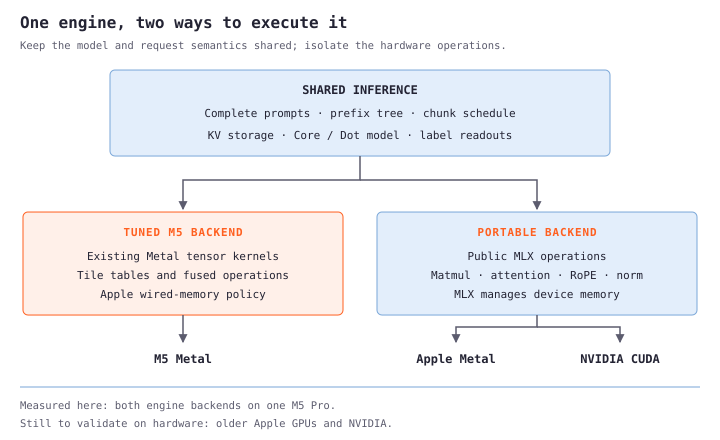</a></figure>

The `metal` backend keeps the existing M5 code. The `portable` backend uses public MLX matmul, RoPE, attention, elementwise and reduction operations, leaving memory management to MLX. `auto` selects the tuned path when the required Metal capabilities are present and the portable path otherwise. CUDA execution does not need to import my Metal kernels or query Apple's device properties. [The split and its checks](https://github.com/harsh-sqwish/local-models-benchmarking/blob/ceafa8a/PORTABILITY.md) are small enough to inspect.

That gives the code a portable route. It does not give me NVIDIA timings. Every measurement in this update is still from the M5 Pro, sometimes running the tuned backend and sometimes MLX's portable operations. Running the portable backend on an M5 still invokes MLX's implementations for an M5. It doesn't simulate an M2, M3, M4 or NVIDIA GPU.

### The first problem was accuracy

Core uses grouped RMSNorm: statistics are computed separately for two groups of hidden channels. Dot uses one group. There is also an important rounding boundary: add the residual, round it to the activation dtype, then compute statistics and apply the normalization weight in fp32.

The first Core portability failure appeared when the same request ran in small chunks. Moving the existing tolerance would have made the test green and left the problem in the engine. Instead, I traced an avoidable rounding point in the portable SwiGLU activation. It rounded SiLU to bf16 *before* multiplying by the up projection. Computing both in fp32 and rounding the completed product once brought the chunked reference error from **0.01211 to 0.00879**, below the existing **0.01** limit. The M5 activation paths kept their original implementations.

This is what I mean by preserving the model throughout these changes: no retraining, weight edits, architecture changes, tokenizer changes or new quantization. Floating-point execution can still change the probabilities slightly. The gates stay fixed: maximum absolute probability error of **0.01 for Core**, **0.03 for Dot**, finite outputs and matching top labels. Fresh, cached and independently chunked execution are checked against the fixed CPU references. "Same model" does not mean every alternative GPU reduction must be bit-identical.

## 11. Making the shared path do less work

With hardware-specific code isolated, the next opportunities were things both backends did unnecessarily.

### Reuse storage as well as tokens

The cache already avoided recomputing a retained prefix. But taking that prefix could still allocate a new cache, zero it, and copy the old keys and values into it. When the retained allocation is large enough and has the right dtype, the new request can instead borrow distinct views of that storage. MLX's copy-on-write behavior preserves an independent reader when a request writes new tokens. Larger requests and dtype changes retain the copy path.

That needs ownership tests, not just a latency test: two borrowers must be able to diverge without corrupting each other. Shorter requests must not read old tail tokens. Cache eviction must count the storage actually retained. In the [first shared-cache experiment](https://github.com/harsh-sqwish/local-models-benchmarking/blob/ceafa8a/PORTABILITY.md#shared-cache-optimizations-12-october-2026), repeated 16,384-token scoring improved by roughly **13.5–15.3%** across Core/Dot and both backends. Those are scoring-only measurements with a warm prefix, not fresh end-to-end requests.

For larger real requests, I also kept a little spare capacity. If the question tails occupy at most **1/16** of the valid prefix length, retain the whole allocation instead of compacting the prefix and expanding it again on the next request. The token IDs still bound what is valid, and the cache budget counts the spare capacity. Keeping a few unused positions can be cheaper than copying thousands of useful ones.

### Submit the work that belongs together

MLX arrays are lazy, but converting a result to a Python list waits for it. Reading out four questions one by one was therefore four opportunities to stop and wait. Submitting their readouts together removes those separate waits.

The same reasoning applied to the last chunk: let the final model chunk, retained prefix and label readouts finish in one evaluation. Intermediate chunks still complete before the next starts, keeping activation memory bounded. The isolated [fresh-request experiment](https://github.com/harsh-sqwish/local-models-benchmarking/blob/ceafa8a/experiments/fresh-optimization/README.md) saved only **0.15–0.62 ms** on the short scoring cases. Useful, but nowhere near a solution for a multi-second request.

Then I combined the last prefix chunk with the question tails when they fit in the existing one-pass limit. The earlier prefix chunk boundaries stay fixed, and the tree mask keeps each question's visibility unchanged. Explicit chunk sizes and oversized tails keep the old schedule. It saves one model invocation; it doesn't make attention see fewer tokens. The [larger-request comparisons](https://github.com/harsh-sqwish/local-models-benchmarking/blob/ceafa8a/experiments/large-request-optimization/README.md) showed modest fresh gains and clearer reuse gains, with some small results going the other way.

### A shortcut can become a regression later

Here was the uncomfortable part. Keeping an existing cache entry looked sensible in isolation. After deferred evaluation was added, the old references could keep buffers alive while the new graph ran. MLX could no longer donate those buffers to the update, and a repeat allocated another full cache.

The fix refreshes a compatible retained entry with distinct views of the newly computed cache. It preserves independent writers while releasing the stale ownership that blocked reuse. At a **16K-token context, one question**, the controlled subsequent-repeat measurements were:

<div role="region" aria-label="Cache ownership fix: subsequent-repeat latency" tabindex="0" style="overflow-x: auto;">
<div style="min-width: 620px;">

| Model / backend | Before → after | Lower latency |
|---|---:|---:|
| Core / Metal | 173.6 → 83.7 ms | 51.8% |
| Core / portable | 131.7 → 81.5 ms | 38.1% |
| Dot / Metal | 67.8 → 46.3 ms | 31.7% |
| Dot / portable | 65.9 → 51.4 ms | 22.0% |

</div>
</div>

These are repeats after priming, with two warm-up repeats and six timed repeats per worker in each process order. They are not the first repeat immediately after a long changed request. [The investigation](https://github.com/harsh-sqwish/local-models-benchmarking/blob/ceafa8a/results/controlled-regression/README.md) retains those transient timings, the smaller mixed results and the memory measurements too. For Core Metal's one-question 16K repeat, peak MLX allocation fell from **24.312 to 19.583 GB**.

The lesson was about composition. Avoiding a copy in one function can cause a much larger allocation later if it extends a buffer's lifetime. The unit of performance is the whole request, including the objects still alive when its graph executes.

## 12. The CPU work before the GPU starts

The early 500-token trace showed a busy GPU during scoring. It didn't say that building a real request was free. Once I timed rendering separately, four-question requests at 8K and 16K contexts spent about **50 and 100 ms** on the CPU before scoring.

Each question needs a complete prompt, including the context. The renderer was calling the tokenizer separately for each one. I changed it to batch the complete strings through the same checkpoint tokenizer. No padding, truncation, extra special tokens or concatenation of independently tokenized fragments. Tokenization can depend on a fragment's boundary, so the complete prompt is the safe unit of reuse.

Finding the shared token prefix also did more Python work than necessary. The common prefix of a set of sequences is the common prefix of its lexicographic minimum and maximum: all the other sequences lie between those two. Bounding those comparisons by the shortest sequence avoids walking a long context repeatedly, while leaving each question at least its last token to read out.

Together, these changes reduced rendering time by **55–60%**. A few representative four-question rows, in milliseconds:

<div role="region" aria-label="CPU request rendering before and after" tabindex="0" style="overflow-x: auto;">
<div style="min-width: 620px;">

| Model / backend | Context | Fresh rendering | Changed-question rendering |
|---|---:|---:|---:|
| Core / Metal | 8K | 56.02 → 23.02 | 53.50 → 23.04 |
| Core / portable | 16K | 102.14 → 45.35 | 103.04 → 45.16 |
| Dot / Metal | 8K | 48.14 → 20.89 | 48.38 → 20.29 |
| Dot / portable | 16K | 101.88 → 42.16 | 100.75 → 42.67 |

</div>
</div>

These times are *inside* the full request, not a second saving to add to it. Saving 60 ms of rendering in a six-second request is about 1%, even though that CPU stage is more than twice as fast. The full-request results were much smaller and some inconclusive; power and memory pressure varied during that earlier run. [The report](https://github.com/harsh-sqwish/local-models-benchmarking/blob/ceafa8a/results/large-phase-optimization/README.md) keeps those limitations alongside the timings. The clearest result is the repeated CPU saving with identical tokens, readouts and request outputs. One-question encoding remains scalar, so I don't claim the same benefit there.

## 13. Back to the GPU, with narrower claims

After that CPU work, I profiled the large requests again. At an 8K context and four questions, ordinary portable latency was about **7.92 s fresh / 4.96 s changed** for Core, and **2.28 s / 1.47 s** for Dot. Separate component diagnostics put attention first, then the MLP projections. Dot's normalization also stood out: about **250 ms fresh / 138 ms changed** across the request.

Those component timings insert evaluation boundaries. They change scheduling, so they are clues about where to investigate, not slices that can be added up to reconstruct ordinary latency. This is a different measurement from the GPU-clock trace in section 3.

### Three plausible ideas that didn't survive the request

<div role="region" aria-label="Rejected GPU optimization candidates" tabindex="0" style="overflow-x: auto;">
<div style="min-width: 620px;">

| Candidate | Why it might help | What happened |
|---|---|---|
| Fold query heads sharing a KV head into query rows | Waste fewer partially filled attention tiles | Dot's 8K fresh request was 0.9% slower and changed requests 1.9% slower; rejected |
| Skip the final layer's unused query projection in cache-only chunks | Those queries never contribute to a readout | No useful fresh gain; changed requests 2.0% slower; rejected |
| Reuse RoPE sine/cosine tables | Avoid recomputing rotations' trigonometry | All eight sampled component shapes were slower, even excluding table construction; rejected |

</div>
</div>

The first two kept exact outputs in their recorded comparisons. Accuracy alone doesn't make an optimization worth keeping. The [patches and measurements](https://github.com/harsh-sqwish/local-models-benchmarking/blob/ceafa8a/experiments/gpu-optimization/README.md) are retained so a failed idea doesn't turn into folklore, or get proposed again without its result.

### One normalization group gave Dot a useful path

The portable normalization used several ordinary MLX operations: cast, square, reduce, rescale, weight, cast back. MLX also has a weighted `fast.rms_norm`, with native Metal and CUDA implementations. For Dot's single group, I can use it without reshaping separate normalization groups together.

The dtype contract is the important part:

```python
# Dot's portable path; the model supplies fp32 norm weights.
h = (x + delta).astype(x.dtype)       # required residual rounding
n = mx.fast.rms_norm(h.astype(mx.float32), w, eps).astype(x.dtype)
```

<figure class="diagram"><a href="rounding-boundaries.svg">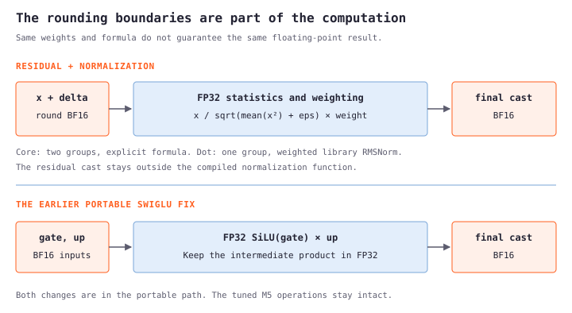</a></figure>

Casting a normalized value to bf16 before multiplying by its weight is a different computation. Passing fp32 inputs and weights keeps that intermediate in fp32; the final cast happens after weighting. The [pinned CUDA implementation](https://github.com/ml-explore/mlx/blob/v0.32.3/mlx/backend/cuda/rms_norm.cu) supports the operation too. Its existence is compatibility evidence, not an NVIDIA speed measurement.

I also tried weighted library normalization separately for Core's two groups. Its cache-reuse reference error reached **0.01203**, above **0.01**. Rejected. Core keeps its explicit grouped formula. This is why a shared backend doesn't mean every model must take the same optimized branch.

### The measurement had to survive its own checks

An initial run became unusable when the laptop switched to battery while another benchmark ran. I stopped it, retained the partial files as invalid, and restarted after restoring AC and an exclusive benchmark window. The comparison wrapper now samples AC status every five seconds and stops its own workers if power is lost.

The first clean, short comparison was still mixed: small Dot requests improved, while the pooled 8K fresh and changed timings looked 1.3% and 3.3% slower. The isolated norm was faster even at large row counts, so that wasn't evidence for inventing a batch-size cutoff. I alternated only the norm function within one loaded model to reduce process drift, then returned to a longer full-engine comparison. Both methods reproduced fresh and changed-request gains.

Here is that full-engine comparison: **Dot, portable backend, M5 Pro, four questions**, baseline `3595f0c` to the normalization accepted in `ceafa8a`. Separate sequential processes ran A/B and B/A, with three warm-up cycles and five timed cycles per worker: ten timed samples per arm for each row. These medians include request validation, rendering, scoring and answer construction; they exclude model loading, startup, network and answer JSON serialization.

A **fresh** request starts with an empty application prefix cache after model warm-up. **Changed** replaces the first question on the same context. **Repeat** repeats that changed request. Context appears twice in the prompt: 2K, 8K and 16K contexts produce longest prompts of roughly 4.3K, 16.3K and 32.3K tokens.

<div role="region" aria-label="Dot portable fresh and changed-question latency" tabindex="0" style="overflow-x: auto;">
<div style="min-width: 620px;">

| Context | Fresh: before → after | Faster | Changed: before → after | Faster |
|---|---:|---:|---:|---:|
| 2K | 419.25 → 406.99 ms | 2.9% | 256.04 → 248.36 ms | 3.0% |
| 8K | 2,276.72 → 2,195.17 ms | 3.6% | 1,453.46 → 1,434.16 ms | 1.3% |
| 16K | 6,402.99 → 6,235.31 ms | 2.6% | 4,378.86 → 4,282.63 ms | 2.2% |

</div>
</div>

Every fresh and changed case improved in both process orders. But the repeats need their own table:

<div role="region" aria-label="Dot portable repeat latency" tabindex="0" style="overflow-x: auto;">
<div style="min-width: 620px;">

| Context | Repeat: before → after | Latency change |
|---|---:|---:|
| 2K | 45.38 → 45.41 ms | +0.07% |
| 8K | 117.15 → 117.03 ms | −0.10% |
| 16K | 219.32 → 223.09 ms | +1.72% |

</div>
</div>

The 16K repeat was slower in both process orders, so I checked it directly rather than averaging it into the wins. Six timed interleaved pairs gave **213.07 → 213.05 ms**: four improved and two slowed down. Fresh and changed requests improved in all six pairs. That supports a fresh/changed benefit and no consistent repeat regression in these measurements. It does not establish a repeat speedup. The [full-process samples](https://github.com/harsh-sqwish/local-models-benchmarking/blob/ceafa8a/results/gpu-optimization/dot-portable-norm-confirm/summary.json) and [targeted repeat check](https://github.com/harsh-sqwish/local-models-benchmarking/blob/ceafa8a/results/gpu-optimization/dot-paired-norm-16k.json) both stay in the record.

### What was actually accepted

The runtime change is one single-group branch in the portable normalization function. Its isolated kernel savings of roughly 35–40% become only a few percent of the full large request, because attention and the projections still dominate. Core and the tuned M5 backend do not get a speedup from this branch; their paths stay intact.

<div role="region" aria-label="Final accuracy regression checks" tabindex="0" style="overflow-x: auto;">
<div style="min-width: 620px;">

| Final regression suite | Checks passed | Largest probability error | Unchanged limit |
|---|---:|---:|---:|
| Core / portable | 28 / 28 | 0.009848 | 0.01 |
| Core / Metal | 28 / 28 | 0.008304 | 0.01 |
| Dot / portable | 28 / 28 | 0.015612 | 0.03 |
| Dot / Metal | 28 / 28 | 0.017893 | 0.03 |

</div>
</div>

All **52 engine tests** pass. Core and both Metal suites' numerical check dictionaries exactly match the previous release. Dot's probabilities move within the original limits, and its top labels agree. The larger before/after request comparisons also pass, with a largest Dot probability difference of **0.023415** at 16K. These finite regression suites are not a comprehensive quality evaluation. [The final validation](https://github.com/harsh-sqwish/local-models-benchmarking/blob/ceafa8a/results/gpu-optimization/final-validation.json) records what was checked and the unchanged source hashes.

## Where this leaves things

The first part of this post was about making the M5's kernels run closer to the chip's limits. The next part exposed work around those kernels: copies, live references, evaluation boundaries and repeated CPU scans. The latest GPU pass found a smaller Dot improvement and a Core change that I couldn't accept at the existing accuracy limit.

Those are different kinds of progress. A 60% faster renderer can save 1% of a request. A cache shortcut can become expensive when another change keeps its buffers alive longer. A faster normalization kernel can fail after its small rounding differences pass through 36 layers. Keeping each experiment's baseline, request, accuracy checks and rejected result is how I can tell which explanation actually survived the code.

The portable implementation is now in place alongside the preserved M5 path. The next hardware claim needs the next hardware: run these same requests and accuracy checks on an older Mac and NVIDIA, profile the operations those devices actually choose, and keep only the changes that survive there too.
