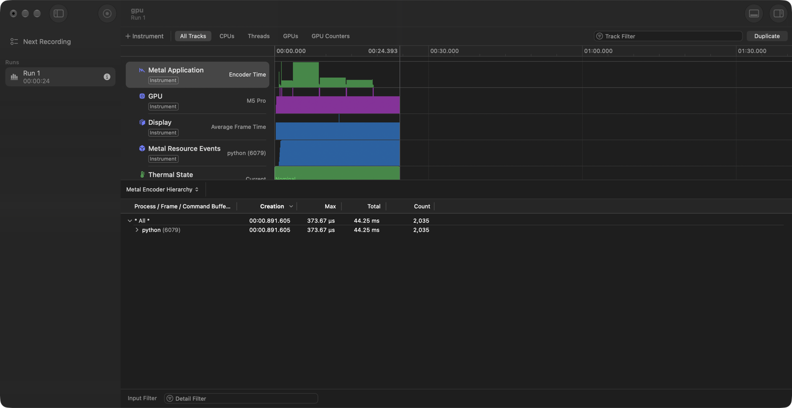

+++
aliases = ["/writes/inference-on-a-macbook/"]
path = "writes/2026-10-10-inference-on-a-macbook"
title = "squeezing a macbook for inference, kernel by kernel"
date = 2026-10-10
updated = 2026-10-30
draft = true
description = "Making decision models fast on an M5 Pro MacBook without changing their answers: how its GPU works, how to see where the time goes, the Metal kernels I wrote because the stock ones don't fit decision-shaped work, the ceiling every runtime hits, and the measurement mistakes that cost more than any kernel."

[taxonomies]
tags = ["inference", "apple-silicon", "mlx", "metal", "performance", "gpus"]
+++

<!--
TODO before publishing (every number must come from a public model):
- Looking: an xctrace flame graph by layer and step (the profile-based ones are by operation)
- Writing my own Metal kernels: the threadgroup-layout comparison and the independent-vs-chain table on a public
  model's shapes
- numbers and figure presets from models neki has since dropped (Laya, d1-3B, d1-omni-600M, d3-lite): re-measure
  on current models or say they were dropped; the reduce figure offers Laya and d1-3B as row widths
- figures: checked 30 Oct at phone width (390 px), light and dark: no overflow, no console errors; look them over
- link neki once its repository is public
-->

<link rel="stylesheet" href="lab.css">
<noscript><p><strong>The figures need JavaScript.</strong> The text and tables read fine without it.</p></noscript>

I wanted to know how fast a MacBook can read.

The models I work with are decision models. You give one a state (a support ticket, a transcript, an agent's trace) and a few questions about it: is this a refund request, which team should handle it, how upset is the customer. Each answer is a probability over a handful of options, read off the model's output at a few positions. The model never writes a token. The GPU runs one forward pass over the prompt, the part of inference usually called prefill, and that's the whole job.

Most of what's written about running models on a Mac is about generation, where every new token reads all of the weights once and memory bandwidth is the limit. Prefill is different: a prompt of a few hundred tokens multiplies the weights by that many rows at once, and the limit is arithmetic. Decision requests sit in an awkward middle, from a few dozen rows for a short question to a few thousand for a long state, and neither the generation advice nor the training advice quite fits.

This is what I learned doing that on one laptop, an M5 Pro. It ended up as neki, a library that runs public decision models, twelve of them from nine makers as I write: Liquid's d1-2B and d1-Omni-2B, Cloudflare's Clef-Flash, Perplexity's pplx-decider flash, vllm-sr's d3-mini and d3-flash, Bespoke Labs' Nimble v3, Base Labs' elephant-1, H2O.ai's H2O-Lightning-4B, Torchcast's Decision 4B, and our own Kettei Core and Dot. Every number below comes from a public model. Some come from the models neki started with, Liquid's d1-3B and d1-omni-600M, vllm-sr's d3-lite and Laya, which their makers have since replaced or which dropped out of the rankings; they're still public, and what they taught carries over. Two rules held throughout. A model runs as its maker published it, with the same weights, tokenizer and prompt. And a faster path counts only if it gives the maker's answers, checked against the maker's own code run in fp32.

Every useful step followed the same loop: write down the fastest a request could possibly be, look at where the time goes before touching anything, change one thing, test it in an experiment shaped like the model, let the request's own clock decide, and keep the record, failures included. My wasted days were the ones that skipped a step.

## Inside an M5 Pro

The laptop is a MacBook Pro with an M5 Pro, on macOS 27.0.1 and MLX 0.32.4. Like every Apple M-series chip, it puts several different processors on one piece of silicon around one pool of memory, so the first question is which of them does the work.

<section class="mac-lab" data-lab="chip" id="chip-lab" aria-labelledby="chip-title">
<h3 id="chip-title">The chip, and the doors into it</h3>
<p class="lab-intro">Pick where a matrix multiply comes from to see which processor it lands on. Then look inside one GPU core.</p>
</section>

- The **CPU** has 18 cores, 6 "super" cores and 12 performance cores. It runs Python, the tokenizer and the code that tells the GPU what to do.
- The **GPU** has 20 cores. Each runs thousands of threads, and on the M5 each also has a **Neural Accelerator**, a unit that only does matrix multiply-accumulate, built "right alongside the other GPU pipelines" in [Apple's words](https://developer.apple.com/videos/play/tech-talks/111432/). M1 to M4 have no such unit and multiply matrices on the GPU's ordinary arithmetic units.
- The **Neural Engine** is a separate block of 16 cores for running Core ML models at low power. Despite the name, it has nothing to do with the Neural Accelerators.
- **Unified memory**, 48 GB here, is shared by all of them at up to 307 GB/s. There's no graphics memory to copy weights into: the GPU reads them where they are, and can keep about 78% of the memory resident (MLX reports 40.2 GB).

Software reaches these through different doors, which is why the same model can run at very different speeds on the same Mac. NumPy goes through Accelerate to the CPU. Core ML decides for itself where each operation runs, and it's the only way onto the Neural Engine. PyTorch's Mac backend uses Apple's prebuilt GPU kernels in Metal Performance Shaders. [MLX](https://github.com/ml-explore/mlx), and neki on top of it, go straight to **Metal**: each operation is a kernel, a small program in Metal's C++-like shading language that the GPU runs as thousands of copies at once. Since macOS 26.2, MLX's matmul and attention kernels reach the Neural Accelerators through Metal 4's tensor operations ([Apple's write-up](https://machinelearning.apple.com/research/exploring-llms-mlx-m5)). On this laptop a large matmul runs at about **33 TFLOPS**.

### Inside a GPU core

A kernel launches as a grid of threadgroups, and each threadgroup runs on one GPU core: up to 1,024 threads, in SIMD groups of 32 that execute the same instruction together. The threads of a threadgroup can share up to 32 KB of fast threadgroup memory and wait for each other at barriers, and every thread has its own registers. Since the M3, a core splits one on-chip memory between registers, threadgroup memory and cache as each kernel needs.

On the M5, a SIMD group hands its share of a matrix multiply to the core's Neural Accelerator, typically a 32 × 32 block of the output at a time, and keeps the running sums in its threads' registers. Everything else (adds, exponentials, norms) runs on the core's ordinary arithmetic units. While one SIMD group waits for memory, the core switches to another that's ready, which hides the wait as long as there are enough of them. The kernels below are partly about when there aren't.

### What a tile is, and why its size matters

Multiplying a prompt's M rows by a weight matrix gives an M × N output, far too much for one threadgroup. So a matmul kernel cuts the output into tiles: each threadgroup computes one tile of BM × BN, and each of its SIMD groups a 32 × 32 piece of that. To compute its tile, a threadgroup needs BM rows of the input and BN rows of the weights, and it walks along their shared dimension K a slice at a time, adding each slice's products into its sums.

<section class="mac-lab" data-lab="tile" id="tile-lab" aria-labelledby="tile-title">
<h3 id="tile-title">One tile of a matmul</h3>
<p class="lab-intro">d1-3B's 2,048 × 2,048 output projection. Change the tile and the prompt's rows, and walk one tile along K.</p>
</section>

How big to make the tile is a trade between three things, and [Apple's guide to matmuls on the M5](https://developer.apple.com/download/files/Metal-Performance-Primitives-Programming-Guide.pdf) lists the same three:

- **Reuse.** Every number a tile loads gets used BN or BM times. A 64 × 128 tile does 43 FLOPs per byte it loads, a 32 × 32 tile 16, so bigger tiles ask less of the memory system.
- **Work for every core.** Bigger tiles mean fewer of them. A 32-row prompt against a 2,048-wide matrix makes 16 tiles of 64 × 128, for 20 cores. And when the count isn't a multiple of 20, the last round leaves cores idle.
- **Registers.** Each SIMD group keeps its block of sums in registers. Make the block too big and they spill to memory, and the kernel slows down.

The figure also shows a fourth effect. When the rows aren't a multiple of the tile's height, the last row of tiles is partial and has to check its bounds on every load. Decision prompts come in every length, so the kernels below run into all four.

### The floor

Every kernel waits on either memory or arithmetic, and the [roofline model](https://dl.acm.org/doi/10.1145/1498765.1498785) says which. The chip's compute over its bandwidth, 33 TFLOPS over 307 GB/s, is about 107 FLOPs per byte. A kernel doing fewer FLOPs than that per byte it reads waits on memory; more, and it waits on arithmetic.

For a matmul of M tokens by a K × N matrix of 16-bit weights, that's 2·M·K·N FLOPs over 2·K·N bytes: **M FLOPs per byte, the number of tokens**. So on this chip a prompt longer than about 110 tokens is compute-bound, and the fastest it could possibly run, its floor, is its FLOPs divided by 33 TFLOPS. The FLOPs come straight from a model's config: 2 per weight per token, counting the backbone's matrices (the embeddings are a lookup, and a decision reads only a few rows of the output head).

<section class="mac-lab" data-lab="roofline" id="roofline-lab" aria-labelledby="roofline-title">
<h3 id="roofline-title">Where a prompt sits on the roofline</h3>
<p class="lab-intro">Pick a chip, a model and a prompt length. The dot is the prompt's matmuls; the readout works out its floor. On the M5 Pro it also shows what the model's 1,000-word request actually took.</p>
</section>

The 3B to 9B models run 18 to 28% above their floor, the models under 1B 48 to 77% above theirs. Most of this post is about where those gaps come from.

## Why decision models are a different problem

Almost everything written about making models fast is about chat models, and most of it doesn't apply here. It helps to see why before looking at any kernel.

A chat model answers by generating. It reads the prompt once, then produces the reply one token at a time, and every new token is a full pass through the model for a single row. A single row does about one FLOP per byte of weights read, far below the 107 FLOPs per byte where the M5 Pro's arithmetic becomes the limit, so generation waits on memory. That's why chat servers batch: if 32 users are each generating, one pass can read the weights once and produce a token for all 32. Continuous batching, paged key-value caches and speculative decoding all exist to make that loop cheaper.

A decision model never generates. It reads the prompt once and answers from the output at a few positions, so the whole request is that first pass, the part chat inference calls prefill. Four things follow, and each one turned into work later in this post:

- **The request is matmuls over the prompt's rows.** With a few hundred tokens the matmuls do a few hundred FLOPs per byte read, so the request waits on arithmetic. The tricks that save memory bandwidth for generation, quantization included, buy little here.
- **Almost all of the output is thrown away.** A chat model needs every token's score to sample the next one. A decision needs the scores of a handful of options at a handful of positions, so most of the output matrix, 2 GB on a 9B model, never needs to be read.
- **Questions arrive in groups about one state.** "Is this urgent, which team should take it, how upset is the customer" are three questions about the same ticket. Read naively, that's the ticket read three times.
- **Every request has a new length.** A chat server sees the same shape for every generated token. Decision traffic brings a prompt of 87 tokens, then 1,103, then 2,559, and kernels that compile per shape or assume tidy multiples of 64 pay for it on every request.

Software built for chat has little reason to care about any of these, and it shows in what I measured: Perplexity's own package runs one pass per question, and MLX's stock matmul tiles, built for one row or for thousands, read the weights at half the bandwidth or less between 96 and a few hundred rows, exactly where short decision requests live. None of that matters when the job is generating. For decisions it's a large share of the cost.

### How a probability comes out

A decision model answers by turning a few of its output vectors into a probability for each option. The makers do it in a handful of ways, and an adapter has to reproduce each one exactly:

- **Label tokens.** The prompt lists the options with labels ("0. billing", "1. sales", or "Yes" and "No") and ends where the answer would start. The model's output at that last position is multiplied by the output matrix's rows for those label tokens only, and a softmax over those few scores gives the probabilities. Kettei Core and Dot, elephant-1 and the bring-your-own causal models work this way.
- **A readout of codes.** vllm-sr's d3 and Perplexity's flash model read the answer position (d3's last token, the marker Perplexity puts after each question) through a small matrix of 255 rows, one score per code. d3 divides the scores by a calibration temperature its maker fitted, and the softmax runs over the codes that question uses.
- **A head that reads every position.** Cloudflare's Clef-Flash puts every question and option in one sequence, and its joint head reads the hidden states over the questions' and options' spans, so the readout touches far more than one row.
- **Groups of questions under one state.** Liquid's d1 models pack up to 16 questions after the state and read each question's answer slot, with the label forms max-pooled and a calibration temperature on top.

Two consequences matter for speed. The answer depends on a handful of rows of the output, which is why computing only those is exact and free. And the readout's arithmetic, temperature included, is part of the answer, so it has to match the maker's in order and precision, not only in shape.

## How agents call decision models

How a model is called decides what's worth optimizing, so before any kernel I looked at how agents use these models. The same few patterns come up in every agent workload I've looked at:

- **A decision before an action.** An agent asks whether a tool call is safe, which tool to use, whether a reply is done, which team a ticket goes to. These are short calls in the middle of a loop, and the loop waits for each answer, so a decision's latency adds to every step.
- **Several questions about the same context.** A support agent asks about urgency, category, sentiment and refund eligibility of the same conversation in one call.
- **The same context again and again.** The next step asks a new question about the same conversation, or about the conversation plus one new message. Most of the prompt is text the model has already read.
- **Many agents at once.** A team of agents, or one agent running steps in parallel, sends a burst of short requests together, each a few hundred tokens.

Each pattern rewards something different. Questions about one state reward reading the state once. A context sent again, or grown by a message, rewards keeping what was read and reading only what's new. A burst of short requests rewards reading them together, because one short prompt can't keep 20 GPU cores busy. Runtimes built for chat do some of this for their own reasons, prompt caches mostly, but none was designed around it. The sections below are how neki does each one, and what it was worth.


## Decision models, as the GPU sees them

The public decision models come in four shapes:

- **Short convolutions with some attention.** Liquid's d1-3B has 30 layers, only 8 of them attention ([config](https://huggingface.co/LiquidAI/d1-3B/blob/main/config.json)); d1-omni-600M has 16 layers, 6 of them attention.
- **Linear attention with some full attention.** Qwen3.5's layers run three Gated DeltaNet layers, a linear attention with a fixed-size state, for every full-attention layer of 16 heads of 256. Clef-Flash and Nimble are 9B models of this kind, pplx-decider flash and d3-mini 4.5B, d3-lite 0.85B.
- **Encoders.** Laya is ModernBERT-large, 28 layers that read every token both ways, at most 512 tokens; Laya multilingual is the 22-layer base size, up to 1,024.
- **Plain decoders** that attend in every layer: Qwen3, Llama and the bases many fine-tunes start from.

Attention does work for every pair of a query and an earlier key, so it grows with the square of the prompt, while the matmuls grow with its length. The hybrids keep attention small by using it in only a quarter of their layers: at 4,000 tokens it's about 2% of a Clef-Flash request's arithmetic. So for decision requests up to a few thousand tokens, **the matmuls are the job**.

## Looking: traces, profiles and flame graphs

Before optimizing anything, you need to see it. I ended up looking in two ways, and they answer different questions.

**A trace** records what the GPU actually did, on its own clock. Xcode's Instruments has a command-line twin, `xctrace`, and its Metal System Trace template records every command buffer the GPU ran:

```sh
xcrun xctrace record --template 'Metal System Trace' --output gpu.trace \
    --launch -- python bench.py <model> --shapes single500
xcrun xctrace export --input gpu.trace --toc
```

Two tricks turn that into a per-kernel profile. The Metal Application instrument has an "Enable Shader Timeline" checkbox that records which shader is running; there's no command-line flag for it, so you tick it in Instruments and save your own template. And MLX packs operations into a command buffer until it holds `MLX_MAX_OPS_PER_BUFFER` of them; set that to 0 and every operation gets its own buffer, so every interval in the trace is exactly one kernel.

<figure><a href="instruments-trace.png"></a></figure>

My first trace taught me what not to work on. The GPU was busy almost the whole time, with MLX encoding command buffers well ahead of it, so there was no idle time for fewer Python calls to recover. That was true for the large model I traced. The CPU's share, further down, is about the small models, where it wasn't.

**A profile** is cheaper and answers "which operation". `neki profile` runs a request one operation at a time, waits for the GPU after each, and subtracts that wait. A [flame graph](https://www.brendangregg.com/flamegraphs.html) shows the result at a glance: every frame is as wide as its share of the time, and its children sit on top of it.

<section class="mac-lab" data-lab="flame" id="flame-lab" aria-labelledby="flame-title">
<h3 id="flame-title">Where a request's time goes</h3>
<p class="lab-intro">Two measured requests: a 9B decoder and a small encoder. Click a frame to zoom in, hover or tap it for its numbers.</p>
</section>

On Clef-Flash, matmuls are 89% of the request, and two of them, the MLP's gate/up and down projections, are almost two thirds. The attention kernel, the part everyone talks about, is under 1%. Laya multilingual looks different: it attends every token to every other in every layer, and its matrices are only 768 wide, so attention is a quarter of the request and the add-and-norm between blocks another tenth. I kept coming back to that contrast: **the smaller the model's matmuls, the more everything else shows**.

One more tool decided everything after this. A kernel's own time is a hypothesis; the request's time is the verdict. Every change ran as a comparison in fresh processes, alternating A, B, B, A..., each loading the model and timing every request shape, so drift lands on both arms. A change counts when some cell is at least 3% faster, with its bootstrap interval clear of zero, and no cell is more than 1% slower.

## Do less work

The first changes worth making removed work outright. They're exact, they don't depend on the chip, and they were the biggest wins of the whole project.

**One pass for all the questions.** A request's questions share its state. Perplexity's own package runs one pass per question, so three questions about a 4,000-token state read about 14,200 tokens. Instead, the state and every question's own tokens can go in one pass under a tree mask: the state attends causally, each question to the state and to itself, the prefix-sharing idea behind [SGLang's RadixAttention](https://arxiv.org/abs/2312.07104) and [Hydragen](https://arxiv.org/abs/2402.05099).

That came with a surprise. MLX's attention skips the blocks above the diagonal only in its built-in causal mode; given any other mask, it computes every block and throws the masked ones away ([source](https://github.com/ml-explore/mlx/blob/v0.32.3/mlx/backend/metal/scaled_dot_product_attention.cpp)). My mask was mostly causal, and it had switched the shortcut off. The fix is to split the call: the state's rows go through causal mode, and only the questions' rows use the mask.

<section class="mac-lab" data-lab="tree" id="tree-lab" aria-labelledby="tree-title">
<h3 id="tree-title">One pass for a state and its questions</h3>
<p class="lab-intro">Queries run down, keys across. Change the state and the questions, and switch between one masked call and the split.</p>
</section>

On d1-3B, which attends in 8 of its 30 layers, a 2,000-word state with three questions got 1.5% faster from the split. A model that attends in every layer gains far more.

**Compute only what's read.** Nothing reads the last layer's output except at the answer positions, so the last layer runs on those rows only. And an answer is a probability over a few options, which needs only those options' rows of the output matrix. The Qwen3.5 models have a 248,320-token vocabulary, so for the 9B ones that's 2 GB of weights a decision never needs to read.

**Keep what you've read.** The keys and values a layer computes for a token depend only on the tokens before it, so a request that starts like an earlier one can reuse them. Asking Clef-Flash new questions about a 4,000-word state it had already read took 233 ms instead of 2.48 s, and a state that had grown since took 241 ms. The hybrids' linear layers carry a running state instead of per-token keys and values, so the cache keeps a copy of it where reuse begins. For agents that ask about the same state over and over, nothing else comes close.

That only works when the model reads causally, each token seeing only the ones before it, so that a token's keys and values don't change when more text follows. Which models qualify comes down to their attention:

- **Causal models with the state first** (Clef-Flash, Kettei Core and Dot, H2O-Lightning-4B's GGUF build, the bring-your-own decoders) can keep the state's reading and read only the new question.
- **Models whose state looks at the questions** can't. vllm-sr's d3 reads every prompt both ways, so the state's reading depends on the question that follows it, and Liquid's d1 lets the state see every question packed after it. Every request is read whole, and no runtime can do otherwise without changing the answers.
- **Block models** sit between. elephant-1 reads its system turn and state as one block, both ways inside itself, and every question after it. A state sent again unchanged keeps its block; a state that grows changes the block and has to be read again.

The hybrids add a wrinkle. A Gated DeltaNet or short-convolution layer has no per-token keys to keep, only a running state that summarises everything read so far, so neki stores a copy of that state at a mark it picks while reading. The mark sits a few tokens before the end of the state, because an agent re-sends its state with something appended: the closing tag or bracket after the old state moves, and the tokenizer may merge the old text's last characters with what now follows them. Resuming from a mark a little earlier and re-reading those few tokens gives the same answer as reading everything. Each mark splits every recurrent layer's pass and costs a copy of its state, 18 MB for a 2B hybrid, which made a fresh 20-word request 3 to 4% slower, so each prompt gets one mark, at the state's end. The kept readings also go to disk, so a state outlives the process that read it.

**Batch by length.** Requests answered together share a pass, but a batch pads every prompt to its longest. Sorting eight requests of 40 to 1,800 words by length cut d1-omni's time by 21% and d1-3B's by 13%, with the same answers.

## Keep the GPU ready

Real requests don't arrive back to back. After about half a second idle, a Mac's GPU drops its clock, and the next request's first milliseconds run slow. After about five seconds, macOS lets go of the GPU's hold on its memory, and the next request waits while the driver wires the whole model back in: hundreds of "Wire Memory" events in the trace before the GPU starts. A thread that runs a 16-element add on the GPU once a second keeps the memory wired. Nothing short of real load keeps the clock up: a busier keep-alive slowed every other request and the slow start stayed.

Here is what that looks like from a client, on d1-2B's Q8_0 file served over HTTP, a one-question request about a 20-word state, the median of five after each gap:

| Idle before the request | With the keep-alive (neki's default) | Without it |
|---|---:|---:|
| none, sent right after another | 12.6 ms | 12.5 ms |
| 0.5 s | 25.4 ms | 25.4 ms |
| 2 s | 24.8 ms | 27.5 ms |
| 10 s | 26.0 ms | 65.4 ms |
| 30 s | 25.6 ms | 64.5 ms |

The clock costs the first doubling and the keep-alive can't stop it. The re-wiring costs the second, from 26 to 65 ms, and a once-a-second add on the GPU takes it away. `neki serve` keeps the heartbeat going for five minutes after the last request and stops it after that, so an idle server doesn't keep the GPU awake all day.

## Writing my own Metal kernels

MLX's kernels are good, and they're written for everyone's shapes, mostly the two that most people run: one row at a time when generating text, and thousands of rows when training or reading long prompts. Decision requests are neither:

| | What stock kernels are built around | What a decision request brings |
|---|---|---|
| Rows per matmul | 1, or many thousands | 30 to 3,000, and anything between |
| Row counts | multiples of a tile | whatever the prompt is: 1,103, 2,559 |
| Output | every vocabulary row, then sampling | a few option rows at a few positions |
| Attention mask | causal | causal for the state, the state plus itself for each question |
| Lengths | compile once, generate many tokens | a new length on nearly every request |

Each row of that table turned into a kernel or a fix, and the matmul gets the most space.

**How they're written.** `mx.fast.metal_kernel` compiles a Metal source string at run time and launches it like any MLX operation. neki keeps its GPU code in 35 `.metal` files; Python only picks a variant, fills in template parameters and launches. MLX ships its own tile library as headers inside the Python wheel, and since the Metal compiler can't read files, those headers get inlined into the source. Every candidate kernel is checked against MLX's result before it's timed: a good fraction of the tile configurations I first generated compiled fine and computed garbage, and my first tuner, which didn't check, reported one faster than the chip's peak. If your benchmark beats physics, the kernel is wrong.

One detail I liked: MLX hashes a custom kernel's whole source at every launch, to find it in its cache. With the tile library inlined that's 42 KB of text, about 2 µs per launch, and on d1-omni 7.6% of the main thread's time. Stripping comments, indentation and blank lines gives the same program in 32 KB.

### The matmul

The tile figure at the start is the whole idea; the question is which tile. The answer depends on the number of rows, and decision requests come with every row count.

MLX picks one tile for every 16-bit matmul on an M5: 64 × 128 per threadgroup, 32 × 32 per SIMD group ([matmul.cpp](https://github.com/ml-explore/mlx/blob/v0.32.3/mlx/backend/metal/matmul.cpp)). Below 65 rows it switches to a "thin" kernel that keeps a slice of x in registers while the Neural Accelerator streams the weights. My kernel is MLX's own matmul with the tile shape as a parameter, and a tuner that tries every reasonable shape for each of a model's matrices at each band of row counts. Because it's the same loop in the same order, a correct tile's products equal MLX's bit for bit.

<section class="mac-lab" data-lab="tiles" id="tiles-lab" aria-labelledby="tiles-title">
<h3 id="tiles-title">Tiles, rows and what each runs at</h3>
<p class="lab-intro">d1-3B's four big matrices. Move the prompt's rows and change the tile: the strip shows the row blocks, the chart the measured speed of MLX's matmul and of the best tile the tuner found.</p>
</section>

The chart has three regimes. Up to 64 rows everything rides the bandwidth line, and MLX's thin kernel is already right: across eight models, no tile beat it by 10% there. From 96 to a few hundred rows, where short decision requests live, MLX's regular tile reads the weights at half the bandwidth or less, and the best tiles are up to 43% faster. From about a thousand rows the two are within a few percent of each other near 30 TFLOPS, except on the down projection, whose K of 10,752 keeps the tile 5 to 16% ahead.

Two things about writing it surprised me. My first kernels ran noticeably slower than MLX's at the same tile, with identical output, and I was sure it was the runtime compiler. I had started reading about C++ extensions when I tested the cheap ideas first. It was the launch: MLX launches its matmul's threadgroups as 32 × WN × WM threads, and I'd passed a flat 256 × 1 × 1. The SIMD groups are the same either way, but the GPU schedules them differently, and changing that one tuple closed the gap. <!-- TODO: the threadgroup-layout comparison on a public model's shape -->

The second was the few-rows regime. With a few dozen rows, a matmul is only a hundred or two SIMD groups, and each walks K alone: load, wait for memory, multiply, load the next. A GPU normally hides that wait by switching to another SIMD group, and Apple's guide says kernels need no explicit pipelining when each core has enough threads. With a few dozen rows there aren't enough.

<section class="mac-lab" data-lab="kloop" id="kloop-lab" aria-labelledby="kloop-title">
<h3 id="kloop-title">Waiting on memory, and prefetching</h3>
<p class="lab-intro">One GPU core's matrix unit fed by its SIMD groups. Compare one SIMD group with four, and MLX's loop with one that prefetches.</p>
</section>

**Prefetching** loads the next slice into a second set of registers while the current one is multiplied. It walks the same slices in the same order, so the result doesn't change by a bit. MLX's **thin kernel**, used past its 64-row limit, is the other fix. Both became options the tuner picked per band of rows, and on the public models they split the work: from 96 to 512 rows the thin kernel won 122 bands, prefetching 65 and plain tiles 66; above 512, plain tiles won 73, prefetching 36 and the thin kernel 1.

### Teaching the tuner to measure like the model

`neki tune` measured every matrix shape a model has at 28 row counts from 8 to 4,096 and stored the winners per chip, MLX version, macOS version and kernel version. Getting it to choose well took longer than writing the kernels, because four times it measured something the model doesn't do.

**Independent instead of dependent matmuls.** The tuner first timed eight matmuls at once on separate weight copies. MLX runs independent kernels concurrently, so the GPU overlapped them, and a tile with a slow last wave looked fine. In a model every matmul waits for the one before and pays that tail in full. It now times a dependent chain. <!-- TODO: the independent-vs-chain table on a public model's shapes -->

**Multiples of 64 instead of real prompts.** The tuner timed tiles at 512, 1,024 and 2,048 rows, so every row block was whole. Real prompts are 1,103 or 2,103 tokens long, and in the kernel a partial last block takes a different loop with bounds checks at every step of K, the cost Apple's guide warns about. One prefetching tile 2% faster than MLX at 2,560 rows was **30 to 35% slower** at 2,103 and 2,559. The fix is the trick MLX's thin kernel uses (try "moved back" in the tiles figure): move the last block back so it ends at the last row. It overlaps its neighbour and computes a few rows twice, writing the same values, and every block runs the fast loop. After that, the same tile was 6 to 10% faster than MLX at every row count I tried.

**A band's top instead of its whole range.** A tile timed at 2,560 rows serves every prompt from 2,049 to 2,560. On Perplexity's flash model's down projection:

| Rows | MLX | Tile A | Tile B (prefetching) |
|---:|---:|---:|---:|
| 2,049 | 3.774 ms | **3.390 ms** | 3.454 ms |
| 2,095 | 4.021 ms | **3.635 ms** | 3.723 ms |
| 2,560 | 4.948 ms | 4.602 ms | **4.587 ms** |

Tile B won at the top by 0.3% and lost by 2 to 2.4% over most of the band. So the tuner timed each band's finalists at both ends.

**One sample of a noisy threshold.** With a 10% bar, a tile measured 9.6% faster is rejected and one measured 10.1% faster is used, and run-to-run noise is about that big. Once the measurements were honest the bar could drop to 3% from 512 rows. Even then, tiles that tie in isolation can differ inside a model: on Laya at 139 tokens, swapping one shape's tile at a time moved the pass by under 0.5%, and all of them together by 2.7%. So where two rules disagree, the model's own forward pass decides.

Re-tuning every model with the fixed tuner made each request another 2 to 7% faster at most lengths, against its tunings from before, in fresh-process comparisons. That sounds small after all that, but these models were already close to their floor. The answers stayed well inside their bounds against the makers' fp32 code: d1-3B at 0.0013 against 0.039, Perplexity's flash at 0.0069 against 0.0119.

Nobody runs that tuner on their own Mac anymore. Once its winners settled into patterns of chip, matrix shape and row count, they became rules neki applies when a model loads, with the measured tables behind them shipped in the library. A first request on a new M5 gets the chosen kernels with no tuning step, and asking a user to spend twenty minutes measuring before anything works was the worst part of the old design.

### The quantized matmul

Many people run 8-bit or 4-bit builds, where the weights are stored in fewer bits with a scale per group of 32 or 64 and unpacked to 16 bits for the multiply. The roofline says what to expect: fewer bytes help whatever waits on reading weights, which is generation and very short prompts. A prompt of a few hundred tokens waits on arithmetic, and the multiply still happens in 16 bits. With MLX's quantized matmul, d1-3B's 1,000-token request took 211 ms from Liquid's 4-bit build and 221 ms from the 8-bit one, against 195 ms in full precision. For prefill, quantization saved memory and cost time.

Part of that was MLX's kernel. MLX 0.32.4 runs a prompt's rows through one fixed 64 × 64 × 64 tile of 2 × 2 SIMD groups, and a matrix with few output tiles through split-K on SIMD-group kernels that never reach the Neural Accelerators. MLX's main branch has a better schedule ([#4682](https://github.com/ml-explore/mlx/pull/4682)), not yet released, and I built it as a custom kernel on the released MLX's pieces, with the tuner choosing its parameters:

- the 64 × 64 tile of weights is unpacked into threadgroup memory, double-buffered, with one barrier per 64-deep step of K;
- each thread fetches the next step's packed weights and scales into registers before the current step's multiplies, the same prefetching idea as above;
- each SIMD group computes 16 or 32 rows, and optionally K is split into parts summed afterwards, so a matrix with few output tiles still fills the GPU.

Against the faster of MLX's two routes, on seven decision models' shapes from 16 to 2,048 rows, the 8-bit version is 6% to 90% faster and the 4-bit 2% to 122%. Clef-Flash's and Nimble's down projection is 76% faster at 16 rows, 35% at 333 and 15% at 2,048. From 1,024 rows it runs at 25 to 30 TFLOPS, where MLX's reaches 22 to 27.

In whole requests the kernel is one part of the time, so the gain shrinks. On Clef-Flash's MLX 8-bit build, one question about ~1,000 tokens took 660 ms on neki and 796 and 778 ms on oMLX and mlx-vlm, which run MLX's quantized matmul on the same file: 21% and 18% faster. With 50 questions the margins were 9% and 8%. A typical call of about 500 tokens and three questions took 437 ms against 522 and 518. On Ollama's MXFP8 builds, the same kernel in its MXFP8 form, neki was 5% faster than Ollama on Clef-Flash and 16 to 37% on d1-2B, d3-mini and d3-flash.

The bug that taught me most: every loop over a thread's registers has to be unrolled in full, as MLX's are. Rolled, the compiler can't keep an indexed register array in registers, spills it to memory, and the kernel ran at a quarter of MLX's speed.

### Fusing the gate and up projections

The gate/up projection is the largest matmul in most of these models. Unfused, it writes an output twice the MLP's width, then the next kernel reads it back, applies SwiGLU (silu(gate) × up) and writes half of it. On d1-3B at 1,100 tokens that's 47 MB written and read back per layer before 24 MB of real output. With my own matmul, the SwiGLU happens in the epilogue: each SIMD group accumulates a tile of x @ gate and the matching tile of x @ up, applies the activation to the fp32 sums, and writes only the result, rounded once instead of three times.

How the two tiles get computed mattered more than the fusion. My first version walked K twice per SIMD group, once for the gate and once for the up, reading x twice: 3 to 7% faster than MLX's matmul followed by a separate GLU kernel on d1-3B's shape. Walking K once with both accumulators, so each slice of x is loaded once and multiplied into both, made it 7 to 11% faster. The quantized matmul does the same with its 64-row tiles of weights, each 32 gate rows and the matching 32 up rows.

### Norms, and adding across a SIMD group

Between blocks, every layer adds the block's output to the residual and normalizes it. An RMSNorm needs the sum of squares of the whole row before it can scale any element, so it's a reduction: many numbers in, one out. neki does the add and the norm in one kernel, one threadgroup per row:

<section class="mac-lab" data-lab="reduce" id="reduce-lab" aria-labelledby="reduce-title">
<h3 id="reduce-title">How a threadgroup sums a row</h3>
<p class="lab-intro">Step through one row of the add and RMSNorm kernel. Each square is a thread; the more of the row it has added up, the darker it gets.</p>
</section>

The step that makes this fast is `simd_sum`. Threads in a SIMD group already run in lockstep, so adding a value across its 32 lanes needs no shared memory and no barrier; it happens in registers. Only the 8 partial sums go through threadgroup memory. On Clef-Flash the add-and-norm is 1.7% of a request, while on Laya multilingual it was 10.6%, so this kernel is mostly for the small models.

The same pattern runs elsewhere. Gated DeltaNet needs its queries and keys normalized per head: MLX's composition makes about five full passes over them in fp32, plus five small kernels for its gates, and one kernel with one SIMD group per head does it all.

Two fixes in this area weren't about arithmetic at all. MLX's fused Gated DeltaNet kernels only take a few head counts, and any other shape ran 50 to 100 times slower, so neki pads the heads with zeros up to a shape the kernel takes: for 8 key and 16 value heads, 99 ms became about 2 ms at 2,048 tokens. Zero heads add nothing to a state or an output, so the answers don't change. And several of my kernels took the request's length as a template constant, so Metal compiled them again for every new length, about 60 ms each time. Decision traffic has a new length on nearly every request, and d1-omni at 50 words ran at 63 ms instead of 6 to 10. The kernels now read their sizes from a small input.

### Attention

An attention kernel walks the keys in blocks for a block of queries: multiply the queries by those keys to get scores, keep a running softmax (each row's maximum and sum so far, rescaling as the maximum grows), and multiply the weights by the values into an output tile. The full table of scores never exists in memory, which is the trick of [FlashAttention](https://arxiv.org/abs/2205.14135).

At head size 256, the size of the Qwen3.5 models' full-attention layers, MLX 0.32.4 uses its fused kernel on an M5 only for 1,024 queries or more under a causal or array mask. Everything else, including every both-ways call and every short prompt, multiplies the queries by the keys into a score matrix in memory: at d3-mini's shape, an extra 0.53 GiB at 4,096 tokens, 2.06 at 8,192 and 4.59 at 12,288. neki's kernel is MLX's head-split kernel for the Neural Accelerators with 16 or 32 query rows per threadgroup instead of 64, so a short prompt still makes enough threadgroups, and with the queries kept in registers.

The kernel is much faster than MLX's unfused path: 49 to 60% for causal prompts of 256 to 1,000 tokens, 15% both ways at 1,100 tokens and 17% at 4,100. Past 8,000 tokens the gain shrinks to 0 to 7%, because each block of keys is read again for every 32 queries and that runs into the bandwidth. The request barely noticed. In pplx-decider flash at 4,000 words attention went from 104 ms to 86 ms of a request of about 1,150 ms, and a clean four-round comparison came out 0.89% faster, under the 3% bar. So it ships behind a switch, and MLX's path stays the default. Its real gain is the gigabytes of scores it never allocates on a long prompt. A kernel 17% faster in a tenth of the request can make the request at most 1.7% faster, and that's the arithmetic to do before writing one.

## The CPU's share

The first trace said the GPU never idles, so the CPU didn't matter. For a 9B model that holds. Laya answers a short request in a few milliseconds, though, and the main thread's work around the GPU is a real share of that. Profiling the main thread found:

- Python rebuilt each layer's graph on every request, 25 to 60 µs per layer. Now each layer runs as one call of an `mx.compile`d function, so layers of one kind replay one recorded trace, with the same kernels and the same bits.
- The tokenizer's thread pool cost about 70 µs per call: a question's instructions and three options took 85 µs as a batch and 13 µs one by one.
- Python's garbage collector walked about 100,000 objects a load had left behind, 11 ms in the middle of one Laya request. Freezing them after the load took that to 0.1 ms.
- The 42 KB kernel-source hash from earlier.

Main-thread CPU time per 100-word request fell from 1.6 to 0.9 ms for d1-omni with one question, from 2.3 to 1.6 ms for Laya and from 2.9 to 1.8 ms for d3-lite.

Instructions per decision puts the rest in one number. On d1-2B's Q8_0 file, a decision about a 70-word state with one question took 15.3 ms, and for it the CPU retired about 39 million instructions over 11 million cycles, all threads together: 2.8 ms of CPU time beside 15.3 ms of wall time. I measured it with `/usr/bin/time -l` as the difference between a process that made 201 decisions and one that made one, twice each, and the two pairs agreed to 0.1%. That CPU work overlaps the GPU's, but it is still a fifth of the request on a small model, which is why the main thread mattered.

## We don't trade accuracy for performance

Every speedup in this post was counted only after the answers matched. For each model, neki runs the same requests as the maker's own code run in fp32 on the CPU: the standard set, each maker's own cases, and pictures, clips and videos where the model reads them. Prompts have to match token for token, which is checked exactly. Each probability then has to land within a bound of the maker's: 0.01, or how far the maker's own fast path (its bf16 on the Mac's GPU) lands from its fp32, plus 0.0005, whichever is larger. So neki has to be at least as close to the maker's exact answers as the maker's own fast path.

| Model | neki's default, worst difference | Bound |
|---|---:|---:|
| Liquid d1-2B | 0.0012 | 0.0162 |
| Liquid d1-Omni-2B | 0.0018 | 0.0172 |
| Perplexity pplx-decider flash | 0.0069 | 0.0119 |
| vllm-sr d3-mini | 0.0085 | 0.0291 |
| vllm-sr d3-flash | 0.0017 | 0.0161 |
| Bespoke Labs Nimble v3 | 0.0101 | 0.6396 |
| Base Labs elephant-1 | 0.0024 | 0.0249 |
| H2O.ai H2O-Lightning-4B | 0.0040 | 0.0193 |
| Torchcast Decision 4B | 0.0024 | 0.0429 |
| Kettei Core | 0.0067 | 0.0369 |
| Kettei Dot | 0.0026 | 0.0324 |

Pictures, audio and video are held to the same rule: on d3-flash, 0.012 on pictures (bound 0.022) and 0.0022 on video (0.025); on d1-Omni-2B's clips, 0.0010 (0.0144). Clef-Flash is the exception: its prompts and scoring head are checked against Cloudflare's code, and its community 8-bit build against the runtime it was published for.

neki's default computes in fp16 wherever a model's activations fit, because on these models fp16 lands several times closer to fp32 than bf16 does. Nimble's own engine in bf16 is 0.64 from its fp32, enough to change answers, where neki's fp16 is 0.010. bf16 is the fallback for the rare request that overflows fp16, and an option; on a few models it lands past the bound (d3-flash 0.0185 on a 40-question request, Kettei Core 0.045). The docs say so, and neki reports when it falls back.

The two 16-bit formats split their bits differently. fp16 keeps 10 bits of mantissa and 5 of exponent, bf16 7 bits of mantissa and 8 of exponent. bf16 can hold the same range of magnitudes as fp32, which is why training uses it, but it rounds every number about eight times more coarsely than fp16. fp16 is more precise but tops out at 65,504, and a model whose activations pass that overflows into infinities. So neki measures the largest activation a model produces while warming up and uses fp16 when there's room, bf16 when there isn't. If a later request still overflows, neki answers it again in bf16 and stays there.

The tempting shortcut was fewer bits. On a 9B model a 4-bit build halves the memory again, and many runtimes default to one. For decision answers it's the wrong trade: elephant-1 at 4-bit landed 0.52 from its fp32 and at 6-bit 0.14, with top answers changed, and even 8-bit landed 0.028 against a bound of 0.025. So neki never loads fewer bits than the maker published unless asked to, and every precision option carries its measured distance in the docs. When neki races another runtime's quantized build, it runs that exact build and reproduces that build's answers. Where the build itself drifts from the maker's (Ollama's MXFP8 build of d3-mini is 0.062 from vllm-sr's fp32), the docs mark it experimental.

## Against the other runtimes

Each comparison runs the same build of the model on both sides: neki reads the same GGUF file as llama.cpp, the same MLX 8-bit build as oMLX and mlx-vlm, Ollama's own MXFP8 and NVFP4 builds through its blobs, and the maker's full checkpoint against the maker's code. On 28 October, for Clef-Flash 9B with a 1,000-token state:

| Against, on the same build | One question | 50 questions |
|---|---|---|
| llama.cpp, Q8_0 GGUF | 666 ms against 1,044: 57% faster | 3.4 s against 5.0 s: 50% faster |
| oMLX 0.7.2, MLX 8-bit | 660 ms against 796: 21% faster | 9% faster |
| mlx-vlm 0.7.10, MLX 8-bit | 660 ms against 778: 18% faster | 8% faster |
| Ollama 0.40.11, its MXFP8 build | 765 ms against 816: 7% faster | 8% slower |
| Cloudflare's own code, full weights | 659 ms; out of memory on this 48 GB Mac | |

The makers' own code is where the gaps are widest. With eight clients at once, neki served 635% more d3-mini requests a second than vllm-sr's own runtime, and on single requests Perplexity's package in bf16 took 2.8 s against 0.39.

### Where the extra speed comes from

Against llama.cpp and the makers' own code, neki wins on almost everything at once. Against the runtimes built on MLX, it wins on what decision traffic does differently. In one place:

| What neki does | What it saves | Measured |
|---|---|---|
| Reads a request's state once for all its questions | the state read once per question | three questions about a 4,000-token state: about 14,200 tokens read by Perplexity's package, the state once plus each question's own tokens by neki |
| Keeps what it has read between requests | the whole state, when only a question changed | a new question about a 4,000-word state on Clef-Flash: 233 ms instead of 2.48 s |
| Computes only the rows and options it reads | the last layer for unread rows, most of the output matrix | 2 GB of a 9B model's weights never read |
| Kernels shaped for 30 to 3,000 rows | MLX's tiles at row counts it wasn't built for | matmuls up to 43% faster between 96 and a few hundred rows; 2 to 7% per request after tuning |
| A quantized matmul for prefill | the slower of MLX 0.32.4's two quantized routes | 6 to 90% faster at 8 bits |
| Less CPU around each kernel | Python rebuilding graphs, the tokenizer's thread pool, garbage collection | main-thread time per 100-word request down 30 to 44% |
| Batches requests by length, and short ones together | padding, and the GPU idling on short prompts | sorting by length cut d1-omni-600M's time by 21%; short concurrent requests below |

### Concurrent requests, from the GPU's side

A batch puts several requests into one pass: their rows stack up, and every weight is read once for all of them. Whether that helps depends on how many rows one request already brings.

A short request, say 300 tokens, is a matmul of 300 rows. That's the few-rows regime from the kernels section: too few tiles in flight to hide each core's waits on memory. MLX's stock tile reads the weights at half the bandwidth or less there, and even the best tile does far less arithmetic per second than it does at a few thousand rows. A layer also runs dozens of small kernels (norms, the recurrence, the gates) whose launch and synchronization cost doesn't shrink with the prompt. Sixteen such requests in one pass fill every core and pay those fixed costs once. Below about 110 tokens the request is also waiting on memory, and reading the weights once for sixteen requests saves the reads outright.

A long request is already a full GPU. 1,344 rows make enough tiles for every core, the fixed costs are small next to the arithmetic, and stacking seven of them only makes bigger matrices and one later finish for everyone. The Clef-Flash loss below is that case. So neki reads waiting requests together when they're short and one after another when they're long, decided from their shapes.

The agents' round tested exactly that: 16 clients each sending a ~300-token request at the same moment. On d1-2B, neki answered 31 requests a second, where Ollama 0.40.13 answered 21 to 23 on its own builds and llama.cpp 16.5 on the same Q8_0 file. On d3-mini it was 8.8 against Ollama's 5.2 and oMLX's 7.3, and on Clef-Flash 4.0 against 3.3, 3.2 and 2.6. The waits tell the other half. neki's are even: on d1-2B's Q8_0 file the median client waited 515 ms and the 90th percentile 518. llama.cpp answers its first few clients almost at once, a median of 121 ms, and makes the rest queue, 5.3 s at the 90th percentile, and 33 s on Clef-Flash. A lower median that hides a starved tail is why the README shows both numbers and the requests per second.

### The ceiling

The margins over Ollama, oMLX and mlx-vlm are small, and the flame graph says why. On Clef-Flash the matmuls are 89% of a request, and from about a thousand rows MLX's own matmul runs within a few percent of the best tile I could find, near 30 TFLOPS. Ollama's MLX engine, oMLX and mlx-vlm all call those same kernels. On one fresh 1,000-token request, then, every runtime built on MLX does the same 89% at the same speed, and the most anyone can win is a share of the remaining 11% plus overhead. neki's 7 to 21% is most of that share. llama.cpp brings its own kernels and the makers bring PyTorch on the Mac's GPU, which is why those gaps are wider.

That ceiling will move under everyone. MLX's main branch has merged a staged quantized matmul for the M5's Neural Accelerators ([#4682](https://github.com/ml-explore/mlx/pull/4682)) close to the one I built, sliding-window attention inside the fused kernel ([#4734](https://github.com/ml-explore/mlx/pull/4734)) and faster fp4 unpacking for older Macs ([#4709](https://github.com/ml-explore/mlx/pull/4709)). When they ship, every runtime on MLX gets faster on single requests, neki included.

What doesn't move is how decision models are called. An agent asks about the same state again and again, its context grows one message at a time, and many agents ask short questions at once. Keeping what's been read made a new question about a 4,000-word state take 233 ms instead of 2.48 s, and that's the kind of margin a kernel can't buy.

Against the other runtimes it's the same story. With the same ~1,000-token context sent again and a new question, neki answered Clef-Flash in 76 ms, where llama.cpp took 1,037 ms on the same Q8_0 file and oMLX 810 ms on the same 8-bit build: 14 and 11 times as fast. H2O-Lightning-4B took 31 ms against llama.cpp's 589. Ollama keeps a prompt cache of its own (it reported 1,246 of Clef-Flash's tokens as cached), so its gap is smaller: 88 against 103 ms when the context comes back unchanged, and 123 against 179 when it has grown by one message. Models that read in both directions, d3 among them, can't keep anything, and their margins stay where a fresh request's are, 10 to 36% over Ollama.

### Losing to Ollama, and why

The one place neki lost was Clef-Flash with eight clients at once on Ollama's MXFP8 build, where neki served 22% fewer requests a second. The logs showed Ollama answering the eight requests one at a time, 0.81 s each. neki answered the first alone in 0.76 s, faster, then read the seven that had queued meanwhile in one batched pass, and that pass took 7.69 s: 1.10 s a request, 45% slower than seven single passes. The quantized matmul at 9,400 rows was the slow part, and every client waited for the whole batch.

Reading requests together is a win when each is short, because a short prompt can't fill the GPU and the weights get read once for all of them. A 1,344-token prompt already fills it. neki now reads requests together only where that's faster for their shapes, and long ones go one after another. With eight clients it then served 1.30 requests a second against Ollama's 1.24, and the median wait fell from 8.77 s to 6.14 s.

## What else it took

Most of the work wasn't kernels. Choosing which models to support meant reading two public leaderboards (JevBench and the Artificial Analysis Decision Index), keeping only models from companies, and dropping ones that fell out of the rankings: Laya and d3-lite went, and when Liquid replaced d1-3B and d1-omni-600M with d1-2B and d1-Omni-2B, the old ones went too. The 27B models were the hardest call. In bf16 they take 52 to 55 GB, more than this 48 GB Mac has. In 8-bit they fit with little room, and 8-bit had already drifted past the bound on the 9B elephant-1. Checking one against its maker would have meant streaming the weights from disk layer by layer. So the largest tier is 9B, which runs in full precision on a 32 GB Mac and in 8-bit on 24 GB.

Reading pictures, audio and video the way each maker does was its own project. A video's frames have to be the ones the maker's decoder picks at the same timestamps, so neki decodes Liquid's videos with PyAV and checked all 98 sampled frames against Liquid's TorchCodec pixel for pixel, and vllm-sr's with OpenCV, as their code does. Audio goes through Liquid's own resampler, matched to within one float32 rounding step, and images get each maker's own EXIF handling and resize.

## The Neural Engine

The M5 Pro also has a 16-core Neural Engine, and I assumed a dedicated ML block would win short requests. On this chip it doesn't: one d1-omni-600M question of 44 to 172 tokens took 3.5 to 6.0 ms on the GPU and 5.2 to 8.0 ms on the Neural Engine, like against like. Its case would be the M1 to M4, whose GPUs have no Neural Accelerators; neki dropped its Neural Engine path when Liquid replaced d1-omni-600M, the only decision model with a Core ML build.

## What decides speed on a Mac

Four numbers, all from a model's config before running it, decide most of it: matmul FLOPs per token, attention FLOPs per pair of tokens, the size of the key-value cache per token, and the weights' size. The first two give the work, the roofline turns work into time, and the last two decide whether it fits in the GPU's share of memory: a 9B model's 18 GB of 16-bit weights leave a 24 GB Mac nothing for anything else, which is the honest reason to download the 8-bit build.

- **At short prompts, attention barely matters.** Fewer attention layers or narrower heads change a 500-token decision by a few percent at most.
- **At long prompts it's the bill**, unless the model avoids it. At 16,000 tokens attention is about 7% of Clef-Flash's arithmetic; for Llama 3.2 3B, which attends in all 28 layers with 24 heads of 128, it would be about a third.
- **Fewer key-value heads save memory, not time.** The cache shrinks, so a longer context fits.

And the chip. The M5's Neural Accelerators matter much more for prefill than for generation: by my estimates from cores and clocks, an M4 Pro multiplies 16-bit matrices at about 9 TFLOPS and an M3 Pro at about 7, against 33 here, while bandwidth grew far less. Apple's own measurements show prefill 230 to 310% faster on the M5 than on the M4, and generation only 19 to 27% faster. The roofline figure has both older chips; their ridges sit at about 33 and 47 FLOPs per byte, so even short prompts are compute-bound there. On M1 to M4 neki keeps MLX's own matrix kernels until it has measured those chips. I haven't measured an older Mac yet, and I won't scale these numbers by a factor and call it a measurement.

## What I'd tell myself on day one

- **Write the floor down first.** Every result is then a ratio to something real.
- **Trace before guessing**, and profile the CPU too once the model is small.
- **If a kernel beats the chip's peak, it's computing the wrong thing.**
- **Shape the microbenchmark like the model**: dependent matmuls, real row counts, both ends of a range, more than one sample near a threshold.
- **Believe the request's clock, not the kernel's.** A 17% faster kernel made a request 0.9% faster.
- **Do less work before doing it faster.** Reading the state once and keeping what's been read were each worth more than all the tile tuning.
- **Keep the failed ideas with their numbers**, or you'll try them twice.
- **Check the answers before timing anything.** A path that moves a probability past the maker's own fast path is a different model, however fast it runs.
- **Read requests together only when they're short.** Batching eight 1,344-token requests cost 45% a request; batching short ones is where it pays.

## What's next

The agents' workloads above, measured against every runtime that runs these models; instructions per decision on the CPU for the small models; MLX's next release and its kernels; and an M1 to M4, where several of these answers will change. One experiment I want to run: trellis-coded quantization (EXL3) is the most accurate per byte of any weight format, and if a 5 or 6-bit build of a 9B decision model stays within its bound, that tier fits a 16 GB Mac.

<script type="module" src="lab.mjs"></script>
